# Lecture 001 学习指南：从 PyTorch 平方到自己的 GPU Kernel

这份指南把本目录的零散代码和讲义重新组织成一条可以动手完成的路线。始终围绕同一个任务：**输入张量 `x`，在 GPU 上计算逐元素平方 `y = x * x`，确认结果正确，再解释时间花在哪里。**

本讲的原始目标写在 PDF 第 3 页：把 CUDA kernel 接进 PyTorch，并学会 profile。你第一遍应掌握的是这套工作流程。PyBind、Triton、PTX、Nsight 都围绕这个目标出现，学习深度各不相同。

文中的 **Triton** 是编写 GPU kernel 的语言与编译器，和 NVIDIA Triton Inference Server 是不同项目。

> 使用范围：远程 Linux + NVIDIA GPU；实验以单 GPU、连续的 `float32` 张量、前向计算为主。本文根据当前目录的代码和 21 页 PDF 整理，并核对了官方文档。第 2、4 节已补入你提供的实际环境、Profiler 日志及两份 JSON 时间线的分析；其余练习示例仍以静态检查为主，是否能在远程环境运行需逐项验证。图中的耗时来自已有报告，没有重新运行 GPU 实验。

## 导航

- [0. 先明确重点和学习顺序](#s0)
- [1. 目录里哪些要读，哪些是生成物](#s1)
- [2. 准备 SSH 远程 GPU 实验环境](#s2)
- [3. 实验一：PyTorch 平方与正确计时](#s3)
- [4. 实验二：用 PyTorch Profiler 看见调用链](#s4)
- [4.2 从代码到日志：Profiler 的调用过程与逐行对应](#profiler-code-to-log)
- [4.6 本次报告图解：沿着 CPU 与 GPU 时间线读结果](#profile-results)
- [5. 实验三：C++、PyBind 和 load_inline](#s5)
- [6. 实验四：手写 CUDA kernel 并接回 PyTorch](#s6)
- [6.3 host wrapper 语法拆解：torch::、c10 与 C++](#host-wrapper-syntax)
- [7. 实验五：用 Triton 表达同一个计算](#s7)
- [7.3 从 CUDA 思维理解 Triton：逐行索引、mask 和启动](#triton-from-cuda)
- [8. 实验六：torch.compile 与公平比较](#s8)
- [8.3 本次 compile_codegen.log：从 x * x 到生成的 Triton kernel](#compile-log-analysis)
- [8.3.9–8.3.13 Inductor 为什么存在：组件、backend 与 mode 对比表](#inductor-and-modes)
- [9. 实验七：Nsight Systems 和 Nsight Compute](#s9)
- [9.2 实际 Nsight 图解：统计表、时间线、同步与采集开销](#nsys-screenshots)
- [10. 读懂性能数字，避免“假加速”](#s10)
- [11. Numba、PTX 与调试：第二遍再学](#s11)
- [12. 原代码和 PDF 的阅读提醒](#s12)
- [13. 分次学习计划与验收](#s13)
- [14. 常见故障与排查顺序](#s14)
- [15. 官方资料与后续章节](#s15)

<a id="s0"></a>

## 0. 先明确重点和学习顺序

### 0.1 学完后应该能做什么

你应该能独立走通这个闭环：

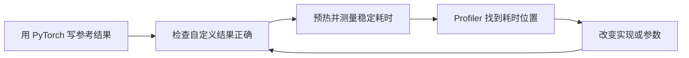

更具体地说，能回答下面五个问题就抓住了本讲的重点：

1. Python 调用 GPU 运算后，为什么函数返回不代表 GPU 已经算完？
2. 如何区分数据生成、CPU/GPU 传输、kernel 执行和首次编译的时间？
3. Python 怎么调用一个 C++ 函数，C++ 又怎么启动 CUDA kernel？
4. CUDA 的线程索引与 Triton 的块状索引，怎样覆盖全部输入？
5. 一个实现看起来更快时，如何证明它没有漏算、计时范围没有变化？

### 0.2 各知识点学到什么程度

| 层级    | 内容                                       | 第一遍的目标                            |
| ----- | ---------------------------------------- | --------------------------------- |
| 必须掌握  | Tensor 的 device、dtype、shape、stride；逐元素计算 | 能说明 kernel 假设了怎样的输入               |
| 必须掌握  | CUDA 异步、预热、同步、Event 计时                   | 能自己写一个基本可信的 benchmark             |
| 必须掌握  | PyTorch Profiler                         | 找到 Python/ATen 操作、GPU kernel、内存复制 |
| 必须掌握  | `load_inline`、host wrapper、CUDA 索引和边界判断  | 能把一个平方 kernel 从 Python 调起来        |
| 必须理解  | PyBind / pybind11                        | 知道它绑定的是 host 函数，能读懂生成的 `m.def`    |
| 必须理解  | Triton 的 program、offset、mask、load/store  | 能修改并验证最小平方 kernel                 |
| 做一次即可 | `torch.compile` 与输出代码日志                  | 看见“手写 PyTorch，编译器生成 kernel”的路径    |
| 第二遍深入 | Nsight Systems、Nsight Compute            | 分别回答“整体在等什么”和“这个 kernel 为什么慢”     |
| 了解即可  | Numba、PTX、occupancy、scoreboard stall     | 知道它们的位置，暂时不用背指令和性能指标              |
| 暂时跳过  | Tensor Core、复杂共享内存优化、autotune、反向算子注册     | 留到后续章节                            |

### 0.3 工具之间是什么关系

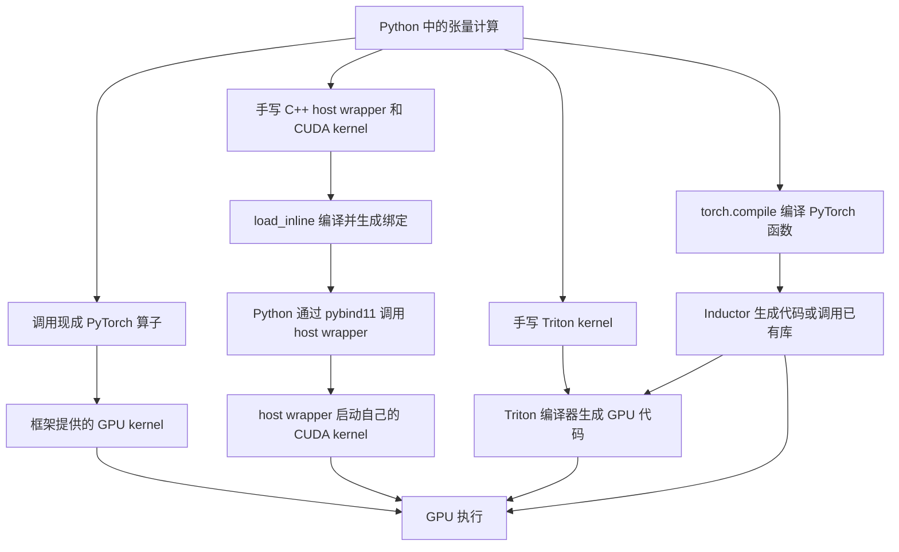

这里有几条**可选的实现路径**，不是每写一个 kernel 都要依次使用所有工具。学习上先走 C++/CUDA 路径，是为了把 Python 到 GPU 的连接过程看清楚；再学 Triton，就知道它替你承担了哪些工作。

<a id="s1"></a>

## 1. 目录里哪些要读，哪些是生成物

### 1.1 逐文件地图

下表中的“源码”表示你应维护、理解的程序入口。仅凭文件不能判定作者当时是否借助过 AI；这里区分的是**源代码与构建工具/编译器产物**。

| 文件 | 性质 | 学习用途与顺序 |
|---|---|---|
| [pytorch_square.py](pytorch_square.py) | 源码 | 第一个读：三种平方写法、CUDA Event、Profiler |
| [pt_profiler.py](pt_profiler.py) | 源码 | 第二个读：采样调度、trace 导出；注意它把随机数和拷贝也放进循环 |
| [本次 Profiler 报告目录](reprots/lecture001-reports/lecture001-reports/) | 本次实测的 JSON trace | 第 4.6 节图解的原始依据：`square_only.json` 和 `with_copy.json`，保留原文件供查看器打开 |
| [hello_load_inline.py](hello_load_inline.py) | 源码，内含 C++ 字符串 | 第三个读：单独理解编译与 Python/C++ 绑定 |
| [load_inline.py](load_inline.py) | 源码，内含 CUDA/C++ 字符串 | 第四个读：本讲 CUDA 集成的核心示例 |
| [triton_square.py](triton_square.py) | 源码，改编自 Triton softmax 教程 | 第五个读：kernel、Python wrapper、正确性检查、性能绘图 |
| [numba_square.py](numba_square.py) | 源码 | 第二遍读：用 Python 语法表达 CUDA 线程模型 |
| [nsys_square.py](nsys_square.py) | 实验源码片段 | 了解意图即可；文件末尾有未定义的 `model` 和 `inputs`，不可直接当完整示例 |
| [main.py](main.py) | 不完整/不正确的尝试 | 暂时跳过；错误地把 `__global__` kernel 当成普通 Python 可调用函数 |
| [test.py](test.py) | 独立试验 | 加载 BERT 并打印属性，和本讲主线无关，运行还会下载模型 |
| [tmp/main.cpp](tmp/main.cpp) | `hello_load_inline.py` 对应的生成源码 | 看一次：C++ 函数被原样写入，头文件和绑定代码由工具补齐 |
| [load_inline_cuda/main.cpp](load_inline_cuda/main.cpp) | `load_inline.py` 对应的生成源码 | 看一次：包含你提供的函数声明和自动生成的 PyBind 绑定 |
| [load_inline_cuda/cuda.cu](load_inline_cuda/cuda.cu) | 字符串落盘后的生成源码 | kernel 算法来自 `load_inline.py`，工具并没有替你设计平方算法 |
| `tmp/build.ninja`、`load_inline_cuda/build.ninja` | 自动生成的构建规则 | 认识即可；含作者机器上的绝对路径，不能照搬到远程机器 |
| 两个构建目录中的 `*.o`、`.ninja_deps`、`.ninja_log` | 编译中间文件、依赖缓存和日志 | 不用读，不用上传，不要手工修改 |
| [square_kernel.ptx](square_kernel.ptx) | GPU 编译器生成的 PTX 文本 | 进阶时认出 load / multiply / store 即可 |
| [ncu_logs](ncu_logs)、[triton_profile](triton_profile) | 历史 Nsight Compute 文本报告 | 后面练习读报告；它们不是 Python 源码，也不是你机器的结果 |
| [CUDA MODE_ Lecture 1.pdf](<CUDA MODE_ Lecture 1.pdf>) | 原讲义 | 按本文最后的页码索引回看，无需先从头硬啃 |

### 1.2 到底哪些需要自己写

以 `load_inline.py` 为例：

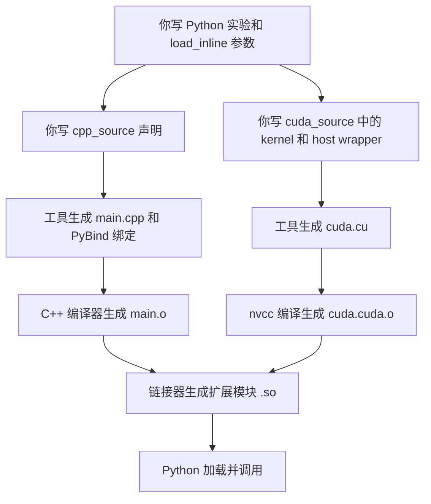

**你负责的内容：**计算规则、输入约束、线程或 tile 如何覆盖数据、边界保护、输出分配、启动参数、正确性检查、测量方法。

**工具负责的内容：**在指定模式下生成绑定模板、组织编译命令、编译链接、加载模块，以及把源码转换成底层指令。

本目录没有保存一个通用可用的 `.so`。你在远程重新编译后通常会看到它；文件名和缓存目录随环境变化。

还有两种容易混淆的“自动生成”：

- 手写 Triton：你写 `@triton.jit` 函数，Triton 编译器生成低层 GPU 代码。
- `torch.compile`：你写普通 PyTorch 函数，编译后端可能生成 Triton 源码，再进一步编译；也可能调用现成库。

因此，**`.py` 也可能是生成物，`.cu` 也可能包含你自己写的算法**。判断依据是生成链和被维护的源文件，不能只看扩展名。

<a id="s2"></a>

## 2. 准备 SSH 远程 GPU 实验环境

### 2.1 远程机器需要具备什么

选择能 SSH 登录的 Linux NVIDIA GPU 环境，并检查以下四层：

| 层 | 用途 | 检查方式 |
|---|---|---|
| NVIDIA 驱动与 GPU 可见性 | 让进程访问 GPU | `nvidia-smi` |
| 支持 CUDA 的 PyTorch | 跑 PyTorch、分配 GPU Tensor | `torch.cuda.is_available()` |
| C++ 编译器、CUDA Toolkit、Ninja | 编译 `load_inline` 自定义扩展 | `c++ --version`、`nvcc --version`、`ninja --version` |
| Triton 与分析工具 | 跑后半部分实验 | `import triton`、`nsys --version`、`ncu --version` |

能运行 `torch.square(x)`，并不说明能编译 CUDA 扩展。PyTorch 安装包不等于完整 CUDA 编译工具链；`load_inline` 的 CUDA 路径需要另外可用的 Toolkit/nvcc。[PyTorch 扩展文档](https://docs.pytorch.org/docs/stable/cpp_extension.html)

选择与该环境 PyTorch/Triton 版本兼容的 GPU 和预装开发镜像即可。本讲不要求昂贵的旗舰卡。优先选已有可工作的 PyTorch + CUDA 开发环境，并确认可用显存和主机内存；C++ 扩展编译也会占主机内存。

三种“CUDA 版本”不要混淆：

- `nvidia-smi` 中的 CUDA Version：驱动所支持的 CUDA 版本信息，不代表本机装了这个版本的 Toolkit。
- `nvcc --version`：实际用于编译扩展的 Toolkit 编译器版本。
- `torch.version.cuda`：当前 PyTorch 构建所用的 CUDA 版本。

它们需要兼容，不要求字符串完全一致。初学时选平台配套的版本组合最省事。[NVIDIA 兼容性说明](https://docs.nvidia.com/datacenter/tesla/drivers/latest/cuda-toolkit-driver-and-architecture-matrix.html)

### 2.2 本地编辑，远程执行

本地 Mac 负责编辑、上传和查看报告。所有 CUDA 实验都在远程执行。MPS 设备不能直接替代本讲的 CUDA 环境。

以下 `GPU_HOST`、`USER`、`PORT` 是需要替换的占位符。若你配置了 SSH 别名，可以直接使用别名。密钥由你已有的 SSH 配置管理。

```bash
# 本地终端：确认连接，并创建远程工作目录
ssh -p PORT USER@GPU_HOST
mkdir -p ~/gpu-mode-lectures/lecture_001
exit
```

在本地仓库根目录运行：

```bash
rsync -av -e 'ssh -p PORT' \
  --exclude='tmp/' \
  --exclude='load_inline_cuda/' \
  --exclude='study_work/' \
  --exclude='__pycache__/' \
  --exclude='*.o' --exclude='*.so' \
  lecture_001/ USER@GPU_HOST:~/gpu-mode-lectures/lecture_001/
```

只同步源码、讲义和文档；构建产物在目标机器重新生成。这里没有使用 `--delete`，不会因为本地少一个文件就删除远程实验结果。

远程登录后：

```bash
cd ~/gpu-mode-lectures/lecture_001
mkdir -p study_work/artifacts
cd study_work
```

**后续所有“保存为某文件”的示例都保存在 `study_work/`，所有实验命令都在这里运行。**这些文件是你按本文创建的练习文件，并非原目录已经存在的文件。使用独立目录能避免覆盖课程原稿与混用历史构建缓存。

### 2.3 Python 环境与依赖

如果平台已经提供可用的 PyTorch 环境，先使用它完成检查。不要先随意升级其中的 torch、triton 和 CUDA 包。

如果需要自行创建环境：

```bash
python3 -m venv .venv
source .venv/bin/activate
python -m pip install --upgrade pip
```

随后根据 [PyTorch 官方安装选择器](https://pytorch.org/get-started/locally/) 为远程系统和 CUDA 组合安装 **torch**。本讲的核心实验不需要 torchvision、torchaudio 或 transformers。已安装 torch 后再补充：

```bash
python -m pip install ninja
```

Triton 先尝试导入。在部分 PyTorch Linux 安装中，它已经作为依赖安装；缺少时参照 [Triton 安装文档](https://triton-lang.org/main/getting-started/installation.html)，使用与 torch 兼容的版本。原 `triton_square.py` 的画图代码还会用到 matplotlib/pandas 等，本文核心实验先只输出文本结果。

### 2.4 做一次环境验收

这一步用于确认远程 GPU、当前 Python 环境和编译工具是否可用。**先通过 SSH 登录 GPU 服务器，在远程终端运行下面整段命令，不要在 Mac 本地运行。**如果使用了虚拟环境，先激活要做实验的环境。

复制代码块中的原始内容即可：不要带上 `&#x20;`，不要给每行末尾添加 `\`。Python 版本属性是 `__version__`（两侧各两个下划线），不是 `**version**`；末尾的 `PY` 必须独占一行且顶格写。

```bash
mkdir -p ~/gpu-mode-lectures/lecture_001/study_work/artifacts
cd ~/gpu-mode-lectures/lecture_001/study_work

nvidia-smi
nvcc --version
c++ --version
ninja --version
python -m pip check
python - <<'PY'
import sys
import torch
from torch.utils.cpp_extension import CUDA_HOME

print('Python:', sys.version)
print('Torch:', torch.__version__)
print('Torch CUDA:', torch.version.cuda)
print('CUDA_HOME:', CUDA_HOME)
assert torch.cuda.is_available(), '当前 Python 环境无法使用 CUDA'
print('GPU:', torch.cuda.get_device_name(0))
print('Compute capability:', torch.cuda.get_device_capability(0))
x = torch.tensor([1., 2., 3.], device='cuda')
print('square:', torch.square(x))
torch.cuda.synchronize()
try:
    import triton
    print('Triton:', triton.__version__)
except ImportError:
    print('Triton 未安装：可以先做 PyTorch 和 CUDA C++ 实验')
PY
python -m pip freeze > artifacts/environment.txt
nvidia-smi > artifacts/nvidia-smi.txt
```

#### 如何判断检查结果

| 检查项                               | 用途与预期结果                                                                                    |
| --------------------------------- | ------------------------------------------------------------------------------------------ |
| `nvidia-smi`                      | 能看到租用的 NVIDIA GPU、驱动和显存信息；本次选择的 GPU 应为 RTX 3080 Ti。                                        |
| `nvcc --version`                  | 确认 CUDA 编译器存在，记录实际 Toolkit 版本，并与 PyTorch 的 CUDA 构建版本核对。 |
| `c++ --version`                   | 确认 C++ 编译器存在，用于编译扩展的 C++ 部分。                                                               |
| `ninja --version`                 | 能输出版本号；PyTorch JIT 扩展需要 Ninja 组织编译。                                                        |
| `python -m pip check`             | 正常情况下输出 `No broken requirements found.`；若有冲突，先记录具体包名和版本，不要直接升级所有包。                         |
| `Python` / `Torch` / `Torch CUDA` | 确认实际使用的 Python、PyTorch 及其 CUDA 构建版本；以运行结果为准，不根据镜像名称推定。 |
| `CUDA_HOME`                       | 应指向有效的 CUDA Toolkit 目录，例如 `/usr/local/cuda`；若为 `None`，需检查 Toolkit 安装和环境配置。                 |
| CUDA 断言与 `GPU`                    | 断言不报错，并能输出 `NVIDIA GeForce RTX 3080 Ti`，说明当前 Python 可以访问 GPU。                              |
| `Compute capability`              | RTX 3080 Ti 应输出 `(8, 6)`，即 Ampere 架构的 `sm_86`。                                             |
| `square`                          | 输出 `tensor([1., 4., 9.], device='cuda:0')`，且同步不报错，说明这次 GPU 平方计算成功。                         |
| `Triton`                          | 输出已安装版本号；若提示未安装，可先做 PyTorch 和 CUDA C++ 实验，再安装与 torch 兼容的 Triton。                           |

#### 本次实际环境记录（2026-10-11）

以下内容整理自用户提供的远程终端实际输出：`cat environment.txt` 和 `cat nvidia-smi.txt`。执行时位于 Conda 的 `(base)` 环境，工作目录为 `/root/gpu-mode-lectures/lecture_001/study_work/artifacts/`。`nvidia-smi.txt` 内记录的时间为 `Sun Oct 11 15:50:57 2026`（日志未注明时区）。

| 项目                 | 实际记录                              | 依据或说明                                                         |
| ------------------ | --------------------------------- | ------------------------------------------------------------- |
| GPU                | NVIDIA GeForce RTX 3080 Ti        | `nvidia-smi.txt` 中的 GPU 0。                                    |
| 显存                 | 12288 MiB（12 GiB）                 | 采集时使用 1 MiB，GPU 利用率 0%，没有运行中的 GPU 进程。                         |
| NVIDIA 驱动          | 595.71.05                         | `Driver Version` 字段。                                          |
| 驱动报告的 CUDA Version | 13.2                              | 这是驱动支持的版本信息，不能据此认定 Toolkit / `nvcc` 是 13.2。                   |
| PyTorch            | 2.7.0+cu128                       | `environment.txt` 的 torch wheel URL 明确记录此版本；不是先前推荐镜像中的 2.4.1。 |
| PyTorch CUDA 构建    | cu128（CUDA 12.8 构建）               | 来自 wheel 名称；本次粘贴未包含 `torch.version.cuda` 的直接输出。               |
| torchvision        | 0.22.0+cu128                      | 来自 torchvision wheel URL。                                     |
| Python             | wheel 标记为 `cp312`，指向 CPython 3.12 | 根据已安装包记录推断；完整 Python 版本仍需 `sys.version` 输出确认。                 |
| Triton             | 3.3.0                             | `triton==3.3.0`。                                              |
| NumPy              | 2.2.6                             | `numpy==2.2.6`。                                               |
| Matplotlib         | 3.10.3                            | `matplotlib==3.10.3`。                                         |
| setuptools         | 69.5.1                            | `setuptools==69.5.1`。                                         |

包列表还记录了 `nvidia-cuda-runtime-cu12==12.8.57`、`nvidia-cuda-nvrtc-cu12==12.8.61`、`nvidia-cuda-cupti-cu12==12.8.57` 和 `nvidia-cudnn-cu12==9.7.1.26`。这些包的版本不能替代 `nvcc --version` 对编译工具链的检查。

**本次已确认 GPU 在驱动层可见，并取得了实际 Python 包清单；完整环境验收仍需补充以下输出。**这是记录中未包含的部分，不表示这些检查已经失败：

- `nvcc --version`、`c++ --version`、`ninja --version`：编译工具是否可用及其版本。
- `python -m pip check`：当前包依赖是否存在冲突；`pip freeze` 只列出包，不执行依赖验收。
- Python 检查段：`sys.version`、`torch.version.cuda`、`CUDA_HOME`、CUDA 可用性、计算能力、GPU 平方计算结果及 Triton 导入结果。

驱动显示 CUDA 13.2、PyTorch 使用 cu128，两者数值不同本身不说明环境出错。接下来应检查实际 Toolkit 版本，并运行 GPU 计算和扩展编译实验；不需要仅为让这两个版本数字一致而重装环境。

`nvcc` 缺失时，先做实验一、二；到 C++/CUDA 扩展实验前再解决工具链。上述检查通过只说明基础环境可用，**自定义 CUDA 扩展是否能编译、Triton kernel 是否能运行，还要在后续实验中验证**。

#### 保存检查结果

代码块末尾两条命令会在远程 `~/gpu-mode-lectures/lecture_001/study_work/artifacts/` 下保存：

- `environment.txt`：当前 Python 环境的包版本列表，便于后续复现。
- `nvidia-smi.txt`：GPU、驱动及当时显存使用情况。

这两份文件**不包含前面所有检查的终端输出**。如需记录验收情况，请另外复制终端输出；重复执行这两条保存命令会覆盖同名文件。没有报错但也没有新输出是正常的，因为 `>` 将结果写入了文件。

`nsys`/`ncu` 可以稍后安装或使用平台提供的版本。NCU 的硬件计数器可能需要平台开放权限，和普通 GPU 运算权限不同；选环境时可以提前确认。[NVIDIA 计数器权限说明](https://developer.nvidia.com/ERR_NVGPUCTRPERM)

<a id="s3"></a>

## 3. 实验一：PyTorch 平方与正确计时

### 3.1 先把计算与数据位置说清楚

`torch.square(x)`、`x ** 2`、`x * x` 在这里表达相同的逐元素平方。矩阵 `[[1, 2], [3, 4]]` 的结果是 `[[1, 4], [9, 16]]`。这不是 `x @ x` 矩阵乘法。

```python
# 概念对比片段，不需要单独保存
import torch

a = torch.randn(1024, 1024)                # CPU 生成随机数
b = a.cuda()                              # CPU -> GPU 复制
c = torch.randn(1024, 1024, device='cuda') # 直接在 GPU 生成随机数
d = torch.square(c)                        # GPU 上计算平方
```

`c` 的创建本身也有成本；这里只是没有先在 CPU 生成再复制。若研究平方 kernel，先创建输入，再开始计时。

原 `pytorch_square.py` 使用 `10000 × 10000`，有 1 亿个元素。`float32` 输入约 400 MB，输出再约 400 MB，还不包括运行时与其他分配。本文从 `1024 × 1024` 开始，再逐步增加。

### 3.2 为什么不能直接在两行 Python 之间计时

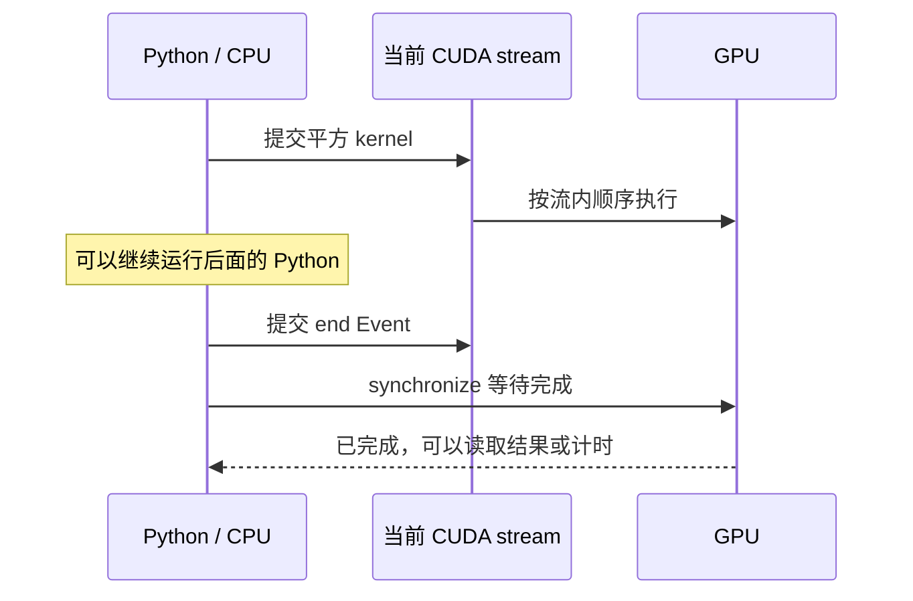

**stream 可以先理解为 GPU 工作队列。**同一 stream 中提交的工作按顺序执行。多个 stream 的并发和依赖留到以后。

不做同步，用 CPU 时钟包住一次调用，常常只测到了提交任务的时间。如果需要端到端耗时，CPU 时钟也能用，但应在测量边界正确同步；如果希望测量当前 GPU stream 上两个位置之间的耗时，可以使用 CUDA Event。

注意：Event 测量的是两个 GPU 时间标记之间的区间。循环提交很小的 kernel 时，CPU 提交不够快造成的 GPU 空闲也可能落在这个区间内，所以不能把所有 Event 数字都称为“单个 kernel 的纯执行时间”。

### 3.3 保存一个可复用的计时工具

保存为 `bench_utils.py`：

```python
import statistics
import torch


def bench_ms(fn, warmup=10, repeats=50, rounds=5):
    """返回多轮平均每次调用耗时的中位数，单位 ms；用于单 GPU 当前流。"""
    for _ in range(warmup):
        fn()
    torch.cuda.synchronize()

    samples = []
    for _ in range(rounds):
        start = torch.cuda.Event(enable_timing=True)
        end = torch.cuda.Event(enable_timing=True)
        start.record()
        for _ in range(repeats):
            fn()
        end.record()
        end.synchronize()
        samples.append(start.elapsed_time(end) / repeats)
    return statistics.median(samples)
```

这个工具改善了原脚本“预热后只测一次，而且不输出时间”的问题：先预热，多次调用取平均，再对多轮结果取中位数，减少偶然波动。

它适合本章学习比较，不是通用性能评测框架：不处理多 GPU、多 stream 依赖，也不会主动清空缓存。首次编译应提前完成；所有实现必须使用同一种计时方法。[CUDA Event API](https://docs.pytorch.org/docs/stable/generated/torch.cuda.Event.html)

### 3.4 跑出你的第一组基线

保存为 `01_baseline.py`：

```python
import torch
from bench_utils import bench_ms


def main():
    torch.manual_seed(0)
    funcs = {
        'torch.square': torch.square,
        'x ** 2': lambda x: x ** 2,
        'x * x': lambda x: x * x,
    }

    for shape in [(1024, 1024), (1823, 781), (4096, 4096)]:
        x = torch.randn(shape, device='cuda', dtype=torch.float32)
        expected = torch.square(x)
        print(f'\nshape={shape}, dtype={x.dtype}, device={x.device}')
        for name, fn in funcs.items():
            torch.testing.assert_close(fn(x), expected)
            ms = bench_ms(lambda: fn(x))
            print(f'{name:16s} {ms * 1000:10.3f} us')


if __name__ == '__main__':
    main()
```

```bash
python 01_baseline.py
```

**验收：**所有正确性检查通过，并得到每个 shape 下的三行时间。具体谁快不预设；小差异可能只是噪声，算子名不同也不意味着 GPU 工作显著不同。
![[Pasted image 20261011161227.png|905]]

现在回看 [pytorch_square.py](pytorch_square.py)，你应该能解释每一段的目的。

<a id="s4"></a>

## 4. 实验二：用 PyTorch Profiler 看见调用链

### 4.1 Benchmark 和 Profile 分别回答什么

| 方法               | 主要问题                            | 本章用途                |
| ---------------- | ------------------------------- | ------------------- |
| Benchmark        | 这次操作稳定下来有多快？                    | 比较实现和参数             |
| PyTorch Profiler | 哪些框架操作、kernel、复制被执行了？           | 建立 Python 到 GPU 的联系 |
| Nsight Systems   | CPU、CUDA API、复制和 GPU 在时间线上怎样配合？ | 找空闲、同步、数据传输问题       |
| Nsight Compute   | 某个 kernel 的硬件资源利用怎样？            | 深入分析线程、寄存器和访存       |

Profiler 本身会带来开销。用它解释执行行为，用独立 benchmark 比较稳态速度。

### 4.2 只 profile 平方，再 profile 包含传输的流程

保存为 `02_profile.py`：

```python
from pathlib import Path
import torch
from torch.profiler import profile, record_function, ProfilerActivity


def save_report(prof, path):
    stats = prof.key_averages()
    # 新版本逐步使用 device 命名；兼顾课程中旧版 CUDA 命名。
    sort_key = (
        'self_device_time_total'
        if stats and hasattr(stats[0], 'self_device_time_total')
        else 'self_cuda_time_total'
    )
    print(stats.table(sort_by=sort_key, row_limit=15))
    prof.export_chrome_trace(str(path))


def main():
    Path('artifacts').mkdir(exist_ok=True)
    x = torch.randn(1024, 1024, device='cuda')
    for _ in range(10):
        torch.square(x)
    torch.cuda.synchronize()

    activities = [ProfilerActivity.CPU, ProfilerActivity.CUDA]
    with profile(activities=activities, record_shapes=True) as prof:
        for _ in range(5):
            with record_function('square_only'):
                y = torch.square(x)
        torch.cuda.synchronize()
    save_report(prof, Path('artifacts/square_only.json'))

    with profile(activities=activities) as prof:
        with record_function('create_on_cpu_copy_then_square'):
            cpu_x = torch.randn(1024, 1024)
            gpu_x = cpu_x.cuda()
            y = torch.square(gpu_x)
        torch.cuda.synchronize()
    save_report(prof, Path('artifacts/with_copy.json'))


if __name__ == '__main__':
    main()
```

```bash
python 02_profile.py
```

第一份 trace 的输入已经在 GPU 上。第二份 trace 刻意包含 CPU 随机数生成、分配、HtoD 复制和平方。对比两份 trace，才能看出原 `pt_profiler.py` 测到的为什么不只是平方。

采样和 trace API 可参考 [PyTorch Profiler 教程](https://docs.pytorch.org/tutorials/recipes/recipes/profiler_recipe.html)。不同版本会使用 `CUDA` 或 `device` 字段命名；当前统计对象也提供 `self_device_time_total` 等字段。[统计字段说明](https://docs.pytorch.org/docs/main/generated/torch.autograd.profiler_util.FunctionEventAvg.html)


<a id="profiler-code-to-log"></a>

#### 4.2.1 先分清：计算代码、采集代码和报告代码

**日志不是“一行 Python 对应一行输出”。**你写的 `torch.square(x)` 会进入 PyTorch 的内部实现，产生多个算子和 CUDA 事件。Profiler 记录这些事件，最后再把同类事件汇总成表。先把本例的三个职责分开：

| 职责    | 本例代码                                                         | 做什么                  |
| ----- | ------------------------------------------------------------ | -------------------- |
| 执行计算  | `torch.randn(...)`、`cpu_x.cuda()`、`torch.square(...)`        | 真正创建、上传和计算张量         |
| 采集与命名 | `profile(...)`、`record_function(...)`                        | 开启观察，给一段代码添加你能认出的名字  |
| 查看与保存 | `key_averages()`、`table()`、`print()`、`export_chrome_trace()` | 汇总已经采集的事件，打印表格，保存时间线 |

这些 API 来自官方教程的第 3 节（执行时间）和第 5 节（导出 trace）；教程用 ResNet 的 `model(inputs)` 做计算，本例用 `torch.square(x)` 做计算。采集方法相同。[官方教程](https://docs.pytorch.org/tutorials/recipes/recipes/profiler_recipe.html)

#### 4.2.2 `with profile(...) as prof` 如何执行？

看第一份报告的核心代码，注释 A～F 是执行顺序标记：

```python
# A：先创建 GPU 输入并预热，此时还没有进入 Profiler
x = torch.randn(1024, 1024, device='cuda')
for _ in range(10):
    torch.square(x)
torch.cuda.synchronize()  # 等预热工作完成，再开始采集

# B：选择记录 CPU 事件和 CUDA 设备活动
activities = [ProfilerActivity.CPU, ProfilerActivity.CUDA]

# C：进入 with，开始采集；prof 是这次采集的对象
with profile(activities=activities, record_shapes=True) as prof:
    for _ in range(5):
        # D：每次进入此范围，就记录一次名叫 square_only 的标签
        with record_function('square_only'):
            y = torch.square(x)

    # E：仍在 profile 内，但已在 square_only 标签外
    torch.cuda.synchronize()

# F：离开 with，采集结束，再打印与保存这次结果
save_report(prof, Path('artifacts/square_only.json'))
```

`with` 是 Python 的上下文管理语法：进入代码块时做准备和启动，离开时做停止和清理。`as prof` 把这个 Profiler 对象命名为 `prof`，供后续读取结果；它不是 GPU 输出张量，计算结果仍保存在 `y` 中。本例没有设置 `schedule`，所以进入 `with profile` 后持续采集，直到退出。

几个参数和调用要分别理解：

- `ProfilerActivity.CPU`：观察 CPU 上的 PyTorch 算子和用户范围。输入在 GPU 上时，CPU 仍需处理算子调用和提交工作，所以也会有 CPU 时间。
- `ProfilerActivity.CUDA`：观察 CUDA 设备活动，包括 kernel 和本次报告中的复制；还会出现主机侧 CUDA runtime 调用。它是**选择观察什么**，不会把 CPU 张量自动移到 GPU。
- `record_shapes=True`：额外记录算子输入形状。第一份 JSON 因此能看到 `[1024, 1024]`；它不修改 shape，也不会执行额外一次平方。普通 `key_averages()` 表不一定显示这些形状。
- `record_function('square_only')`：给内部代码块命名。字符串可自行改成 `'my_square'`；改名字会改变标签名称，不会改变算法或调用的 kernel。即使去掉这个标签，`aten::square` 和实际 kernel 仍可被采集，只是少了这段自定义范围。
- `torch.cuda.synchronize()`：等待此前提交到当前设备的 CUDA 工作完成。它不负责生成报告；GPU 异步执行时，用它把本例的采集边界安排清楚。

CPU 活动、CUDA 活动和用户标签的含义可参照教程第 3 节。CUDA 运算由张量的设备决定，`activities` 是 Profiler 的配置。[官方教程：执行时间](https://docs.pytorch.org/tutorials/recipes/recipes/profiler_recipe.html#using-profiler-to-analyze-execution-time)

**为什么日志是 5 次，而不是 15 次？**前面 10 次平方在 C 之前，属于预热，没有被这个 `profile` 采集。C 内循环才执行并采集 5 次。GPU 输入的最初 `randn` 同样位于采集范围之外，因此第一张表没有这次随机数生成。

**为什么 `square_only` 不包括最后一次显式同步？**看缩进：同步与 `for` 同级，已经离开内部 `with record_function`，但仍位于外部 `with profile`。因此同步可出现在报告里，却不计入某一次 CPU `square_only` 标签的持续时间。

#### 4.2.3 `save_report()` 如何把事件变成两种报告？

```python
stats = prof.key_averages()  # 将同类事件汇总：累计、次数、平均值
text = stats.table(sort_by=sort_key, row_limit=15)  # 排序并生成文本
print(text)                 # 终端里看到的原始日志
prof.export_chrome_trace(str(path))  # 保存每个事件的时间线为 JSON
```

这是原函数最后几行的等价拆写，用来展示每一步的结果。`key_averages()` 不会再执行 `torch.square`，`table()` 也不会重新测量。

例如，JSON 有 5 个实际平方 kernel，持续时间分别为：

```text
9.243、10.203、11.419、11.579、11.611 us
```

汇总后形成一行：累计 `54.055 us`、`# of Calls = 5`、平均 `54.055 / 5 = 10.811 us`。因此 `key_averages` 虽然有 averages 这个名字，输出也包含累计值和次数，不是每一列都取平均。

`sort_key` 优先选 `self_device_time_total`，旧接口则选 `self_cuda_time_total`：它决定按设备自身时间排序，不决定采集什么。表的第一行不表示它最先执行。`row_limit=15` 只控制最多打印 15 行，不会把采集限制为 15 个事件；被隐藏的事件仍在 JSON 中。`export_chrome_trace()` 导出的是时间线，用来查看开始、结束、嵌套和关联，与汇总表互补。[官方教程：导出 trace](https://docs.pytorch.org/tutorials/recipes/recipes/profiler_recipe.html#using-tracing-functionality)

#### 4.2.4 第一张表：每一行对应什么代码？

第一张表的计算主体只有 `y = torch.square(x)`。下面按调用关系解释，顺序与原表的耗时排序不同：

| 日志名称 | 对应代码或产生位置 | 怎么读 |
|---|---|---|
| `square_only`，有 CPU 时间的行 | `with record_function('square_only')` | 5 次进入标签，CPU total 累计 2.655 ms；它包住平方调用，也包含范围中的框架与采集影响 |
| `aten::square` | `torch.square(x)` | PyTorch 的平方算子事件；5 次，CPU total 累计 2.193 ms |
| `aten::pow` | 本次 `aten::square` 的内部实现 | 平方在这版实现中走幂算子路径；这是嵌套调用，不是你另外执行了 5 次平方 |
| `aten::result_type` | `pow` 内部的类型处理 | 确定相关操作的数据类型；不是另一次 GPU 计算 |
| `aten::to` | `pow` 内部的类型处理路径 | 第一份 JSON 中没有 `gpu_memcpy`，不能因名字含 `to` 就判定发生了上传 |
| `cudaLaunchKernel` | PyTorch 的 CUDA 实现启动 kernel | CPU 调用 CUDA API 5 次，累计 73.029 us；不是 GPU 执行了 73.029 us |
| `void at::native::vectorized_elementwise_kernel<4, ...>` | 被启动的真实 GPU kernel | GPU 计算 5 次，累计 54.055 us、平均 10.811 us；理解纯 kernel 时优先看这行 |
| `square_only`，CPU 为零的行 | 同一用户标签对应的 GPU 范围记录 | 与前面的 CPU 标签是不同视角；不会因为同名出现两行就多计算一轮 |
| `Activity Buffer Request` | Profiler/CUPTI 的采集过程 | 本次约 1.936 ms 的 CPU 开销；你没有在计算代码中显式调用它 |
| `cudaDeviceSynchronize` | 显式同步以及本版本 Profiler 停止时的同步 | 表里有 2 次，下面解释为什么 |

`aten::` 是 PyTorch 内部算子的命名空间。Python 表达式进入框架实现后，可以调用多个这样的内部算子；这些名字不是让你再逐个写进 Python 的函数。

第一份 JSON 中的两次 `cudaDeviceSynchronize` 分别持续 `6.518 us` 和 `1.908 us`，合计正好是表里的 `8.426 us`。代码在 `profile` 内显式同步一次；PyTorch 2.7 的底层 Profiler 在停止采集时也调用设备同步，因此会再记录一次。预热后的那次同步在采集范围外，没有计进这两次。[PyTorch 2.7 Profiler 退出逻辑](https://github.com/pytorch/pytorch/blob/v2.7.0/torch/autograd/profiler.py)

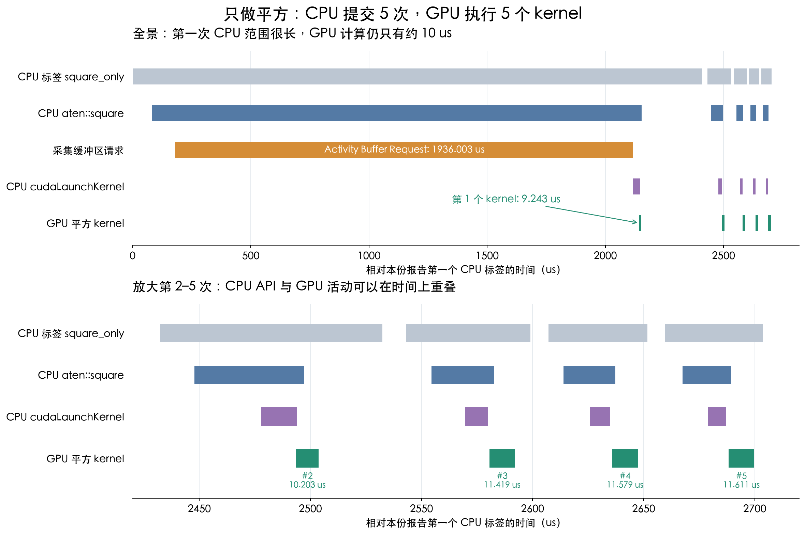

#### 4.2.5 第二张表：三行计算代码为何产生这么多事件？

第二次进入 `with profile(...)` 时，是一个新的采集对象，变量名仍叫 `prof`。第一份结果已经打印并保存；第二张表不会累加第一张表的 5 次平方。

```python
with profile(activities=activities) as prof:
    with record_function('create_on_cpu_copy_then_square'):
        cpu_x = torch.randn(1024, 1024)  # ① CPU 生成随机数
        gpu_x = cpu_x.cuda()            # ② 把 CPU 张量上传到 GPU
        y = torch.square(gpu_x)         # ③ GPU 平方
    torch.cuda.synchronize()            # ④ 等待，位于自定义标签外
save_report(prof, Path('artifacts/with_copy.json'))
```

| 哪行代码                      | 本次内部事件                                                              | 日志数字与解释                                                                                              |
| ------------------------- | ------------------------------------------------------------------- | ---------------------------------------------------------------------------------------------------- |
| 外层 `record_function(...)` | CPU `create_on_cpu_copy_then_square`                                | CPU total 12.549 ms；包含①②③的 CPU 调用范围                                                                  |
| ① `torch.randn(...)`      | `aten::randn` → `aten::empty`、`aten::normal_`                       | 未指定 device，本例默认创建 CPU 张量。`empty` 分配存储，`normal_` 填入正态随机数。`randn` total 9.347 ms，内部 `normal_` 9.308 ms |
| ② `cpu_x.cuda()`          | `aten::to` → `aten::_to_copy` → `aten::empty_strided`、`aten::copy_` | 转到目标设备、分配目标存储并复制。`copy_` CPU total 2.922 ms，包含其内部事件；`empty_strided` 是分配，不是填充随机数                      |
| ② 内部提交复制                  | CPU `cudaMemcpyAsync`                                               | CPU API 调用持续 819.106 us                                                                              |
| ② 对应的设备活动                 | GPU `Memcpy HtoD (Pageable -> Device)`                              | Host → Device，即 CPU 内存 → GPU 显存。上传 4 MiB，真实复制持续 683.293 us                                           |
| ② 内部同步                    | CPU `cudaStreamSynchronize`                                         | 记录到 86.924 us 的主机侧同步调用；Async 名称不保证这次 Python 调用完全不等待                                                  |
| ② 采集期间                    | `Activity Buffer Request`                                           | 约 1.982 ms 的采集开销位于 CPU `copy_` 范围内，不能把 `copy_` total 全叫作纯传输时间                                        |
| ③ `torch.square(gpu_x)`   | `aten::square` → `aten::pow` → 类型处理与 launch → GPU kernel            | 只计算一次；实际 GPU kernel 为 10.299 us。中间各层记录同一次工作                                                          |
| 外层标签的 GPU 视角              | GPU `create_on_cpu_copy_then_square`                                | 范围跨度约 761.048 us，包含复制、平方以及两者间隔；不是新的复制或平方                                                             |
| ④ 及 Profiler 退出           | `cudaDeviceSynchronize`                                             | JSON 中存在；原表最多打印 15 行，部分零设备时间的 CPU 事件未显示                                                              |

特别容易疑惑的是第二张表 `aten::to` 的 `# of Calls = 2`：一次来自②的张量上传，一次来自③内部的类型处理。JSON 中一次持续 `3006.446 us`，另一次仅 `0.304 us`，合计 `3006.750 us`，所以表里累计显示 `3.007 ms`、平均显示 `1.503 ms`。**它是两种来源的同名事件汇总，不能用这个平均数描述一次上传。**实际 HtoD 仍只有一次。

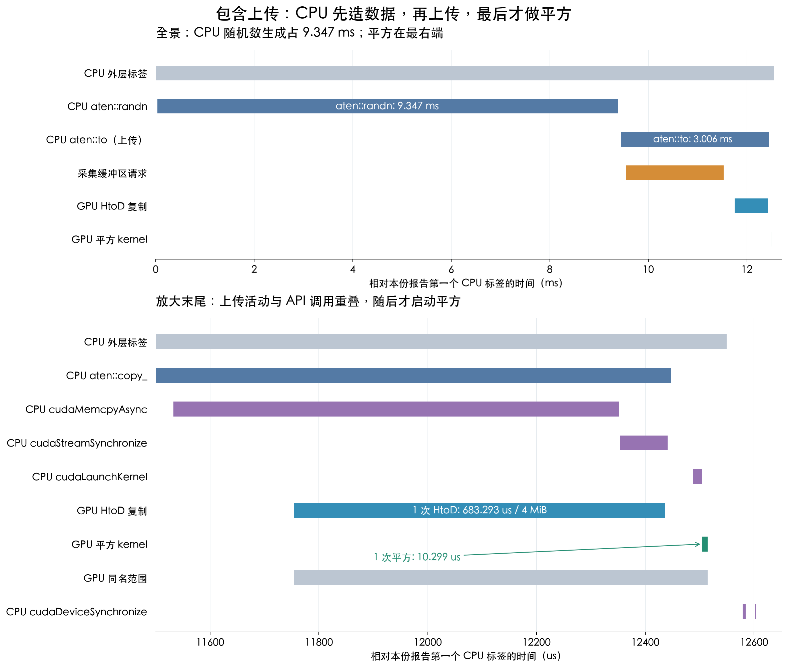

#### 4.2.6 用自己的日志算一遍 Self、total、avg、百分比

先只看 CPU 的 `aten::square` 行：

```text
Self CPU      =   24.006 us   排除内部子事件后，这层算子自身的累计时间
CPU total     = 2193.171 us   包含内部 pow 等子事件的累计范围时间
CPU time avg  = 2193.171 / 5 ≈ 438.634 us
# of Calls    = 5
```

**这里的“排除”，就是在统计时做减法：从父事件的时间里减掉它内部子事件的时间。计算过程照常执行，没有跳过任何计算。**

先用一个假设的单次调用理解。假设 `square` 进入后做了 20 us 的准备，调用内部 `pow` 花了 70 us，`pow` 返回后又处理了 10 us：

```text
时间从左往右 →

square：| 准备 20 us | 调用 pow，70 us | 收尾 10 us |
pow：                |     70 us      |

square 的 CPU total = 20 + 70 + 10 = 100 us
square 的 Self CPU  = 100 - 70     =  30 us
```

`pow` 是 `square` 内部调用的**子事件**。它运行的 70 us 已经包含在 `square` 的 100 us 范围内，所以 `square` 的 Self 只保留前后的 30 us。准备和收尾仅是帮助理解的假设；实际报告中 Self 表示未被已记录子事件覆盖的时间，不能仅凭 Self 数字确定都在执行哪些指令。

回到本次报告，父子关系是：

```text
aten::square                  父事件
└─ aten::pow                  square 的直接子事件
   ├─ aten::result_type       pow 内部的子事件
   ├─ aten::to                pow 内部的子事件
   ├─ Activity Buffer Request 采集事件，出现在首次 pow 范围内
   └─ cudaLaunchKernel       CPU 启动 API
```

这里列的是 CPU 侧范围关系；GPU kernel 单独在设备上执行，通过关联编号连接到启动调用。

把 5 次记录汇总以后：

```text
square 的 CPU total = 2193.171 us
pow    的 CPU total = 2169.165 us

square 的 Self CPU
  = square 的 total - 内部 pow 的 total
  = 2193.171 - 2169.165
  = 24.006 us
```

**减掉的是 `pow` 的 CPU total，不是 `pow` 的 Self CPU。**因为 `pow` 整段范围都在 `square` 内，它内部的类型处理、启动调用等也已经包含在 `pow` total 中。扣掉这一整段后，不再重复扣一次 `result_type`、`to` 或 `cudaLaunchKernel`；否则会重复减去同一段时间。PyTorch 对本例这类同步 CPU 事件的规则就是 `Self CPU = CPU total - 各直接子事件的 CPU total 之和`。[PyTorch 2.7 的具体计算实现](https://github.com/pytorch/pytorch/blob/v2.7.0/torch/autograd/profiler_util.py)

还要分清表格里的“累计”和“平均”：`CPU total = 2193.171 us` 是 5 次 `square` 范围时长的总和，每次都包含内部 `pow`；`Self CPU = 24.006 us` 是这 5 次分别扣除子事件之后的剩余时间之和。

| 数字                          | 这里描述什么                                   |
| --------------------------- | ---------------------------------------- |
| `# of Calls = 5`            | 采集到 5 次 `aten::square` 调用，不是 5 个线程       |
| `CPU total = 2193.171 us`   | 5 次调用从进入到退出的累计时间，包含内部子事件                 |
| `Self CPU = 24.006 us`      | 5 次调用扣除内部子事件之后的累计剩余时间                    |
| `CPU time avg = 438.634 us` | 平均每次的 **total**：2193.171 / 5；不是 Self 的平均 |
| Self 的平均约 `4.801 us`        | 24.006 / 5；原表没有单独显示这一列                   |

所以不能把 `square` 的 2.193 ms 与 `pow` 的 2.169 ms 相加：`pow` 已经在 `square` 的范围里。Self 也不是把 GPU 时间从 CPU 时间里扣掉；CPU 与设备是分别统计的。[官方教程：Self 与 total](https://docs.pytorch.org/tutorials/recipes/recipes/profiler_recipe.html#using-profiler-to-analyze-execution-time)

再看真实 GPU kernel 行：

```text
Self CUDA     = 54.055 us
CUDA total    = 54.055 us
CUDA time avg = 54.055 / 5 = 10.811 us
```

这一行直接描述设备执行活动，所以它的 CPU 时间为 0：CPU 提交工作的时间在 `cudaLaunchKernel` 等行里，不是没有 CPU 参与。

第二张表的百分比再算一次：

```text
设备活动分母 = 683.293 us（复制）+ 10.299 us（平方）= 693.592 us
复制占比     = 683.293 / 693.592 × 100% ≈ 98.52%
平方占比     =  10.299 / 693.592 × 100% ≈  1.48%
```

这个分母没有 CPU `randn`。CPU 的百分比则使用本报告的 Self CPU 总时间作分母。例如第一张表 `Activity Buffer Request` 的 `1936.003 us / 约 2663.221 us ≈ 72.69%`，反映采集开销在本次 CPU 记录里很大。

本日志里 CPU 算子行的 CUDA 列还存在重复归属现象，因此不要跨行相加；例如 `pow`、实际 kernel、GPU 用户范围可能共同描述同一份计算。`109.73%` 是范围跨度除以活动累计得到的比例，详细数值见第 4.6.4 节。

#### 4.2.7 官方教程的代码，与这份实验如何对应？

| 教程中的写法 / 章节                                  | 本例中的写法                                   | 阅读时抓住什么                        |
| -------------------------------------------- | ---------------------------------------- | ------------------------------ |
| 第 3 节 `model(inputs)`                        | `torch.square(x)`                        | 被观察的计算可以是一整个模型，也可以是一个算子        |
| 第 3 节 `record_function("model_inference")`   | `record_function('square_only')`         | 自定义名字帮助你定位“这段代码”               |
| 第 3 节 `activities`                           | `[CPU, CUDA]`                            | 同时看主机调用与设备执行                   |
| 第 3 节 `key_averages().table(...)`            | `save_report()` 中的汇总与打印                  | 查看累计时间、平均值和调用次数；排序不是执行顺序       |
| 第 5 节 `export_chrome_trace(...)`             | 保存 `square_only.json` / `with_copy.json` | 保留每个事件的时间信息，得到上面的图片            |
| 第 4 节 `profile_memory=True`                  | 本例未开启                                    | 若想看张量内存分配，再开启；时间表没有内存列并不表示没有分配 |
| 第 6 节 `with_stack=True`                      | 本例未开启                                    | 想进一步定位 Python 调用位置时再用，会增加采集开销  |
| 第 7 节 `schedule`、`on_trace_ready`、`p.step()` | 本例没有；原 `pt_profiler.py` 使用               | 长循环中选择部分步骤采集，下面说明              |

教程当前页面可能展示更新版本的 API 和字段；你的实际日志来自 PyTorch 2.7。理解采集、标签、汇总与时间线这四步后，再按远程安装版本选具体参数，不需要为了使列名完全一致而更换环境。

#### 4.2.8 为什么原 `pt_profiler.py` 还要调用 `p.step()`？

本次 `02_profile.py` 的两个采集范围很短，没有调度器，退出 `with` 后手动调用 `save_report` 就够了。原 [pt_profiler.py](pt_profiler.py) 则在循环里配置采集窗口：

```python
schedule=torch.profiler.schedule(wait=1, warmup=1, active=2, repeat=1)
on_trace_ready=trace_handler
```

`schedule` 告诉 Profiler 每一步要做什么；它不知道你的循环进行到了哪里，因此每轮末尾用 `p.step()` 通知“这一轮结束，进入下一步”。本例 `step 0` 等待，`step 1` 为采集预热，`step 2、3` 正式记录；第 3 轮末尾触发保存回调，`repeat=1` 表示只做一个采集周期，后续循环仍计算，但不再开启新窗口。

`on_trace_ready=trace_handler` 传入的是**函数本身**，没有括号。窗口结束、结果可用时，Profiler 调用 `trace_handler(p)`，把当前对象作为参数交给它；回调里再调用 `key_averages()`、`table()` 和 `export_chrome_trace()`。这与本次手动执行 `save_report(prof, path)` 的职责相同，只是由 Profiler 决定何时触发。

`p.step()` 不启动平方，不自动重复循环，也不是 GPU 同步。wait / warmup 阶段的计算仍然执行，只是不会成为最终 active 结果。Profiler 的采集预热与本例在采集前做 10 次平方的算子预热是两个独立安排。[官方教程：长任务的调度与回调](https://docs.pytorch.org/tutorials/recipes/recipes/profiler_recipe.html#using-profiler-to-analyze-long-running-jobs)

#### 本次实际 Profiler 日志

以下为用户提供的本次运行原始输出，保留全部行和数值，包括重复名称与超过 100% 的统计项。对应前文记录的 RTX 3080 Ti、PyTorch 2.7.0+cu128 环境。第一张表是 `square_only`（5 次平方），第二张表是 `create_on_cpu_copy_then_square`（1 次 CPU 生成、上传和平方）。

```text
-------------------------------------------------------  ------------  ------------  ------------  ------------  ------------  ------------  ------------  ------------  ------------  ------------  
                                                   Name    Self CPU %      Self CPU   CPU total %     CPU total  CPU time avg     Self CUDA   Self CUDA %    CUDA total  CUDA time avg    # of Calls  
-------------------------------------------------------  ------------  ------------  ------------  ------------  ------------  ------------  ------------  ------------  ------------  ------------  
                                              aten::pow         5.78%     153.960us        81.45%       2.169ms     433.833us      54.055us       100.00%      63.298us      12.660us             5  
void at::native::vectorized_elementwise_kernel<4, at...         0.00%       0.000us         0.00%       0.000us       0.000us      54.055us       100.00%      54.055us      10.811us             5  
                                            square_only         0.00%       0.000us         0.00%       0.000us       0.000us      54.055us       100.00%      54.055us      10.811us             5  
                                Activity Buffer Request        72.69%       1.936ms        72.69%       1.936ms       1.936ms       9.243us        17.10%       9.243us       9.243us             1  
                                            square_only        17.33%     461.624us        99.68%       2.655ms     530.959us       0.000us         0.00%      63.298us      12.660us             5  
                                           aten::square         0.90%      24.006us        82.35%       2.193ms     438.634us       0.000us         0.00%      63.298us      12.660us             5  
                                      aten::result_type         0.16%       4.231us         0.16%       4.231us       0.846us       0.000us         0.00%       0.000us       0.000us             5  
                                               aten::to         0.07%       1.942us         0.07%       1.942us       0.388us       0.000us         0.00%       0.000us       0.000us             5  
                                       cudaLaunchKernel         2.74%      73.029us         2.74%      73.029us      14.606us       0.000us         0.00%       0.000us       0.000us             5  
                                  cudaDeviceSynchronize         0.32%       8.426us         0.32%       8.426us       4.213us       0.000us         0.00%       0.000us       0.000us             2  
-------------------------------------------------------  ------------  ------------  ------------  ------------  ------------  ------------  ------------  ------------  ------------  ------------  
Self CPU time total: 2.663ms
Self CUDA time total: 54.055us

-------------------------------------------------------  ------------  ------------  ------------  ------------  ------------  ------------  ------------  ------------  ------------  ------------  
                                                   Name    Self CPU %      Self CPU   CPU total %     CPU total  CPU time avg     Self CUDA   Self CUDA %    CUDA total  CUDA time avg    # of Calls  
-------------------------------------------------------  ------------  ------------  ------------  ------------  ------------  ------------  ------------  ------------  ------------  ------------  
                         create_on_cpu_copy_then_square         0.00%       0.000us         0.00%       0.000us       0.000us     761.048us       109.73%     761.048us     761.048us             1  
                                            aten::copy_         0.27%      34.258us        23.27%       2.922ms       2.922ms     683.293us        98.52%       1.367ms       1.367ms             1  
                                Activity Buffer Request        15.78%       1.982ms        15.78%       1.982ms       1.982ms     683.293us        98.52%     683.293us     683.293us             1  
                       Memcpy HtoD (Pageable -> Device)         0.00%       0.000us         0.00%       0.000us       0.000us     683.293us        98.52%     683.293us     683.293us             1  
                                              aten::pow         0.19%      24.463us         0.34%      42.263us      42.263us      10.299us         1.48%      10.299us      10.299us             1  
void at::native::vectorized_elementwise_kernel<4, at...         0.00%       0.000us         0.00%       0.000us       0.000us      10.299us         1.48%      10.299us      10.299us             1  
                         create_on_cpu_copy_then_square         1.21%     152.058us        99.94%      12.549ms      12.549ms       0.000us         0.00%       1.377ms       1.377ms             1  
                                            aten::randn         0.17%      21.480us        74.44%       9.347ms       9.347ms       0.000us         0.00%       0.000us       0.000us             1  
                                            aten::empty         0.14%      17.472us         0.14%      17.472us      17.472us       0.000us         0.00%       0.000us       0.000us             1  
                                          aten::normal_        74.13%       9.308ms        74.13%       9.308ms       9.308ms       0.000us         0.00%       0.000us       0.000us             1  
                                               aten::to         0.17%      21.641us        23.95%       3.007ms       1.503ms       0.000us         0.00%       1.367ms     683.293us             2  
                                         aten::_to_copy         0.38%      47.811us        23.77%       2.985ms       2.985ms       0.000us         0.00%       1.367ms       1.367ms             1  
                                    aten::empty_strided         0.12%      15.014us         0.12%      15.014us      15.014us       0.000us         0.00%       0.000us       0.000us             1  
                                        cudaMemcpyAsync         6.52%     819.106us         6.52%     819.106us     819.106us       0.000us         0.00%       0.000us       0.000us             1  
                                  cudaStreamSynchronize         0.69%      86.924us         0.69%      86.924us      86.924us       0.000us         0.00%       0.000us       0.000us             1  
-------------------------------------------------------  ------------  ------------  ------------  ------------  ------------  ------------  ------------  ------------  ------------  ------------  
Self CPU time total: 12.557ms
Self CUDA time total: 693.592us
```

#### 先读列，再看两段流程

`us` 是微秒，`ms` 是毫秒，`1 ms = 1000 us`。`key_averages()` 按事件类别汇总，表格的排列是按耗时排序，并非执行顺序。

| 列                           | 读法                                                                           |
| --------------------------- | ---------------------------------------------------------------------------- |
| `Self CPU` / `Self CPU %`   | CPU 事件自身的累计时间（排除子事件）及其相对整份报告 Self CPU 总时间的比例。                                |
| `CPU total` / `CPU total %` | 包含子事件的累计时间及其比例；父子行会重叠，不能把 total 列逐行相加。                                       |
| `CPU time avg`              | 该行 `CPU total / # of Calls`。                                                 |
| `Self CUDA` / `CUDA total`  | 对 CPU 算子行，是归属到该算子的设备时间统计；对实际 GPU kernel 或复制行，是对应设备活动的时间。归属统计与实际活动行可能描述同一份工作。 |
| `CUDA time avg`             | 该行 `CUDA total / # of Calls`，不一定就是一次纯 kernel 的时间。                            |
| `Self CUDA %`               | 该行 Self CUDA 相对报告设备时间分母的比例，不是 GPU 利用率。                                       |
| `# of Calls`                | 该类事件的记录次数，不是线程数或 block 数。                                                    |

CPU 时间包含调用、等待和采集带来的影响，不等同于 CPU 持续执行指令的时间；也不能与 CUDA 时间直接相加来求端到端耗时。[PyTorch Profiler 教程](https://docs.pytorch.org/tutorials/recipes/recipes/profiler_recipe.html)

#### 第一张表：数据已在 GPU，只做平方

本次 JSON 已确认下面的 CPU 事件嵌套；启动 API 与 GPU kernel 则通过关联编号连接，**GPU kernel 不是 CPU 调用栈里的同步子函数**（图解见第 4.6 节）：

```text
square_only                  自己添加的范围标签
└─ aten::square              torch.square 的框架算子
   └─ aten::pow              本次实现中平方走 pow 路径
      └─ cudaLaunchKernel   CPU 向 GPU 提交工作
         └─ [通过 correlation 关联] vectorized_elementwise_kernel<4, ...>
                                              GPU 执行逐元素平方
```

这里 `aten::pow` 并不意味着执行了另一轮额外的平方，也不能仅凭这个名称认定内部用了昂贵的通用幂函数。

| 观察 | 本次数值 | 解释 |
|---|---|---|
| 实际平方 kernel | 5 次，累计 `54.055 us`，平均 `10.811 us` | 与代码中循环 5 次一致；这一行最直接反映采集期间 kernel 的执行时长。 |
| `aten::pow` 的 CUDA total | `63.298 us`，平均 `12.660 us` | 不等于 kernel 的 `54.055 us`；差值 `9.243 us` 恰好也是 `Activity Buffer Request` 行的 CUDA 统计。JSON 中没有额外平方 kernel，应视为设备时间归属统计的差异。 |
| CPU 的 `square_only` 范围 | total `2.655 ms`，平均 `530.959 us` | 包含框架调用及采集等影响，不能把它叫作一次 GPU 平方的纯耗时。 |
| `cudaLaunchKernel` | CPU 累计 `73.029 us`，平均 `14.606 us` | 是 CPU 调用启动 API 的时间，不是 GPU kernel 时间。 |
| `Activity Buffer Request` | Self CPU `1.936 ms`，占 `72.69%` | 采集活动缓冲区请求开销在这次短实验里很显眼。 |

`Activity Buffer Request` 属于 CUPTI 的 profiling overhead 事件，不是平方算法的一部分。前面的 10 次算子预热并未预热随后新开启的 Profiler 采集过程。[Kineto 对该事件的定义](https://github.com/pytorch/kineto/blob/main/libkineto/src/cupti_strings.cpp)

因此，这张表适合确认调用链；评价优化效果仍应使用第 3 节不带 Profiler 的重复计时。

#### 第二张表：CPU 造数据，上传后再平方

按本节代码，这次流程是：

```text
CPU: torch.randn → 分配 GPU Tensor 并发起 HtoD 复制 → 提交平方
GPU:                   HtoD 复制                → 平方 kernel
```

| 阶段 | 本次数值 | 解释 |
|---|---|---|
| CPU 生成随机数 | `aten::randn` total `9.347 ms`；其中 `aten::normal_` Self CPU `9.308 ms` | 两者为父子关系，不能相加；随机数生成占据了大部分已记录 CPU 时间。 |
| CPU → GPU 复制 | `Memcpy HtoD (Pageable -> Device)` 为 `683.293 us` | 从普通可分页主机内存上传到显存；是设备侧复制活动的记录。 |
| GPU 平方 | kernel 为 `10.299 us`，1 次 | 与第一张表平均 `10.811 us` 接近，不能用这样的小样本差值认定第二种方式更快。 |
| CPU 外层范围 | `create_on_cpu_copy_then_square` total `12.549 ms` | 覆盖 CPU 生成、复制和提交平方；代码中最终的 `torch.cuda.synchronize()` 在这个标签之外，不能把标签时间当作严格的完整端到端计时。 |
| 报告底部 Self CUDA 总时间 | `693.592 us` | 恰好等于复制 `683.293 us` 加平方 `10.299 us`。 |

在这次记录的复制与 kernel 活动中，复制占 `98.52%`，平方占 `1.48%`，复制时间约为平方的 `66.3` 倍。这不是说“GPU 利用率为 98.52%”，也不是说整个程序有 98.52% 的时间在复制；CPU 随机数生成没有计入这个设备时间分母。

`cudaMemcpyAsync` 的 `819.106 us` 是 CPU 侧 API 调用时间，与设备复制行的 `683.293 us` 是不同视角，不能重复相加。名称中的 Async 也不保证这段 Python 流程完全不等待；本次还记录了 `cudaStreamSynchronize`。

这次实验说明：若每次都在 CPU 生成并上传数据，数据准备的开销会远大于这个小平方 kernel。下一步可对比复用 GPU 上的输入，或用 `torch.randn(..., device='cuda')` 在 GPU 生成输入；后者仍有随机数生成成本，要把它与“只测平方”分开测量。

#### 为什么会有同名行、109.73% 和看似重复的 CUDA 时间？

这份表同时展示 CPU 算子的设备时间归属、GPU 活动和用户范围。PyTorch 2.7 汇总键包含设备类型与用户标记等信息，因此相同名字可以形成不同的行；设备时间分母还排除了用户标记。可参照 [PyTorch 2.7 的汇总与表格实现](https://github.com/pytorch/pytorch/blob/v2.7.0/torch/autograd/profiler_util.py)。

- `square_only` 出现两行，其中一行 CPU 为零、CUDA 为 `54.055 us`，另一行有 CPU 范围时间。JSON 分别记录了 `user_annotation` 与 `gpu_user_annotation`；两个视角描述同一段工作，没有多执行 5 次平方。
- 第二张表用户范围显示 `761.048 us / 693.592 us ≈ 109.73%`。JSON 确认范围覆盖了复制结束与平方开始之间的 `67.456 us` 间隔，而分母是复制与 kernel 活动的累计值，二者不是同一种统计对象。
- `aten::copy_` 的 CUDA total 为 `1.367 ms`，约等于 `683.293 us × 2`；同一个 `683.293 us` 也出现在 `Activity Buffer Request` 和实际 Memcpy 行里。**这不能作为进行了两次真实 HtoD 复制的证据**；当前 Memcpy 行的调用次数是 1。

两份 JSON 现在已补齐：`square_only.json` 中有 5 个 `kernel` 事件，没有 `gpu_memcpy`；`with_copy.json` 中有 1 个 `gpu_memcpy` 和 1 个 `kernel`，其设备范围包含 `67.456 us` 的活动间隔。因此，超过 100% 和同名范围已能用实际时间线解释。`Activity Buffer Request` 的设备时间重复归属仍不能只凭导出 JSON 定位内部原因：它在 JSON 中是 `overhead` 事件，未携带这部分统计关联信息。不要把它当成额外 GPU 计算，也不要把所有 Self CUDA / CUDA total 行相加。下方第 4.6 节给出图片、关联编号和逐步解释。


### 4.3 怎样看表和时间线

先识别这几类条目：

| 条目                                     | 含义                        | 容易误解的地方                |
| -------------------------------------- | ------------------------- | ---------------------- |
| `square_only`                          | 自己加的 CPU 侧语义标签            | 标签宽度不是 GPU kernel 的纯耗时 |
| `aten::square`、`aten::pow`、`aten::mul` | PyTorch 内部算子事件            | 可以嵌套；不能简单把所有行相加        |
| `cudaLaunchKernel` 等                   | CPU 调用 CUDA API 启动 kernel | API 调用时间与 GPU 执行时间不同   |
| 较长的 C++ 模板名或 Triton kernel 名           | GPU 上实际运行的 kernel         | 名字随版本和编译方式变化           |
| `Memcpy HtoD`                          | Host 到 Device 的复制         | 是 CPU 内存到显存的传输，不是平方    |
| `cudaDeviceSynchronize` 等              | CPU 等待 GPU 的同步调用          | 里面可能是在等前面提交的工作         |

`Self CPU` 排除子事件，`CPU total` 包含子事件；设备侧也有 self/total 区别。CPU 与 GPU 可以重叠，累计设备时间也不等于整个程序的墙钟时间。

原讲义展示 `aten::square` 内部调用 `aten::pow` 的一次观察。你可以在自己的环境验证，不应要求所有版本显示完全相同的调用树。

**PDF 第 6 页有一处需要纠正：**`vectorized_elementwise_kernel<4, ...>` 中的 `4` 是对应实现的向量化参数，不是 launch 的 block 数量。grid/block 大小要看启动信息，不能从这个模板参数猜。[PyTorch 的 CUDALoops 实现](https://github.com/pytorch/pytorch/blob/main/aten/src/ATen/native/cuda/CUDALoops.cuh)

### 4.4 在本地查看远程 trace

本地终端执行：

```bash
mkdir -p lecture001-reports
scp -P PORT 'USER@GPU_HOST:~/gpu-mode-lectures/lecture_001/study_work/artifacts/*.json' lecture001-reports/
```

用支持 Chrome Trace 格式的查看器打开，例如 [Perfetto UI](https://ui.perfetto.dev/)，选择 Open trace file。查看第一份的 GPU kernel，再在第二份里找 HtoD 复制和 CPU 活动；无需给服务器配置图形桌面。

### 4.5 回看原文件中的 schedule

原 `pt_profiler.py` 使用 `wait=1, warmup=1, active=2, repeat=1`：

| 循环步，按 0 开始 | Profiler 状态 |
|---|---|
| 0 | wait：暂不采集 |
| 1 | warmup：准备采集，数据不作为最终 active trace |
| 2、3 | active：正式记录 |
| 第 3 步末尾调用 `p.step()` | 完成当前采样窗口，触发回调 |
| 4～9 | 这段代码只设置一次重复，后续不再开启窗口 |

`p.step()` 表示进入下一步，不是 GPU 同步。Profiler 的 warmup 用于采集准备；benchmark 的 warmup 用于让实际工作负载稳定、触发编译等，两者目的不同。

<a id="profile-results"></a>

### 4.6 本次报告图解：沿着 CPU 与 GPU 时间线读结果

**先抓住结论：输入已在 GPU 时，平方 kernel 每次约 `10 us`；这次 CPU 造数据再上传的流程中，CPU 随机数生成用了约 `9.347 ms`，实际 HtoD 复制用了 `683.293 us`。要理解这段流程，先分清“准备数据”和“执行平方”。**这两份 trace 是执行行为的观察记录；要比较优化后的速度，仍按第 3 节单独做 benchmark。

#### 4.6.1 原始文件、图例与计时单位

| 报告 | 原始文件 | 已确认的实际工作 |
|---|---|---|
| 数据已在 GPU，仅平方 | [square_only.json](reprots/lecture001-reports/lecture001-reports/square_only.json) | 5 个 CPU 标签、5 次 launch、5 个 GPU 平方 kernel；没有 GPU 复制事件 |
| CPU 生成 → 上传 → 平方 | [with_copy.json](reprots/lecture001-reports/lecture001-reports/with_copy.json) | 1 个外层 CPU 标签、1 次 HtoD、1 个平方 kernel |

报告的 `deviceProperties` 确认设备为 **NVIDIA GeForce RTX 3080 Ti，计算能力 8.6，80 个 SM**。第一份 trace 的输入信息为 `float`、shape `[1024, 1024]`、stride `[1024, 1]`；第二份的复制字节数为 `4,194,304`，即 `4 MiB`，与同样大小的 float32 输入一致。

下面的图片由原始 JSON 的 `ts`（开始时间）和 `dur`（持续时间）绘制，属于**数据重绘**，不是查看器截图。每份报告都以第一个 CPU 用户标签开始为 `t = 0`，所以两张图的零点分别独立，不能跨图比较绝对时间。JSON 中 `ts` / `dur` 的单位是微秒；`displayTimeUnit: "ms"` 是显示偏好，不会把这些原始字段改成毫秒。

读图时从左往右看；同一张时间线中不同轨道共用横轴。蓝灰色表示 CPU 算子，紫色表示 CPU 调用 CUDA API，橙色表示采集开销，蓝色表示设备复制，绿色表示 GPU kernel，浅灰色表示用户范围。**同一时间的上下两条轨道可以在重叠执行，不能把宽度相加。**父子算子也会嵌套。

**为什么查看器显示 `python 3896` 和 `python 0`？**

本报告里的这两项是 CPU 与 GPU 的轨道分组，不表示创建了两个 Python 线程。两组的显示名称都被写成了 `python`，但 JSON 的标签明确区分了它们：

| 查看器里的分组 / 轨道 | JSON 中的依据 | 实际含义 |
|---|---|---|
| `python 3896` | `pid = 3896`，`process_labels = CPU` | 主机上的 Python 进程；其 CPU 事件在 `tid = 3896` 的线程轨道上 |
| 下面的 `thread 3896 (python)` | `pid = 3896`，`tid = 3896` | 运行框架调用、`aten::square`、`cudaLaunchKernel` 等的 CPU 线程 |
| `python 0` | `pid = 0`，`process_labels = GPU 0` | Profiler 为 GPU 0 建立的设备活动分组；这里的 0 是设备编号，不是另一个 Python 进程的操作系统 PID |
| 下面的 `stream 7` | `pid = 0`，`tid = 7`；kernel 参数中 `device = 0`、`stream = 7` | GPU 0 上 CUDA stream 7 的活动轨道；7 是 stream 编号，不是 Python 线程编号 |

Chrome Trace 格式使用 `pid` 和 `tid` 组织轨道。对主机事件，它们表示进程和线程；对本报告的 GPU 事件，Profiler 使用这些字段容纳设备和 stream。因此不能把每个轨道编号都解释成操作系统进程 / 线程。Kineto 的导出器通过 `process_name`、`process_labels` 和 `thread_name` 写入显示名称与分类。[Kineto 的 JSON 导出实现](https://github.com/pytorch/kineto/blob/main/libkineto/src/output_json.cpp)

把本次第一轮平方连起来看：

```text
CPU：python 3896 / thread 3896
     torch.square(x) → aten::square → aten::pow → cudaLaunchKernel
                                                       │
                                      correlation = 7 │ 提交并关联
                                                       ▼
GPU：python 0（GPU 0）/ stream 7
     vectorized_elementwise_kernel 执行平方
```

CPU 线程负责调用框架、提交工作；GPU 在对应 stream 上执行 kernel。同一张时间线把两个执行位置都展示出来，便于观察它们的时序和重叠。`stream 7` 也不表示 kernel 只有 7 个执行线程；kernel 内部的 GPU 线程数由 grid / block 等启动参数决定。

这份 JSON 还包含 `GPU 1`～`GPU 15` 的分组元信息，但实际 kernel 的 `device` 都是 0。仅有空分组名字不能证明使用了那些设备，也不能据此判断服务器实际拥有多少张 GPU。

#### 4.6.2 图一：只做平方，为什么第一次 CPU 范围这么长？


按下面的顺序读：

1. **看上半图橙色轨道。**第一次调用期间有 `Activity Buffer Request`，持续 `1936.003 us`。它处于第一次 `aten::pow` 的 CPU 时间范围内，并在第一次 `cudaLaunchKernel` 开始前结束；这解释了为什么 CPU 第一轮范围特别长。报告能够观察到这段采集开销；它不属于平方计算。
2. **再看绿色轨道。**第一次真正的 GPU kernel 从 `t = 2143.103 us` 开始，只运行 `9.243 us`。CPU 侧标签持续 `2410.665 us`，两者衡量的内容相差很大。
3. **看下半图的后四次。**CPU 一次次启动计算，GPU 执行与之关联的短 kernel，中间保留了真实的活动间隔。`cudaLaunchKernel` 的紫色宽度表示 CPU API 的耗时；绿色宽度表示 GPU 执行耗时。GPU 可以在 API 返回前就开始工作。

| 第几次平方 | CPU `square_only` 范围（us） | GPU kernel 开始，相对零点（us） | GPU kernel 持续（us） |
|---|---:|---:|---:|
| 1 | 2410.665 | 2143.103 | 9.243 |
| 2 | 100.047 | 2493.497 | 10.203 |
| 3 | 55.877 | 2580.591 | 11.419 |
| 4 | 44.418 | 2635.829 | 11.579 |
| 5 | 43.788 | 2688.188 | 11.611 |
| 累计 / 平均 | 累计 2654.795 | 开始时间不相加 | 累计 **54.055**；平均 **10.811** |

例如第一轮 CPU `aten::pow` 的 `External id` 为 `3`；对应 `cudaLaunchKernel` 和 GPU kernel 都带有 `External id = 3`、`correlation = 7`。这就是“这次 CPU 调用启动了哪个 GPU kernel”的证据。不能只凭两个事件在图上靠得近就认定它们相关。

5 个 kernel 都在 GPU 0、stream 7 上，启动参数是 `grid = [1024, 1, 1]`、`block = [128, 1, 1]`；每个 block 有 128 个线程。名称中的 `vectorized_elementwise_kernel<4, ...>` 的 `4` 不表示 4 个 block。报告还记录每线程 20 个寄存器、shared memory 为 0；`est. achieved occupancy % = 100` 是报告中的估计字段，不能据此推断整个程序一直占满 GPU，图中已有明显的活动空隙。

这份报告中虽然有 CPU `aten::to` 事件，却**没有 `gpu_memcpy`**。因此，看到算子名字 `to` 不等于发生了 CPU → GPU 张量上传，仍需检查实际设备事件。

#### 4.6.3 图二：包含上传时，时间主要花在哪里？


上半图先看全貌：CPU 生成随机数占了大部分横轴；平方只在最后出现一个非常窄的绿色条。下半图再放大传输和计算，才能看清各个事件。

| 事件 | 开始 → 结束，相对零点（us） | 持续（us） | 如何理解 |
|---|---:|---:|---|
| CPU `aten::randn` | 35.642 → 9382.168 | 9346.526 | 包含分配与随机数生成；其子事件 `normal_` 为 9307.574 us，不能再加一次 |
| CPU `aten::copy_` | 9524.807 → 12447.091 | 2922.284 | 外层上传操作，包含采集影响、CUDA API 和等待等 |
| 采集 `Activity Buffer Request` | 9547.713 → 11529.709 | 1981.996 | 在 `copy_` 的 CPU 范围内；不是 HtoD 的纯传输耗时 |
| CPU `cudaMemcpyAsync` | 11532.777 → 12351.883 | 819.106 | 主机侧 API 调用，与下行真实设备复制发生重叠 |
| GPU `Memcpy HtoD` | 11753.618 → 12436.911 | **683.293** | 1 次从 pageable 主机内存到设备的复制，4 MiB |
| CPU `cudaStreamSynchronize` | 12353.878 → 12440.802 | 86.924 | 主机侧同步调用，开始时复制还没结束 |
| CPU `cudaLaunchKernel` | 12487.638 → 12504.416 | 16.778 | 提交平方，`correlation = 81` |
| GPU 平方 kernel | 12504.367 → 12514.666 | **10.299** | 与上行同属 `correlation = 81`，只执行 1 次 |

真实复制与 `cudaMemcpyAsync` 都带有 `correlation = 71`、`External id = 520`，对应 CPU `aten::copy_`。这说明紫色 API 条和蓝色设备条是**同一次上传的两个视角**。`819.106 + 683.293` 不能用来计算上传的端到端时间。

`Pageable -> Device` 表示源数据在普通可分页的 CPU 内存中。这里能确认设备侧发生了一次 4 MiB 上传；这份导出的 trace 没有单列出所有可能的主机内存暂存步骤，因此不要把 `copy_` 与实际复制的时间差全归因于某一个未记录的步骤。

还要注意两类同步的区别：`cudaStreamSynchronize` 在这次复制流程内部；后面的 `cudaDeviceSynchronize` 在 CPU 外层标签结束之后。本次实际 kernel 在外层标签结束前已经完成，但代码把最终同步放在标签之外，换一次运行时标签仍不能保证完整覆盖 GPU 完成时刻。

单看这次记录的两种真实设备活动：

```text
设备活动累计 = 复制 683.293 us + 平方 10.299 us = 693.592 us
复制占比     = 683.293 / 693.592 ≈ 98.52%
平方占比     =  10.299 / 693.592 ≈  1.48%
复制 / 平方  = 683.293 / 10.299 ≈ 66.3 倍
```

这些占比的分母只包含复制与 kernel，**没有包含 CPU 生成随机数，也没有包含活动间隔**。上传报告里的 `6.138 GB/s` 同样是 `4,194,304 bytes / 683.293 us` 得出的本次有效复制速率，不能当成 PCIe 峰值或稳定带宽。

#### 4.6.4 图三：为什么 GPU 范围会显示 109.73%？

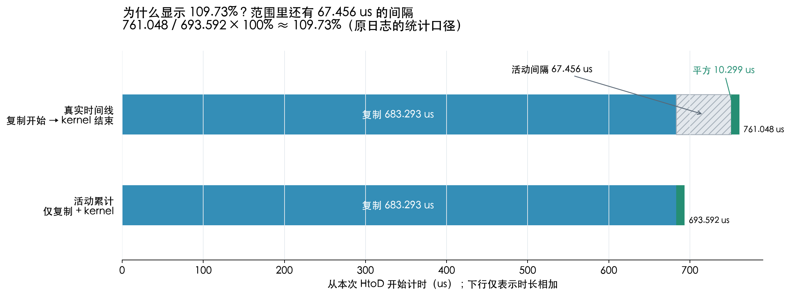

图的上行保留实际时间顺序，下行把两个活动的时长相加，便于比较统计口径。它们不表示执行了两次上传。

```text
复制结束：t = 12436.911 us
平方开始：t = 12504.367 us
两者间隔：12504.367 - 12436.911 = 67.456 us

从复制开始到平方结束的跨度：
683.293 + 67.456 + 10.299 = 761.048 us

原日志的 GPU 范围比例：
761.048 / 693.592 × 100% ≈ 109.73%
```

**这 67.456 us 是两个已记录设备活动之间的间隔**，其中能看到 CPU 完成复制调用、进入平方算子和提交 kernel 等操作；仅凭这些事件不能把间隔完全归为 PCIe 等待、GPU 排队或 GPU 执行。它位于用户 GPU 范围内部，却不属于 Memcpy 或 kernel 的持续时间，所以范围比活动累计更长。

JSON 的 `gpu_user_annotation` 持续为 `761.050 us`，其起止边界比上述设备活动跨度各向外多约 `0.001 us`；与原日志的 `761.048 us` 相差 `0.002 us`，不影响解释。表格计算设备总时间时排除了用户标记，而范围这一行仍用设备总时间作百分比分母，所以可以超过 100%。[PyTorch 2.7 统计实现](https://github.com/pytorch/pytorch/blob/v2.7.0/torch/autograd/profiler_util.py)

至于 `aten::copy_` 的 CUDA total 约 `1.367 ms`、`Activity Buffer Request` 又显示 `683.293 us`：JSON 中仍然只有 **1 个**真实 `gpu_memcpy`。原日志和 JSON 已能排除“两次上传”的解读；要精确解释内部为何重复归属，还需要原始 Kineto 统计对象中的关联信息，当前 JSON 的 `overhead` 事件没有导出这些信息。此处保留这个边界，不把统计归属差异当成额外设备工作。

#### 4.6.5 怎样在查看器里亲自核对，下一步做什么？

把两份 JSON 分别拖入 [Perfetto UI](https://ui.perfetto.dev/)。先找 CPU 的 `square_only` 或 `create_on_cpu_copy_then_square`，再展开 GPU 0 的 stream 7，缩放到对应活动附近；CPU 标签可以搜索，完整 GPU kernel 名称很长，可以搜索 `vectorized_elementwise_kernel`。选择事件后核对 Duration、`correlation`、`External id`；不要把 `gpu_user_annotation` 当成另一个 kernel。

| 想回答的问题 | 该看什么 | 本次答案 |
|---|---|---|
| 平方实际执行了几次？ | `cat = kernel` 的事件数 | 两份分别 5 次、1 次 |
| 是否重复上传了输入？ | `cat = gpu_memcpy` 的事件数与字节数 | 第二份 1 次，4 MiB |
| 第一次 CPU 调用为什么长？ | CPU 算子内的橙色 `overhead` | 约 1.936 ms 的采集缓冲区请求出现在首次调用内 |
| 复制还是平方更耗时？ | 真实 Memcpy 与 kernel 的 `dur` | 本次复制约为平方的 66.3 倍 |
| 这说明 GPU 平方已经优化到最好了吗？ | 需要独立 benchmark、重复样本与硬件指标 | 这两份 trace 不能给出该结论 |

继续实验时，优先做三个对照：复用已经在 GPU 的输入，只测平方；每次 CPU 生成并上传，再平方；直接在 GPU 生成数据，再平方。每种方式先明确计时范围，再用第 3 节的预热和重复计时比较。若只优化平方，在这次设备活动账本里即使把平方时间降到零，也只省去 `1.48%` 的活动时间；优化数据准备与复用输入才是理解这段流程的下一步。

图片与统计可用 [visualize_reports.py](reprots/lecture001-reports/visualize_reports.py) 重新生成（依赖 Matplotlib，无需 GPU）。[trace_summary.json](reprots/lecture001-reports/trace_summary.json) 保存事件数量、时长、间隔及原始文件 SHA-256，方便核对图与报告是否对应。

**验收：**能在 trace 中指出一次平方 kernel、一次 HtoD 复制，并说明 CPU API 与 GPU 活动的关系、`109.73%` 的分母是什么，以及为什么这两份 trace 不能替代独立 benchmark。

<a id="s5"></a>

## 5. 实验三：C++、PyBind 和 load_inline

现在你能看见 PyTorch 启动 GPU 工作了。下一步先只解决一个问题：**Python 如何调用自己写的 C++ 函数？**因此这里先不引入 CUDA。

### 5.1 三个名字各自负责什么

- **C++ 函数**：你实际编写的逻辑；本实验只返回字符串。
- **pybind11**：把 C++ 函数暴露为 Python 模块中的方法，并处理相应类型转换。
- **`load_inline`**：接收源码字符串，组织编译/链接、可选地生成绑定，并把模块加载进 Python。

这里的 PyBind 通常指 **pybind11**。它不负责把算法自动变成 CUDA，也不决定 GPU 的 grid/block。

### 5.2 保存并运行最小例子

保存为 `03_hello_cpp.py`：

```python
from pathlib import Path
from torch.utils.cpp_extension import load_inline


build_dir = Path(__file__).resolve().parent / 'build_hello'
build_dir.mkdir(exist_ok=True)

source = r'''
#include <string>
std::string hello_world() {
    return "Hello from C++";
}
'''

module = load_inline(
    name='lecture001_hello',
    cpp_sources=source,
    functions=['hello_world'],
    build_directory=str(build_dir),
    verbose=True,
)

print(module.hello_world())
```

```bash
MAX_JOBS=2 python 03_hello_cpp.py
ls build_hello
cat build_hello/main.cpp
```

首次运行应出现编译日志和 `Hello from C++`。再次运行通常会复用构建结果，是否重新构建取决于源码、参数和环境。`MAX_JOBS=2` 限制构建并发，避免小机器编译时消耗过多内存。

### 5.3 阅读生成的绑定

你会看到与原 `tmp/main.cpp` 类似的结构：

```cpp
// 结构示意，具体包装代码随 PyTorch 版本变化。
PYBIND11_MODULE(TORCH_EXTENSION_NAME, m) {
    m.def("hello_world", /* C++ 函数或其包装 */, "hello_world");
}
```

`PYBIND11_MODULE` 定义 Python 扩展模块入口；`m.def` 把一个 C++ 函数注册成模块方法。`TORCH_EXTENSION_NAME` 由构建系统传入。

本文使用 `functions=['hello_world']` 让 `load_inline` 生成绑定。以后需要更复杂的类、重载、参数行为时，可以自己写绑定。**自动生成与手写绑定选一种，避免重复定义模块入口。**[pybind11 入门](https://pybind11.readthedocs.io/en/stable/basics.html)

**验收：**能指出生成的 `main.cpp` 中哪一段来自自己的字符串，哪一段由工具补齐。知道这里完全没有运行 CUDA kernel。

<a id="s6"></a>

## 6. 实验四：手写 CUDA kernel 并接回 PyTorch

### 6.1 先认识 host wrapper 和 kernel 两层

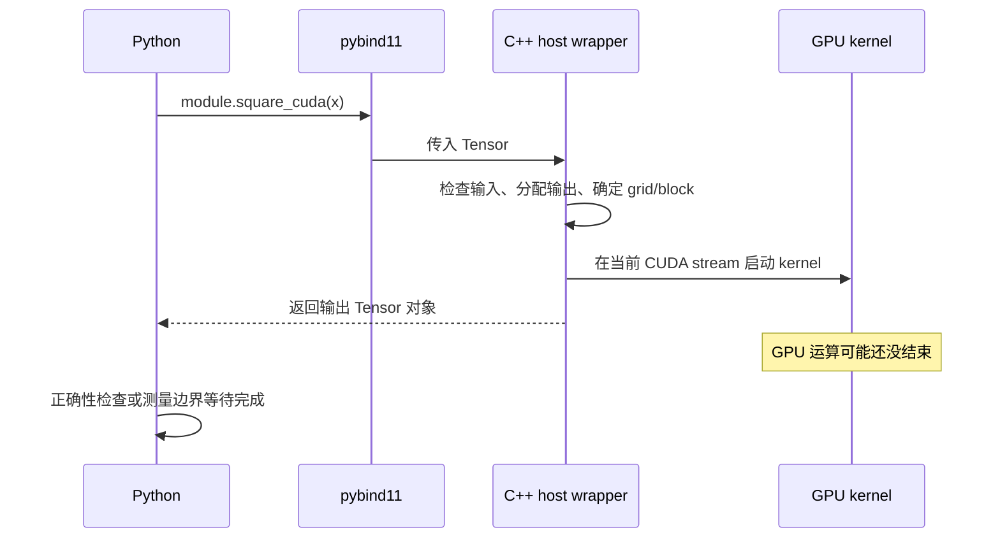

host 指 CPU 侧，device 指 GPU 侧。

- `torch::Tensor square_cuda(torch::Tensor x)` 是 CPU 侧的普通 C++ 函数，Python 绑定它。
- `__global__ void square_kernel(...)` 的函数体由 GPU 线程执行。
- `kernel<<<grid, block, shared_memory_bytes, stream>>>(...)` 是 CUDA kernel 启动语法，在 `.cu` 代码中使用。
- Tensor 在 Python/C++ 间传递，不等于把它的显存数据复制到 CPU。wrapper 取出显存地址交给 kernel。

原 `main.py` 缺少正确的 host wrapper，`functions=['square_kernel']` 不能自动变出上述启动逻辑；`module.square_kernel(grid, block, ...)` 也不是 PyTorch C++ 扩展提供的通用启动 API。

### 6.2 最少的 CUDA 执行模型

| 概念     | 本实验中的解释                       |
| ------ | ----------------------------- |
| thread | 执行 kernel 函数体的一份实例            |
| block  | 一组线程；示例用 256 个线程              |
| grid   | 这次 launch 的所有 block           |
| warp   | NVIDIA GPU 上通常由 32 个线程构成的执行分组 |
| SM     | GPU 的计算单元，可调度多个 block/warp    |

block 不是 SM；启动 1000 个 block 不意味着 GPU 有 1000 个 SM。

先把任意连续张量看成长度为 `n` 的一维数组，让一个线程处理一个元素：

```text
i = blockIdx.x * blockDim.x + threadIdx.x
blocks = ceil(n / threads)
```

例如 `n=1000`、`threads=256`，需要 4 个 block，一共启动 1024 个线程。最后 24 个线程超出数据范围，必须通过 `if (i < n)` 禁止访问。

### 6.3 一个带基本输入检查的完整扩展

保存为 `cuda_square_ext.py`。这个版本使用一维索引，先把“绑定、启动、计算”分清，再回看原代码的二维索引。

```python
from pathlib import Path
import torch
from torch.utils.cpp_extension import load_inline


build_dir = Path(__file__).resolve().parent / 'build_square'
build_dir.mkdir(exist_ok=True)

cpp_source = r'''
torch::Tensor square_cuda(torch::Tensor x);
'''

cuda_source = r'''
#include <cstdint>
#include <c10/cuda/CUDAGuard.h>
#include <c10/cuda/CUDAStream.h>
#include <c10/cuda/CUDAException.h>

__global__ void square_kernel(
    const float* x, float* y, int64_t n) {
    const int64_t i =
        static_cast<int64_t>(blockIdx.x) * blockDim.x + threadIdx.x;
    if (i < n) {
        const float value = x[i];
        y[i] = value * value;
    }
}

torch::Tensor square_cuda(torch::Tensor x) {
    TORCH_CHECK(x.is_cuda(), "x must be a CUDA tensor");
    TORCH_CHECK(x.scalar_type() == torch::kFloat32, "x must be float32");
    TORCH_CHECK(x.is_contiguous(), "x must be contiguous");
    TORCH_CHECK(!x.requires_grad(), "forward-only example: no autograd");

    const c10::cuda::CUDAGuard device_guard(x.device());
    auto y = torch::empty_like(x);
    const int64_t n = x.numel();
    if (n == 0) {
        return y;
    }

    constexpr int threads = 256;
    const int64_t blocks = (n + threads - 1) / threads;
    TORCH_CHECK(blocks <= 2147483647LL, "input too large for this example");
    const auto stream = c10::cuda::getCurrentCUDAStream(x.get_device());
    square_kernel<<<static_cast<unsigned int>(blocks), threads, 0, stream.stream()>>>(
        x.data_ptr<float>(), y.data_ptr<float>(), n);
    C10_CUDA_KERNEL_LAUNCH_CHECK();
    return y;
}
'''

extension = load_inline(
    name='lecture001_square',
    cpp_sources=cpp_source,
    cuda_sources=cuda_source,
    functions=['square_cuda'],
    with_cuda=True,
    extra_cuda_cflags=['-O2'],
    build_directory=str(build_dir),
    verbose=True,
)


def square(x):
    return extension.square_cuda(x)


if __name__ == '__main__':
    for shape in [(0,), (1,), (3, 5), (1823, 781), (1024, 1024)]:
        x = torch.randn(shape, device='cuda', dtype=torch.float32)
        torch.testing.assert_close(square(x), torch.square(x))
    torch.cuda.synchronize()
    print('CUDA square: all checks passed')
```

```bash
MAX_JOBS=2 python cuda_square_ext.py
ls build_square
```

首次运行会编译，可能明显比执行平方本身慢。这里检验的是接入与正确性，暂时不要把整条 `python ...` 命令的耗时当 kernel 耗时。

<a id="host-wrapper-syntax"></a>

#### 6.3.1 为什么这段 C++ 看起来像 Python？

你说的 host wrapper 是上面的 `square_cuda` 函数，wrapper 表示“包装函数”：它在 CPU 上接收 Tensor、检查输入、准备输出和启动 GPU kernel。**这里使用的是 C++ 调用 PyTorch 的 C++ 库接口。**PyTorch 同时提供 Python 和 C++ 接口，很多操作的名字与用法相近，所以看起来熟悉；没有在 C++ 里解释执行 Python。[PyTorch C++ API](https://docs.pytorch.org/cppdocs/)

| Python 中熟悉的写法             | 本例 C++ 写法                        | 差别                              |
| ------------------------- | -------------------------------- | ------------------------------- |
| `torch.Tensor`            | `torch::Tensor`                  | 前者是 Python 的类名；后者是 C++ 的类型名     |
| `y = torch.empty_like(x)` | `auto y = torch::empty_like(x);` | C++ 用 `auto` 在编译时推导变量类型，语句末尾有分号 |
| `x.numel()`               | `x.numel()`                      | 两边都有这个对象方法，返回元素总数               |
| `x.device`                | `x.device()`                     | Python 这里是属性，C++ 这里是方法调用        |
| `x.is_cuda`               | `x.is_cuda()`                    | Python 是属性；C++ 是返回 bool 的方法     |
| `x.requires_grad`         | `x.requires_grad()`              | 同样是属性与方法的区别                     |
| `torch.float32`           | `torch::kFloat32`                | 两边表示相应的 dtype，但标识符不同            |
| `not x.requires_grad`     | `!x.requires_grad()`             | C++ 的 `!` 表示逻辑取反                |

不要直接把 Python 的点号全部替换成 `::`：`torch::` 用于命名空间里的名称；对象方法仍然用点号，例如 `x.numel()`。

#### 6.3.2 `torch::` 是什么，真的能在 C++ 中用吗？

能用。`::` 是 C++ 的**作用域解析符**，这里用来查找命名空间中的名称：

```cpp
torch::Tensor          // torch 命名空间中的 Tensor 类型
torch::empty_like(x)   // torch 命名空间中的 empty_like 函数
torch::kFloat32        // torch 命名空间中的 dtype 常量
```

它与标准库的 `std::string`、`std::vector` 使用的是同一种 C++ 语法。`torch` 不是 C++ 语言的关键字，是 PyTorch 库定义的命名空间。C++ 编译器需要找到相应头文件，链接器也需要找到库实现，才能编译和运行这些调用。

本例由 `load_inline` 安排编译与链接：PyTorch 2.7 会在生成的 `main.cpp` 开头补上 `<torch/extension.h>`，在 `cuda.cu` 开头补上 `<torch/types.h>`、`<cuda.h>` 和 `<cuda_runtime.h>`。因此你在字符串里没有显式写这些头文件，`torch::Tensor` 仍然可用；这不是任意 C++ 文件都会自动拥有的能力。[load_inline 的生成逻辑](https://github.com/pytorch/pytorch/blob/v2.7.0/torch/utils/cpp_extension.py)

如果看到别的教程写 `at::Tensor`，它来自 ATen 张量库。在这里使用的 PyTorch 2.7 类型头文件中，`torch` 命名空间通过 `using namespace at;` 暴露 ATen 的名称，因此 `torch::Tensor` 与 `at::Tensor` 指向同一底层 Tensor 类型。读本例时先统一使用 `torch::Tensor` 即可。[类型头文件](https://github.com/pytorch/pytorch/blob/v2.7.0/torch/csrc/api/include/torch/types.h)

#### 6.3.3 `c10` 又是什么？

`c10` 是 PyTorch 自己的底层 C++ 基础设施库和命名空间。官方将它归为 **Core Utilities**，提供设备、数据类型、错误处理等基础组件；本例用到的 `c10::cuda` 是它的 CUDA 设备与 stream 工具。[C10 官方文档](https://docs.pytorch.org/cppdocs/api/c10/index.html)

**`c10` 不是 CUDA 10 的版本号**，也不是一个 Python 变量。把它按库名读即可，不需要通过名字猜当前 CUDA 版本。

| 本例中的名称                              | 是什么                        | 在 wrapper 中承担什么工作              |
| ----------------------------------- | -------------------------- | ------------------------------ |
| `torch::Tensor`、`torch::empty_like` | PyTorch 的 Tensor 类型与张量操作接口 | 接收输入，准备输出                      |
| `c10::cuda::CUDAGuard`              | c10 的 CUDA 设备管理类           | 临时选择输入所在 GPU，函数退出时恢复原设备        |
| `c10::cuda::getCurrentCUDAStream`   | c10 的函数                    | 取得该设备当前使用的 PyTorch CUDA stream |
| `TORCH_CHECK`                       | PyTorch 的检查宏               | 条件不满足时抛出错误                     |
| `C10_CUDA_KERNEL_LAUNCH_CHECK`      | c10 的 CUDA 检查宏             | 检查 kernel launch 后的 CUDA 错误状态  |
| `square_kernel<<<...>>>(...)`       | CUDA 对 C++ 的扩展语法           | 在指定 GPU stream 中启动你写的 kernel   |

`c10::cuda::CUDAGuard` 按层次读就是“c10 命名空间 → cuda 子命名空间 → CUDAGuard 类型”。大写宏不是命名空间：`C10_CUDA_KERNEL_LAUNCH_CHECK()` 前面不需要加 `c10::`。

#### 6.3.4 函数头、`auto`、`const` 与模板怎么读？

```cpp
torch::Tensor square_cuda(torch::Tensor x) {
    // 函数体
}
```

从左到右：返回类型是 `torch::Tensor`，函数名是 `square_cuda`，参数名是 `x`，参数类型也是 `torch::Tensor`。C++ 在函数名前写返回类型；函数体用 `{}` 包住，不靠缩进划定范围。

`cpp_source` 里的 `torch::Tensor square_cuda(torch::Tensor x);` 末尾是分号，没有函数体，属于**函数声明**，供绑定文件知道这个函数的类型。`cuda_source` 中带 `{ ... }` 的版本才是**函数定义**，里面写实际行为。

参数按值传递 Tensor 时，传的是管理张量的轻量对象；并不因此深拷贝所有元素，也不会自动把显存复制到 CPU。这里的 `x` 仍能指向 GPU 上的张量存储。

| 代码                                  | C++ 语法与本例含义                                              |
| ----------------------------------- | -------------------------------------------------------- |
| `auto y = torch::empty_like(x);`    | 根据右侧表达式在编译时推导 `y` 的类型；本例就是 Tensor。不是 Python 那样运行时可随意更换类型 |
| `const int64_t n = x.numel();`      | 声明 64 位整数 `n`，初始化后不能再赋值；保存输入元素总数                         |
| `constexpr int threads = 256;`      | 编译期已知的整数常量，指定每个 block 的线程数                               |
| `if (n == 0) { return y; }`         | 普通 C++ 条件与返回语句；空张量不启动 kernel                             |
| `2147483647LL`                      | `LL` 是 long long 整数字面量后缀                                 |
| `static_cast<unsigned int>(blocks)` | 显式转换整数类型，作为 kernel 启动的 grid 参数                           |
| `x.data_ptr<float>()`               | 调用模板方法，`<float>` 是类型参数，取得按 float 元素访问的数据地址               |
| `const float* x`                    | 指向 float 数据的指针；kernel 通过这个输入指针读取数据，不修改所指元素               |

`data_ptr<float>()` 并不把任意 dtype 自动转换成 float。它要求类型匹配，所以 wrapper 先检查 `x.scalar_type() == torch::kFloat32`。取到 GPU Tensor 的指针后，也不能在 CPU wrapper 中直接用 `x_ptr[i]` 读取显存；本例把指针交给 GPU kernel 访问。

#### 6.3.5 最容易误读的一行：这是创建对象，不是调用 Python 函数

```cpp
const c10::cuda::CUDAGuard device_guard(x.device());
```

把它拆开：

```text
const                         声明这个局部对象为 const
c10::cuda::CUDAGuard           对象的类型
device_guard                  你给对象取的变量名
(x.device())                  传给构造函数的参数：输入所在设备
```

这行创建一个局部对象 `device_guard`，初始化时立即执行设备选择。例如进入函数时当前设备是 GPU 0，而 `x` 位于 GPU 1，它会保存原设备并把当前设备切到 GPU 1，让后面的 launch 使用正确设备。

当函数返回或抛出异常时，局部对象自动析构，恢复原设备。C++ 用这种对象生命周期管理资源的方式称为 **RAII**。所以你没有看到显式的“恢复设备”语句，它仍会发生；即使走 `n == 0` 的提前返回分支也会恢复。`const` 不会阻止析构。[CUDAGuard](https://github.com/pytorch/pytorch/blob/v2.7.0/c10/cuda/CUDAGuard.h)、[CUDA Guards 文档](https://docs.pytorch.org/cppdocs/api/cuda/guards.html)

这个 guard 选择的是设备，不会把 CPU Tensor 上传到 GPU，也不负责等待 kernel 完成。

#### 6.3.6 stream 对象、`.stream()` 和 kernel 启动怎么连起来？

```cpp
const auto stream = c10::cuda::getCurrentCUDAStream(x.get_device());
```

`x.get_device()` 返回设备编号，例如 0；函数返回一个 `c10::cuda::CUDAStream` 对象，`auto` 推导出这个类型。随后 `stream.stream()` 从该对象中取得 CUDA runtime 使用的原生 `cudaStream_t` 句柄，交给 launch。[CUDAStream 定义](https://github.com/pytorch/pytorch/blob/v2.7.0/c10/cuda/CUDAStream.h)

```cpp
square_kernel<<<static_cast<unsigned int>(blocks), threads, 0, stream.stream()>>>(
    x.data_ptr<float>(), y.data_ptr<float>(), n);
```

把它分成两组参数：

```text
<<< block 数, 每 block 的线程数, 动态共享内存字节数, CUDA stream >>>
(   输入数据地址, 输出数据地址, 元素总数                         )
```

前一组是 **CUDA 启动配置**，后一组是传给 `square_kernel` 函数的参数。`0` 表示这次不申请动态共享内存。`<<<...>>>` 由 CUDA 编译器识别，不是普通 C++ 编译器独自支持的语法。

使用 PyTorch 的当前 stream，使本 wrapper 提交的 kernel 与这个 stream 上先前的操作保持执行顺序。它不是硬编码“必须 stream 7”；前面 Profiler 的 stream 7 是那次 trace 中的记录，CUDA stream 编号并不是你要抄进代码里的常量。

下一行 `C10_CUDA_KERNEL_LAUNCH_CHECK();` 是宏，在本版本中通过 `cudaGetLastError()` 检查错误状态。它不会同步等待整个 kernel 完成；`return y;` 返回时 GPU 工作可能还在执行。[错误检查宏](https://github.com/pytorch/pytorch/blob/v2.7.0/c10/cuda/CUDAException.h)

#### 6.3.7 再按执行顺序读一遍 host wrapper

```text
Python 调用 extension.square_cuda(x)
  → 绑定将 Tensor 交给 CPU 上的 C++ square_cuda
  → TORCH_CHECK 检查设备、dtype、连续性和求导要求
  → CUDAGuard 临时选择输入所在设备
  → torch::empty_like 分配输出 Tensor（元素尚未初始化）
  → x.numel() 取得元素数；空输入直接返回
  → 计算 grid / block，取得 PyTorch 当前 CUDA stream
  → data_ptr<float>() 取得输入、输出数据地址
  → <<<...>>> 把 square_kernel 提交到 GPU
  → 检查启动错误，返回输出 Tensor；guard 恢复原设备

GPU 上的 square_kernel：读取 x[i] → 计算平方 → 写入 y[i]
```

wrapper 在 CPU 上执行，并不表示 `torch::empty_like(x)` 会创建 CPU 输出：本例输入在 GPU，输出沿用输入的设备和 dtype；CPU 负责安排显存分配。真正逐元素读写由 `square_kernel` 的 GPU 线程完成。

`cuda_source = r'''...'''` 虽然写在 Python 文件中，三引号内的内容仍是待编译的 CUDA/C++ 源码字符串。Python 负责把它交给 `load_inline`，不解释执行其中的 `torch::`、`c10::` 或 `<<<...>>>`。阅读时先用字符串边界区分语言，再用 `square_cuda` 与 `square_kernel` 区分 CPU 和 GPU 的执行位置。

### 6.4 为什么要多写这些检查

| 代码                             | 解决的问题                                 |
| ------------------------------ | ------------------------------------- |
| `is_cuda()`                    | 防止把 CPU 指针交给 GPU kernel               |
| `kFloat32`                     | kernel 按 `float*` 访问；其他 dtype 的字节解释不同 |
| `is_contiguous()`              | 一维指针遍历假设逻辑元素连续排列                      |
| `!requires_grad()`             | 这个示例没有实现 backward，明确拒绝需要自动求导的输入       |
| `CUDAGuard`                    | 使用输入 Tensor 所在设备的上下文                  |
| `getCurrentCUDAStream`         | 与当前 PyTorch 工作流在同一 stream 中有序执行       |
| `n == 0`                       | 空输入无需启动零 block 的 kernel               |
| `C10_CUDA_KERNEL_LAUNCH_CHECK` | 检查启动错误；不会替你同步等待整个计算完成                 |

这里的 device/stream 处理遵循 PyTorch 的 CUDA 互操作方式。[CUDA Guards](https://docs.pytorch.org/cppdocs/api/cuda/guards.html)、[CUDA Streams](https://docs.pytorch.org/cppdocs/api/cuda/streams.html)

“Python 能调用”与“完整融入 PyTorch 系统”是不同层次。这个扩展演示前向调用；自动求导、算子注册、FakeTensor/meta、`torch.compile` 组合等属于后续工程化工作，PyBind 不会自动补齐这些能力。

### 6.5 回到原 `load_inline.py` 的二维版本

原文件让一个线程处理矩阵的一个位置：

```text
row = blockIdx.y * blockDim.y + threadIdx.y
col = blockIdx.x * blockDim.x + threadIdx.x
idx = row * width + col
```

`threads_per_block(16, 16)` 总共有 256 个线程，grid 的 x 方向覆盖列，y 方向覆盖行；两边都需要向上取整。

连续二维张量的地址可写为 `base + row * width + col`，这里指针加法以元素为单位。一般 Tensor 则是 `base + row * stride(0) + col * stride(1)`。转置或切片后通常不能继续假设 stride 为 `(width, 1)`。

原示例在连续 `float32` 二维输入上演示了基本过程，但省略了 dtype、连续性、维数、device guard、当前 stream 和启动错误检查。学习时理解这些前提，比把代码无条件复制到项目中更重要。

**验收：**能说明 `cpp_source` 为什么需要函数声明，能指出 host wrapper 的启动语句，并解释非整块输入为什么仍然正确。

<a id="s7"></a>

## 7. 实验五：用 Triton 表达同一个计算

### 7.1 从“一个线程处理一个数”到“一个 program 处理一块数”

在前面的 CUDA 示例里，你显式计算某个线程的 `i`。Triton 的基本写法则是：一个 program 处理一块数据，用 `tl.arange` 一次表达块内所有位置，再由编译器安排这些元素怎样分配给线程、寄存器和指令。

```text
n = 1000，BLOCK_SIZE = 256

program 0 -> 元素   0～255
program 1 -> 元素 256～511
program 2 -> 元素 512～767
program 3 -> 元素 768～1023，其中 1000～1023 被 mask 禁止读写
```

`BLOCK_SIZE` 是这个 program 处理的元素数，**不能直接等同于 CUDA block 的线程数**。例如 NVIDIA 后端的 `num_warps=4` 通常对应 128 个线程，但一个 program 可以处理 256、512 或 1024 个元素。

Triton 的典型入门模型是 program ID、块内 offsets、mask 和向量化的 load/store。[官方向量加法教程](https://triton-lang.org/main/getting-started/tutorials/01-vector-add.html)

### 7.2 一个最小的一维 Triton 平方

保存为 `triton_square_impl.py`：

```python
import torch
import triton
import triton.language as tl


@triton.jit
def square_kernel(x_ptr, y_ptr, n_elements, BLOCK_SIZE: tl.constexpr):
    pid = tl.program_id(axis=0)
    offsets = pid * BLOCK_SIZE + tl.arange(0, BLOCK_SIZE)
    valid = offsets < n_elements
    values = tl.load(x_ptr + offsets, mask=valid, other=0.0)
    squared = values * values
    tl.store(y_ptr + offsets, squared, mask=valid)


def square(x, block_size=256):
    if not x.is_cuda or x.dtype != torch.float32 or not x.is_contiguous():
        raise ValueError('expected a contiguous CUDA float32 tensor')
    if x.requires_grad:
        raise ValueError('forward-only example: no autograd')
    if block_size not in (128, 256, 512, 1024):
        raise ValueError('this exercise supports block_size 128/256/512/1024')

    y = torch.empty_like(x)
    n = x.numel()
    if n == 0:
        return y
    grid = (triton.cdiv(n, block_size),)
    with torch.cuda.device(x.device):
        square_kernel[grid](x, y, n, BLOCK_SIZE=block_size, num_warps=4)
    return y


if __name__ == '__main__':
    for shape in [(0,), (1,), (3, 5), (1823, 781), (1024, 1024)]:
        x = torch.randn(shape, device='cuda', dtype=torch.float32)
        for block_size in (128, 256, 512, 1024):
            torch.testing.assert_close(square(x, block_size), torch.square(x))
    torch.cuda.synchronize()
    print('Triton square: all checks passed')
```

```bash
python triton_square_impl.py
```

这里有意包含空张量、单元素、小矩阵和非整齐形状。只验证 `1024 × 1024` 太容易漏掉边界错误。

<a id="triton-from-cuda"></a>

### 7.3 从 CUDA 思维理解这个一维 Triton 平方

**本质区别是“元素到执行线程的映射由谁表达”：CUDA 中你用 `blockIdx`、`threadIdx` 等写出每个线程负责哪些元素；普通 Triton `tl` kernel 中，你写出每个 program 负责哪些逻辑元素、这些元素怎样计算，再由编译器决定 program 内部的元素如何分给线程。**线程、warp、GPU 并没有消失，变化的是源码表达的层次。[Triton 编程模型](https://triton-lang.org/main/programming-guide/chapter-1/introduction.html)

前面的 CUDA 示例恰好是一个线程处理一个元素，但这不是 CUDA 的限制；CUDA 也可以由一个线程处理多个元素。Triton 的关键也不是“能一次处理多个元素”，而是这个例子没有把逻辑位置绑定到某个 `threadIdx.x`。`BLOCK_SIZE` 决定逻辑块大小，`num_warps` 决定本例的协作线程配置，二者之间的具体映射交给编译器，下面第 7.3.9 节用相同元素数和线程数直接对照。

#### 7.3.1 先与前面的 CUDA kernel 对照

前面的 CUDA 平方表达的是：

```cpp
// 一个 GPU 线程的行为
int64_t i = static_cast<int64_t>(blockIdx.x) * blockDim.x + threadIdx.x;
if (i < n) {
    float value = x[i];
    y[i] = value * value;
}
```

这里 `i` 和 `value` 对每个线程都是一个标量：例如某个线程负责 `i = 300`，就读取 `x[300]` 并写入 `y[300]`。

Triton 表达的是：

```python
# 一个 program 的行为：描述一组元素
pid = tl.program_id(axis=0)
offsets = pid * BLOCK_SIZE + tl.arange(0, BLOCK_SIZE)
valid = offsets < n_elements
values = tl.load(x_ptr + offsets, mask=valid, other=0.0)
squared = values * values
tl.store(y_ptr + offsets, squared, mask=valid)
```

关键区别在变量的含义：

| CUDA 本例               | Triton 本例                          | 怎么理解                                           |
| --------------------- | ---------------------------------- | ---------------------------------------------- |
| `blockIdx.x`          | `pid = tl.program_id(0)`           | 找到当前负责的数据块；在本例的普通 NVIDIA launch 中可与 block 编号类比 |
| `threadIdx.x`，每线程一个编号 | `tl.arange(0, BLOCK_SIZE)`，一整组逻辑偏移 | 不逐个写线程编号，而是描述块内全部元素的编号                         |
| `i`，一个索引              | `offsets`，一组索引                     | 例如 `[256, 257, ..., 511]`                      |
| `i < n`，一个布尔条件        | `valid`，一组布尔条件                     | 每个元素位置有自己的有效 / 无效标记                            |
| `x[i]`，一个值            | `tl.load(...)`，一组值                 | 读取这一组有效位置的数据                                   |
| `value * value`，一个平方  | `values * values`，逐位置平方            | 向量中每个位置独立计算，不是求和或矩阵乘法                          |
| `y[i] = ...`          | `tl.store(...)`                    | 将各个位置的结果写回对应地址                                 |

这里的“一组”是 Triton kernel 中的 `tl.tensor` 表达，不是 Python list，也不是新增的 PyTorch Tensor。源码用方括号展示数值时，只是在帮助你手算它的含义。

#### 7.3.2 两个函数分别在哪里执行？

这个文件中有两层：

```text
CPU 上的普通 Python：square(x, block_size=256)
  检查输入 → torch.empty_like 分配输出 → 决定 grid → 启动 kernel → 返回 y

GPU 上的 Triton kernel：@triton.jit square_kernel(...)
  计算一组索引 → 带 mask 读取 → 逐元素平方 → 带 mask 写回
```

`import triton` 用于 JIT 与 launch 等入口；`import triton.language as tl` 提供 kernel 中的索引、加载、存储等语言操作。`@triton.jit` 告诉 Triton 编译器把函数编译为 GPU 代码，函数体不会逐行当作普通 CPU Python 执行，因此不能任意把普通 Python 或 PyTorch 调用塞进 kernel。[jit API](https://triton-lang.org/main/python-api/generated/triton.jit.html)

Python wrapper 在启动时传入 `x`、`y` 两个 PyTorch Tensor；Triton 的调用接口将它们作为指向数据的指针参数交给 kernel。因此 kernel 中叫 `x_ptr`、`y_ptr`，访问的是设备数据地址；这一步不会把数据复制回 CPU。

`square_kernel` 不通过 `return` 返回计算结果，而是把结果写入预先分配的 `y`。CPU wrapper 最后的 `return y` 返回这个 Tensor 对象，GPU 执行仍是异步的。

#### 7.3.3 用 1000 个元素、每 program 256 个元素手算索引

设 `n_elements = 1000`、`BLOCK_SIZE = 256`。wrapper 中：

```python
grid = (triton.cdiv(1000, 256),)  # 向上取整，得到 (4,)
```

所以创建 4 个 program 实例，它们都执行同一份 kernel 代码，但 `pid` 分别为 0、1、2、3。它们可以由 GPU 并行调度；program 编号不是串行执行顺序，也不是 GPU 设备编号。`axis=0` 表示取 launch grid 的第一个维度编号，不是取输入张量第 0 维的行号。[program_id API](https://triton-lang.org/main/python-api/generated/triton.language.program_id.html)

每个 program 中，下面这行都表达相同的一组局部编号：

```python
tl.arange(0, 256)  # 逻辑值为 [0, 1, 2, ..., 255]，不包含 256
```

然后加上各 program 的起点：

```text
pid = 0：0 * 256 + [0, 1, ..., 255] = [  0,   1, ...,  255]
pid = 1：1 * 256 + [0, 1, ..., 255] = [256, 257, ...,  511]
pid = 2：2 * 256 + [0, 1, ..., 255] = [512, 513, ...,  767]
pid = 3：3 * 256 + [0, 1, ..., 255] = [768, 769, ..., 1023]
```

这解释了为什么不用写一个 Python `for pid in range(4)`：`grid` 已经负责启动这些 program 实例。`arange` 也不是让一个 CPU 线程按 Python 循环访问 256 个元素，而是构造由 GPU 代码处理的逻辑索引块。[arange API](https://triton-lang.org/main/python-api/generated/triton.language.arange.html)

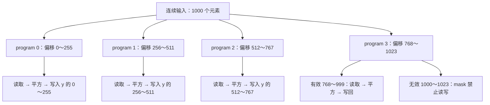

图中的分支表示数据分工，不表示 GPU 必须按从左到右的顺序执行；每个 program 框内还有多个 GPU 线程协作。

#### 7.3.4 最后一块：`mask` 和 `other` 分别做什么？

1000 个元素的合法下标为 0～999。最后一个 program 表达了 768～1023，最后 24 个位置超出边界：

```text
offsets：[768, 769, ..., 998, 999, 1000, 1001, ..., 1023]
valid：  [ T,   T,  ...,  T,   T,    F,    F,  ...,    F]
```

`valid = offsets < n_elements` 是逐位置比较，得到 256 个布尔标记；不是一个“整块通过 / 整块不通过”的 bool。

```python
values = tl.load(x_ptr + offsets, mask=valid, other=0.0)
```

`x_ptr + offsets` 得到一组数据地址。这里按元素偏移，例如 float32 的偏移 1 对应地址增加 4 字节；不用手写 `offsets * 4`。对于 `valid=True` 的位置，load 读取实际元素；对于 `False` 的位置，**不访问那个地址**，只在结果中用 `0.0` 占位。[load API](https://triton-lang.org/main/python-api/generated/triton.language.load.html)

例如为了手算，假设输入值为 `x[i] = i + 1`：

| 逻辑下标 | 是否有效 | load 得到的值 | `values * values` | store 行为 |
|---:|---|---:|---:|---|
| 998 | True | 999 | 998001 | 写入 `y[998]` |
| 999 | True | 1000 | 1000000 | 写入 `y[999]` |
| 1000 | False | 0（other 占位） | 0 | 不写入内存 |
| 1023 | False | 0（other 占位） | 0 | 不写入内存 |

**`other=0.0` 不是向输入末尾补上 24 个真实元素，也不是往越界输出位置写零。**它只规定被屏蔽的 load 在这组计算值中填什么。

```python
tl.store(y_ptr + offsets, squared, mask=valid)
```

store 上的 mask 单独禁止越界写入。load 的 mask 只保护读，不能自动替代 store 的 mask；因此这里两处都要写。[store API](https://triton-lang.org/main/python-api/generated/triton.language.store.html)

#### 7.3.5 `values * values` 为何没有循环？

它描述的是逐元素计算。用一组小数字表示其含义：

```text
values： [ 2, -3,  4,  5]
squared：[ 4,  9, 16, 25]
```

你给编译器的是“这些位置都执行平方”的表达式。编译器再把这组数据的读取、计算和写回分配到 program 内的 GPU 线程，不需要在这里显式写 `threadIdx.x` 或为每个位置写循环。向量长度 256 也不表示 GPU 有一条指令就能瞬间算完 256 个数；具体使用哪些指令、每个线程负责哪些值，要看生成代码。

本例没有跨元素依赖，没有归约，也没有多个 program 互相交换数据；各个 program 写入互不重叠的区间，因此不需要为这个平方加共享内存或同步屏障。

#### 7.3.6 `BLOCK_SIZE=256` 与 `num_warps=4` 如何同时成立？

这两个参数回答不同问题：

| 参数               | 决定什么                 | 本例                        |
| ---------------- | -------------------- | ------------------------- |
| `grid = (4,)`    | 启动几个 program 实例      | 4 个实例，覆盖 4 个数据区间          |
| `BLOCK_SIZE=256` | 每个 program 描述多少个逻辑元素 | 256 个索引 / 值的位置            |
| `num_warps=4`    | 每个实例使用多少个 warp 协作执行  | NVIDIA 上 4 × 32 = 128 个线程 |

在本例这种普通 NVIDIA kernel 配置中，可把一个 program 实例类比为一个 CUDA block，但不能把 `BLOCK_SIZE` 当成 `blockDim.x`。256 个逻辑元素交给 128 个线程处理，平均每个线程承担 2 个位置；若 `BLOCK_SIZE=1024`、仍用 4 个 warp，则平均是 8 个位置。具体哪一个线程负责哪些偏移由编译器的布局决定，这里没有承诺固定的分配公式。[num_warps 配置说明](https://triton-lang.org/main/python-api/generated/triton.Config.html)

前面的 CUDA 教学实现使用 256 个线程、每线程一个元素；此处 Triton 使用 128 个线程处理一组 256 个元素。二者都计算平方，但线程与元素的组织不同，不能只把两段代码的 BLOCK_SIZE / threads 数字直接对齐。

`BLOCK_SIZE: tl.constexpr` 是编译期参数，用于确定 `arange` 等逻辑块的形状。它不表示“256 是线程数”，也不是 PyTorch Tensor 的 dtype 注解。本 wrapper 限制块大小为 128、256、512、1024，都是 2 的幂，适合这里的 `tl.arange(0, BLOCK_SIZE)`。

改变 `BLOCK_SIZE` 或 `num_warps` 可能触发新的配置编译，因此测量每种配置前要先运行并预热；这个例子没有用 autotune 自动选择配置。

#### 7.3.7 Python wrapper 的启动行怎么读？

```python
with torch.cuda.device(x.device):
    square_kernel[grid](x, y, n, BLOCK_SIZE=block_size, num_warps=4)
```

方括号 `[grid]` 是 Triton 提供的 launch 接口，用来指定 program grid，不是从一个 Python 数组中取出元素；括号 `(...)` 才传入参数和编译配置。

```text
Python 调用参数              kernel 中的对应名称
x                         → x_ptr，输入设备数据地址
y                         → y_ptr，输出设备数据地址
n                         → n_elements，实际元素总数
BLOCK_SIZE=block_size      → 编译期块形状参数
num_warps=4               → 编译 / 执行配置；不在你定义的形参列表里
```

`grid = (triton.cdiv(n, block_size),)` 中的逗号让结果成为一维 tuple，例如 `(4,)`。向上取整用于覆盖最后不满一块的输入；如果误用 `n // block_size`，1000 / 256 会只启动 3 个 program，768～999 的元素就漏算了。

`torch.cuda.device(x.device)` 在启动期间选择输入所在设备，作用上与前面 C++ wrapper 的设备 guard 类似。`y = torch.empty_like(x)` 仍由普通 Python / PyTorch 分配输出；Triton kernel 负责写入数据，不负责创建这个 Tensor。

#### 7.3.8 为什么叫“一维”，却能输入矩阵？怎样验证理解？

“一维”描述本 kernel 使用的**线性数据索引与 program grid**，不要求输入 Tensor 的 shape 只有一维。连续的 `(3, 5)` 张量有 15 个元素，可以按线性偏移 0～14 读写；输出由 `empty_like` 创建，所以仍保留 `(3, 5)` 的 shape。

这个前提正是 wrapper 检查 `x.is_contiguous()` 的原因。转置后的张量可能不连续，不能直接把这套 `x_ptr + offsets` 当成任意 stride 的访问方式。

上面的测试分别检查空输入、单元素、小矩阵、非整齐形状和整齐大矩阵，并遍历 4 种 BLOCK_SIZE。`torch.testing.assert_close(...)` 比较你的实现与 PyTorch 参考结果；它不保证自定义实现更快。空输入在 wrapper 中提前返回，不会启动 program。

可以手算以下两组，再回看代码：

| 输入与配置 | program 数 | 最后一块的有效元素数 | 被 mask 掉的逻辑位置数 |
|---|---:|---:|---:|
| `n=1000, BLOCK_SIZE=256` | 4 | 232（768～999） | 24 |
| `(3, 5)` 连续矩阵，`BLOCK_SIZE=128` | 1 | 15（0～14） | 113 |

覆盖是否正确，只要核对每个 program 的区间 `[pid * BLOCK_SIZE, (pid + 1) * BLOCK_SIZE)` 不重叠，所有 0～n−1 都落入其中，再用 mask 屏蔽超出 n 的位置。GPU 不需要按 pid 顺序完成执行，结果仍然正确。

#### 7.3.9 本质区别：同样 256 个元素、128 个线程，谁决定线程分工？

你的理解可以这样表述：**CUDA 写“这些线程各自处理哪些元素、执行什么操作”；本例的 Triton 写“这个 program 的这些逻辑元素执行什么操作”，并通过 `num_warps` 给出线程配置，编译器决定 program 内部的具体分配。**

为了排除“一个线程一个元素”这个教学写法带来的干扰，两边都用 128 个线程处理 256 个元素。在 CUDA 中，可以写下面的 kernel，并以每个 block 128 个线程启动：

```cpp
// 对照示意：每个 block 处理 256 个元素，启动时 blockDim.x = 128
__global__ void square_cuda_mapping(const float* x, float* y, int64_t n) {
    const int64_t base = static_cast<int64_t>(blockIdx.x) * 256;
    for (int local = threadIdx.x; local < 256; local += blockDim.x) {
        const int64_t i = base + local;
        if (i < n) {
            const float value = x[i];
            y[i] = value * value;
        }
    }
}
```

这段代码已经明确指定了线程分工：

| CUDA 线程             | 该 block 内负责的逻辑偏移 | 为什么                    |
| ------------------- | ---------------- | ---------------------- |
| `threadIdx.x = 0`   | 0、128            | local 从 0 开始，每次加 128   |
| `threadIdx.x = 1`   | 1、129            | local 从 1 开始，每次加 128   |
| `threadIdx.x = 127` | 127、255          | local 从 127 开始，每次加 128 |

例如 block 1 的线程 0，负责全局元素 `256 + 0 = 256` 与 `256 + 128 = 384`。这是你通过索引公式与循环直接规定的。

对应的 **Triton 代码**如下。这里直接展开第 7.2 节的 Triton kernel，便于与本节 CUDA 代码对照；不需要用 `threadIdx` 指定哪个线程处理哪个元素：

```python
import torch
import triton
import triton.language as tl


@triton.jit
def square_triton_mapping(x_ptr, y_ptr, n_elements, BLOCK_SIZE: tl.constexpr):
    # 你指定：哪个 program 负责哪一组逻辑元素
    pid = tl.program_id(axis=0)
    offsets = pid * BLOCK_SIZE + tl.arange(0, BLOCK_SIZE)
    valid = offsets < n_elements

    # 你指定：这组元素如何读取、计算和写回
    values = tl.load(x_ptr + offsets, mask=valid, other=0.0)
    squared = values * values
    tl.store(y_ptr + offsets, squared, mask=valid)

    # 没有指定：线程 0、线程 1 等各自负责哪些 offsets
    # program 内部的元素到线程映射由 Triton 编译器安排


# 普通 Python 启动代码：1000 个元素，每个 program 处理 256 个逻辑位置
x = torch.randn(1000, device='cuda', dtype=torch.float32)
y = torch.empty_like(x)
n = x.numel()
grid = (triton.cdiv(n, 256),)  # (4,)，共 4 个 program

with torch.cuda.device(x.device):
    square_triton_mapping[grid](
        x, y, n,
        BLOCK_SIZE=256,  # 每个 program 的逻辑元素数
        num_warps=4,    # 本例 NVIDIA 上每个 program 使用 4 × 32 = 128 个线程
    )
```

这就是上一个回答中下面三行的完整上下文：

```python
offsets = pid * 256 + tl.arange(0, 256)
values = tl.load(x_ptr + offsets, mask=valid, other=0.0)
squared = values * values
```

kernel 中使用编译期参数 `BLOCK_SIZE` 代替写死的 256，启动时传入 `BLOCK_SIZE=256`。这一组逻辑元素的含义是：

```text
program 1 的逻辑索引：[256, 257, ..., 511]
这组元素的计算：读取 x → 逐位置平方 → 写入 y
协作线程配置：4 个 warp，即本例 NVIDIA 上的 128 个线程
```

但 Triton 源码没有规定“线程 0 必须负责 256 与 384”。下面两种 block 内分工都能覆盖 256 个位置，这张表只示意合法分工，并非本次编译结果：

| 执行线程 | 分工示意 A     | 分工示意 B     |
| ---- | ---------- | ---------- |
| 0    | 偏移 0、128   | 偏移 0、1     |
| 1    | 偏移 1、129   | 偏移 2、3     |
| 127  | 偏移 127、255 | 偏移 254、255 |

普通 `tl` 代码描述的是逻辑块，具体生成怎样的线程 / lane / 寄存器布局，由编译器结合形状、操作和配置安排。你可以通过 BLOCK_SIZE、num_warps、张量形状与访存方式影响生成代码，但本例没有显式声明每个线程拥有哪个元素。要确认某次编译的实际映射，需要检查生成的布局或底层代码，不能由 `tl.arange` 猜成固定的线程编号。

| 分工层次 | CUDA 对照代码 | 本例 Triton |
|---|---|---|
| 哪个 block / program 负责哪段数据 | 你写 `blockIdx.x * 256` | 你写 `pid * BLOCK_SIZE` |
| 一段数据里的元素做什么运算 | 你写读取、平方、写回 | 你写 `tl.load`、`values * values`、`tl.store` |
| 使用多少执行线程 | 你在 launch 中设 block 线程数为 128 | 你设 `num_warps=4`，本例 NVIDIA 上为 128 个线程 |
| 段内哪个线程负责哪个元素 | 你用 threadIdx 与循环明确表达 | 本例交给编译器决定 |

因此 Triton 也不是“所有数据分工都自动决定”：program 与数据块的关系仍由你写，grid 是否覆盖全部输入、mask 是否正确，也仍由你负责。它把**块内部的线程分配**提升为编译器处理的工作。[Triton 编程模型](https://triton-lang.org/main/programming-guide/chapter-1/introduction.html)、[num_warps 说明](https://triton-lang.org/main/python-api/generated/triton.Config.html)

这里“线程”指参与执行的 CUDA 线程实例，不是你指定了一颗固定的 GPU 运算核心；CUDA 与 Triton 都不在这段源码中指定 block 最终落在哪个 SM 或何时运行。这一节的对照范围是前面的普通 NVIDIA Triton `tl` 平方 kernel，而非所有底层编程接口。

下面这张表可用作回看代码时的速查：

| 表达式                        | 作用                       | 对应的思考方式             |
| -------------------------- | ------------------------ | ------------------- |
| `@triton.jit`              | 标记待编译的 Triton 函数         | 函数体不是普通 Python 解释执行 |
| `tl.program_id(0)`         | 当前 program 在 grid 中的编号   | 我负责哪一块数据？           |
| `tl.arange(0, BLOCK_SIZE)` | 表达块内一组偏移                 | 块内有哪些元素？            |
| `pid * BLOCK_SIZE + ...`   | 得到全局元素偏移                 | 这些元素在整个数组哪里？        |
| `mask=valid`               | 禁止超出边界的读写                | 最后一块不足整块怎么办？        |
| `tl.load` / `tl.store`     | 从指针读取 / 向指针写入            | 显式描述访存              |
| `tl.constexpr`             | 编译期已知的参数                 | 让编译器确定块形状等信息        |
| `kernel[grid](...)`        | Python 侧启动 Triton kernel | Triton 提供的启动入口      |

Triton 省掉了这里手写 PyBind 和 C++ launcher 的步骤，但仍然需要 Python wrapper 来分配输出和决定 grid。输入检查、索引正确性和性能验证仍由你负责。

### 7.4 现在再读原来的二维 Triton 版本

原 `triton_square.py` 改自 fused softmax 教程，采用“一个 program 负责一整行”：

```text
row_idx = program_id(0)
BLOCK_SIZE = next_power_of_2(n_cols)
grid = (n_rows,)
```

当列数为 781 时，块大小取 1024，再 mask 掉末尾多出来的列。`next_power_of_2` 返回大于或等于输入的最小 2 的幂，输入本来是 1024 时仍返回 1024。

理解时留意四点：

1. `input_row_stride` / `output_row_stride` 负责跨行，但列内仍是 `+ col_offsets`，因此它并不支持任意列 stride；本例随机创建的连续张量满足要求。
2. 注释中的“softmax”是改编遗留，实际计算只有平方，没有求和或归一化。
3. `other=-inf` 是 softmax 风格的遗留选择。平方示例可使用 `other=0.0`；这里越界位置最终被 store mask 屏蔽。
4. “load 到 SRAM”是简化描述，不能因此断言所有 `tl.load` 都自动使用共享内存。具体寄存器、缓存或共享内存行为要看编译结果和分析工具。

**不要只把原代码的 `BLOCK_SIZE` 改成 1024。**如果仍保持“一行一个 program”，列数超过 1024 时就会漏算后面的列。本文的一维版本可以使用固定块大小，因为 grid 同时改为 `ceil(总元素数 / BLOCK_SIZE)`，能覆盖全部数据。

原文件前面只检查了一个 `(1823, 781)` 输入；这个检查无法保证后面 benchmark 扫描的所有列宽都正确。每次改布局、grid 或块大小后，都要重新验证全部测试 shape。

**验收：**能解释为什么 `num_warps=4` 和 `BLOCK_SIZE=1024` 可以同时成立，能从索引证明所有元素恰好被写入。

<a id="s8"></a>

## 8. 实验六：torch.compile 与公平比较

### 8.1 torch.compile 在这条路线中的位置

普通 PyTorch eager 执行中，框架逐个调度算子。`torch.compile` 尝试捕获函数中的计算，再交给后端优化和生成执行代码；GPU 上常见的 Inductor 路径会生成 Triton kernel，也可以使用现有库或其他代码。

所以现在有四个候选实现：

| 实现 | 你写的东西 | 底层代码从哪里来 |
|---|---|---|
| PyTorch eager | `torch.square(x)` | 框架已有的 kernel |
| CUDA 扩展 | host wrapper + CUDA kernel | 编译自己的 CUDA 源码 |
| 手写 Triton | Python wrapper + Triton kernel | Triton 编译器 |
| compiled PyTorch | 普通 PyTorch 函数 + `torch.compile` | 编译后端生成代码或调用库 |

这些方法都可能很好地完成平方。单个平方本身已经很简单，自定义版本或编译版本不一定明显更快；多个逐元素操作融合时，节省中间张量和 launch 次数的机会通常更清楚。

### 8.2 使用同一输入和同一个计时工具

保存为 `04_compare.py`，依赖前面创建的三个模块：

```python
import torch
from bench_utils import bench_ms
from cuda_square_ext import square as cuda_square
from triton_square_impl import square as triton_square


def native_square(x):
    return torch.square(x)


def main():
    # 在计时回调之外创建；不同 shape 的实际编译也在测量前触发。
    compiled_square = torch.compile(native_square)
    providers = {
        'torch-eager': native_square,
        'cuda-extension': cuda_square,
        'triton': triton_square,
        'torch-compile': compiled_square,
    }

    for shape in [(1024, 1024), (1823, 781), (4096, 4096)]:
        x = torch.randn(shape, device='cuda', dtype=torch.float32)
        expected = native_square(x)
        print(f'\nshape={shape}, elements={x.numel()}')

        for name, fn in providers.items():
            # 先编译/运行当前 shape，再校验；都在计时区间之外。
            actual = fn(x)
            torch.testing.assert_close(actual, expected)
            del actual
            ms = bench_ms(lambda: fn(x))
            logical_bytes = 2 * x.numel() * x.element_size()
            effective_gbps = logical_bytes / (ms * 1e-3) / 1e9
            print(f'{name:18s} {ms * 1000:9.3f} us  '
                  f'{effective_gbps:9.2f} effective GB/s')

        print('Triton block-size sweep:')
        for block_size in (128, 256, 512, 1024):
            torch.testing.assert_close(triton_square(x, block_size), expected)
            ms = bench_ms(lambda: triton_square(x, block_size))
            print(f'  BLOCK_SIZE={block_size:4d}: {ms * 1000:9.3f} us')


if __name__ == '__main__':
    main()
```

```bash
MAX_JOBS=2 python 04_compare.py
```

这个比较采用**返回新输出张量的 API 口径**：所有函数都分配输出，输入已在 GPU。Event 区间测量 GPU 时间线，仍可能受主机提交和分配开销造成的空闲影响。如果以后研究纯 kernel，应为所有实现预分配输出，并使用一致的缓存和计时条件。

如果 CUDA 扩展工具链尚未装好，可以暂时删去它对应的 import 和 provider 行，先比较其他路径；这只影响候选实现，不改变其余实验。
![[Pasted image 20261011202615.png|1210]]
### 8.3 直接看到自动生成的代码

保存为 `05_compile_inspect.py`：

```python
import torch


def square(x):
    return x * x


compiled_square = torch.compile(square)
x = torch.randn(1024, 1024, device='cuda', dtype=torch.float32)
y = compiled_square(x)
torch.testing.assert_close(y, square(x))
torch.cuda.synchronize()
print('compiled square: correct')
```

```bash
TORCHINDUCTOR_CACHE_DIR="$PWD/inductor_inspect_cache" \
TORCH_LOGS=output_code \
python 05_compile_inspect.py \
  > artifacts/compile_stdout.txt 2> artifacts/compile_codegen.log
```

打开 `artifacts/compile_codegen.log`，寻找生成的文件路径、kernel 定义、load、乘法和 store。`output_code` 用于输出 Inductor 生成代码；具体文件名和实现属于版本相关细节。[PyTorch 编译日志文档](https://docs.pytorch.org/docs/main/logging.html)

下面保留你贴入的原始日志；[逐行解释在日志之后](#compile-log-analysis)。当前本地目录里没有独立的 `compile_codegen.log` 文件，因此以下分析以这段实际输出为依据。

> V1011 20:32:29.823000 5038 site-packages/torch/_inductor/graph.py:2104] [0/0] [__output_code] Output code:
> 
> V1011 20:32:29.823000 5038 site-packages/torch/_inductor/graph.py:2104] [0/0] [__output_code] # AOT ID: ['0_inference']
> 
> V1011 20:32:29.823000 5038 site-packages/torch/_inductor/graph.py:2104] [0/0] [__output_code] from ctypes import c_void_p, c_long, c_int
> 
> V1011 20:32:29.823000 5038 site-packages/torch/_inductor/graph.py:2104] [0/0] [__output_code] import torch
> 
> V1011 20:32:29.823000 5038 site-packages/torch/_inductor/graph.py:2104] [0/0] [__output_code] import math
> 
> V1011 20:32:29.823000 5038 site-packages/torch/_inductor/graph.py:2104] [0/0] [__output_code] import random
> 
> V1011 20:32:29.823000 5038 site-packages/torch/_inductor/graph.py:2104] [0/0] [__output_code] import os
> 
> V1011 20:32:29.823000 5038 site-packages/torch/_inductor/graph.py:2104] [0/0] [__output_code] import tempfile
> 
> V1011 20:32:29.823000 5038 site-packages/torch/_inductor/graph.py:2104] [0/0] [__output_code] from math import inf, nan
> 
> V1011 20:32:29.823000 5038 site-packages/torch/_inductor/graph.py:2104] [0/0] [__output_code] from cmath import nanj
> 
> V1011 20:32:29.823000 5038 site-packages/torch/_inductor/graph.py:2104] [0/0] [__output_code] from torch._inductor.hooks import run_intermediate_hooks
> 
> V1011 20:32:29.823000 5038 site-packages/torch/_inductor/graph.py:2104] [0/0] [__output_code] from torch._inductor.utils import maybe_profile
> 
> V1011 20:32:29.823000 5038 site-packages/torch/_inductor/graph.py:2104] [0/0] [__output_code] from torch._inductor.codegen.memory_planning import _align as align
> 
> V1011 20:32:29.823000 5038 site-packages/torch/_inductor/graph.py:2104] [0/0] [__output_code] from torch import device, empty_strided
> 
> V1011 20:32:29.823000 5038 site-packages/torch/_inductor/graph.py:2104] [0/0] [__output_code] from torch._inductor.async_compile import AsyncCompile
> 
> V1011 20:32:29.823000 5038 site-packages/torch/_inductor/graph.py:2104] [0/0] [__output_code] from torch._inductor.select_algorithm import extern_kernels
> 
> V1011 20:32:29.823000 5038 site-packages/torch/_inductor/graph.py:2104] [0/0] [__output_code] from torch._inductor.codegen.multi_kernel import MultiKernelCall
> 
> V1011 20:32:29.823000 5038 site-packages/torch/_inductor/graph.py:2104] [0/0] [__output_code] import triton
> 
> V1011 20:32:29.823000 5038 site-packages/torch/_inductor/graph.py:2104] [0/0] [__output_code] import triton.language as tl
> 
> V1011 20:32:29.823000 5038 site-packages/torch/_inductor/graph.py:2104] [0/0] [__output_code] from torch._inductor.runtime.triton_heuristics import start_graph, end_graph
> 
> V1011 20:32:29.823000 5038 site-packages/torch/_inductor/graph.py:2104] [0/0] [__output_code] from torch._C import _cuda_getCurrentRawStream as get_raw_stream
> 
> V1011 20:32:29.823000 5038 site-packages/torch/_inductor/graph.py:2104] [0/0] [__output_code] from torch._C import _cuda_getCurrentRawStream as get_raw_stream
> 
> V1011 20:32:29.823000 5038 site-packages/torch/_inductor/graph.py:2104] [0/0] [__output_code]
> 
> V1011 20:32:29.823000 5038 site-packages/torch/_inductor/graph.py:2104] [0/0] [__output_code] aten = torch.ops.aten
> 
> V1011 20:32:29.823000 5038 site-packages/torch/_inductor/graph.py:2104] [0/0] [__output_code] inductor_ops = torch.ops.inductor
> 
> V1011 20:32:29.823000 5038 site-packages/torch/_inductor/graph.py:2104] [0/0] [__output_code] _quantized = torch.ops._quantized
> 
> V1011 20:32:29.823000 5038 site-packages/torch/_inductor/graph.py:2104] [0/0] [__output_code] assert_size_stride = torch._C._dynamo.guards.assert_size_stride
> 
> V1011 20:32:29.823000 5038 site-packages/torch/_inductor/graph.py:2104] [0/0] [__output_code] empty_strided_cpu = torch._C._dynamo.guards._empty_strided_cpu
> 
> V1011 20:32:29.823000 5038 site-packages/torch/_inductor/graph.py:2104] [0/0] [__output_code] empty_strided_cuda = torch._C._dynamo.guards._empty_strided_cuda
> 
> V1011 20:32:29.823000 5038 site-packages/torch/_inductor/graph.py:2104] [0/0] [__output_code] empty_strided_xpu = torch._C._dynamo.guards._empty_strided_xpu
> 
> V1011 20:32:29.823000 5038 site-packages/torch/_inductor/graph.py:2104] [0/0] [__output_code] reinterpret_tensor = torch._C._dynamo.guards._reinterpret_tensor
> 
> V1011 20:32:29.823000 5038 site-packages/torch/_inductor/graph.py:2104] [0/0] [__output_code] alloc_from_pool = torch.ops.inductor._alloc_from_pool
> 
> V1011 20:32:29.823000 5038 site-packages/torch/_inductor/graph.py:2104] [0/0] [__output_code] async_compile = AsyncCompile()
> 
> V1011 20:32:29.823000 5038 site-packages/torch/_inductor/graph.py:2104] [0/0] [__output_code] empty_strided_p2p = torch._C._distributed_c10d._SymmetricMemory.empty_strided_p2p
> 
> V1011 20:32:29.823000 5038 site-packages/torch/_inductor/graph.py:2104] [0/0] [__output_code]
> 
> V1011 20:32:29.823000 5038 site-packages/torch/_inductor/graph.py:2104] [0/0] [__output_code]
> 
> V1011 20:32:29.823000 5038 site-packages/torch/_inductor/graph.py:2104] [0/0] [__output_code] # kernel path: /root/gpu-mode-lectures/lecture_001/study_work/inductor_inspect_cache/3s/c3swswdoou5x3c7zuvjgrujwwacgc4hlcfnl72f6kjp6576q2t7c.py
> 
> V1011 20:32:29.823000 5038 site-packages/torch/_inductor/graph.py:2104] [0/0] [__output_code] # Topologically Sorted Source Nodes: [mul], Original ATen: [aten.mul]
> 
> V1011 20:32:29.823000 5038 site-packages/torch/_inductor/graph.py:2104] [0/0] [__output_code] # Source node to ATen node mapping:
> 
> V1011 20:32:29.823000 5038 site-packages/torch/_inductor/graph.py:2104] [0/0] [__output_code] # mul => mul
> 
> V1011 20:32:29.823000 5038 site-packages/torch/_inductor/graph.py:2104] [0/0] [__output_code] # Graph fragment:
> 
> V1011 20:32:29.823000 5038 site-packages/torch/_inductor/graph.py:2104] [0/0] [__output_code] # %mul : [num_users=1] = call_function[target=torch.ops.aten.mul.Tensor](args = (%arg0_1, %arg0_1), kwargs = {})
> 
> V1011 20:32:29.823000 5038 site-packages/torch/_inductor/graph.py:2104] [0/0] [__output_code] triton_poi_fused_mul_0 = async_compile.triton('triton_poi_fused_mul_0', '''
> 
> V1011 20:32:29.823000 5038 site-packages/torch/_inductor/graph.py:2104] [0/0] [__output_code] import triton
> 
> V1011 20:32:29.823000 5038 site-packages/torch/_inductor/graph.py:2104] [0/0] [__output_code] import triton.language as tl
> 
> V1011 20:32:29.823000 5038 site-packages/torch/_inductor/graph.py:2104] [0/0] [__output_code]
> 
> V1011 20:32:29.823000 5038 site-packages/torch/_inductor/graph.py:2104] [0/0] [__output_code] from torch._inductor.runtime import triton_helpers, triton_heuristics
> 
> V1011 20:32:29.823000 5038 site-packages/torch/_inductor/graph.py:2104] [0/0] [__output_code] from torch._inductor.runtime.triton_helpers import libdevice, math as tl_math
> 
> V1011 20:32:29.823000 5038 site-packages/torch/_inductor/graph.py:2104] [0/0] [__output_code] from torch._inductor.runtime.hints import AutotuneHint, ReductionHint, TileHint, DeviceProperties
> 
> V1011 20:32:29.823000 5038 site-packages/torch/_inductor/graph.py:2104] [0/0] [__output_code] triton_helpers.set_driver_to_gpu()
> 
> V1011 20:32:29.823000 5038 site-packages/torch/_inductor/graph.py:2104] [0/0] [__output_code]
> 
> V1011 20:32:29.823000 5038 site-packages/torch/_inductor/graph.py:2104] [0/0] [__output_code] @triton_heuristics.pointwise(
> 
> V1011 20:32:29.823000 5038 site-packages/torch/_inductor/graph.py:2104] [0/0] [__output_code] size_hints={'x': 1048576},
> 
> V1011 20:32:29.823000 5038 site-packages/torch/_inductor/graph.py:2104] [0/0] [__output_code] filename=__file__,
> 
> V1011 20:32:29.823000 5038 site-packages/torch/_inductor/graph.py:2104] [0/0] [__output_code] triton_meta={'signature': {'in_ptr0': '*fp32', 'out_ptr0': '*fp32', 'xnumel': 'i32', 'XBLOCK': 'constexpr'}, 'device': DeviceProperties(type='cuda', index=0, multi_processor_count=80, cc=86, major=8, regs_per_multiprocessor=65536, max_threads_per_multi_processor=1536, warp_size=32), 'constants': {}, 'configs': [{(0,): [['tt.divisibility', 16]], (1,): [['tt.divisibility', 16]], (2,): [['tt.divisibility', 16]]}]},
> 
> V1011 20:32:29.823000 5038 site-packages/torch/_inductor/graph.py:2104] [0/0] [__output_code] inductor_meta={'grid_type': 'Grid1D', 'autotune_hints': set(), 'kernel_name': 'triton_poi_fused_mul_0', 'mutated_arg_names': [], 'optimize_mem': True, 'no_x_dim': False, 'num_load': 1, 'num_reduction': 0, 'backend_hash': '6769567BF9CB28FC4140E0A692BA44D0F6558D1D18952489FF33DAF4A85D2E95', 'are_deterministic_algorithms_enabled': False, 'assert_indirect_indexing': True, 'autotune_local_cache': True, 'autotune_pointwise': True, 'autotune_remote_cache': None, 'force_disable_caches': False, 'dynamic_scale_rblock': True, 'max_autotune': False, 'max_autotune_pointwise': False, 'min_split_scan_rblock': 256, 'spill_threshold': 16, 'store_cubin': False},
> 
> V1011 20:32:29.823000 5038 site-packages/torch/_inductor/graph.py:2104] [0/0] [__output_code] min_elem_per_thread=0
> 
> V1011 20:32:29.823000 5038 site-packages/torch/_inductor/graph.py:2104] [0/0] [__output_code] )
> 
> V1011 20:32:29.823000 5038 site-packages/torch/_inductor/graph.py:2104] [0/0] [__output_code] @triton.jit
> 
> V1011 20:32:29.823000 5038 site-packages/torch/_inductor/graph.py:2104] [0/0] [__output_code] def triton_poi_fused_mul_0(in_ptr0, out_ptr0, xnumel, XBLOCK : tl.constexpr):
> 
> V1011 20:32:29.823000 5038 site-packages/torch/_inductor/graph.py:2104] [0/0] [__output_code] xnumel = 1048576
> 
> V1011 20:32:29.823000 5038 site-packages/torch/_inductor/graph.py:2104] [0/0] [__output_code] xoffset = tl.program_id(0) * XBLOCK
> 
> V1011 20:32:29.823000 5038 site-packages/torch/_inductor/graph.py:2104] [0/0] [__output_code] xindex = xoffset + tl.arange(0, XBLOCK)[:]
> 
> V1011 20:32:29.823000 5038 site-packages/torch/_inductor/graph.py:2104] [0/0] [__output_code] xmask = tl.full([XBLOCK], True, tl.int1)
> 
> V1011 20:32:29.823000 5038 site-packages/torch/_inductor/graph.py:2104] [0/0] [__output_code] x0 = xindex
> 
> V1011 20:32:29.823000 5038 site-packages/torch/_inductor/graph.py:2104] [0/0] [__output_code] tmp0 = tl.load(in_ptr0 + (x0), None)
> 
> V1011 20:32:29.823000 5038 site-packages/torch/_inductor/graph.py:2104] [0/0] [__output_code] tmp1 = tmp0 * tmp0
> 
> V1011 20:32:29.823000 5038 site-packages/torch/_inductor/graph.py:2104] [0/0] [__output_code] tl.store(out_ptr0 + (x0), tmp1, None)
> 
> V1011 20:32:29.823000 5038 site-packages/torch/_inductor/graph.py:2104] [0/0] [__output_code] ''', device_str='cuda')
> 
> V1011 20:32:29.823000 5038 site-packages/torch/_inductor/graph.py:2104] [0/0] [__output_code]
> 
> V1011 20:32:29.823000 5038 site-packages/torch/_inductor/graph.py:2104] [0/0] [__output_code]
> 
> V1011 20:32:29.823000 5038 site-packages/torch/_inductor/graph.py:2104] [0/0] [__output_code] async_compile.wait(globals())
> 
> V1011 20:32:29.823000 5038 site-packages/torch/_inductor/graph.py:2104] [0/0] [__output_code] del async_compile
> 
> V1011 20:32:29.823000 5038 site-packages/torch/_inductor/graph.py:2104] [0/0] [__output_code]
> 
> V1011 20:32:29.823000 5038 site-packages/torch/_inductor/graph.py:2104] [0/0] [__output_code] def call(args):
> 
> V1011 20:32:29.823000 5038 site-packages/torch/_inductor/graph.py:2104] [0/0] [__output_code] arg0_1, = args
> 
> V1011 20:32:29.823000 5038 site-packages/torch/_inductor/graph.py:2104] [0/0] [__output_code] args.clear()
> 
> V1011 20:32:29.823000 5038 site-packages/torch/_inductor/graph.py:2104] [0/0] [__output_code] assert_size_stride(arg0_1, (1024, 1024), (1024, 1))
> 
> V1011 20:32:29.823000 5038 site-packages/torch/_inductor/graph.py:2104] [0/0] [__output_code] with torch.cuda._DeviceGuard(0):
> 
> V1011 20:32:29.823000 5038 site-packages/torch/_inductor/graph.py:2104] [0/0] [__output_code] torch.cuda.set_device(0)
> 
> V1011 20:32:29.823000 5038 site-packages/torch/_inductor/graph.py:2104] [0/0] [__output_code] buf0 = empty_strided_cuda((1024, 1024), (1024, 1), torch.float32)
> 
> V1011 20:32:29.823000 5038 site-packages/torch/_inductor/graph.py:2104] [0/0] [__output_code] # Topologically Sorted Source Nodes: [mul], Original ATen: [aten.mul]
> 
> V1011 20:32:29.823000 5038 site-packages/torch/_inductor/graph.py:2104] [0/0] [__output_code] stream0 = get_raw_stream(0)
> 
> V1011 20:32:29.823000 5038 site-packages/torch/_inductor/graph.py:2104] [0/0] [__output_code] triton_poi_fused_mul_0.run(arg0_1, buf0, 1048576, stream=stream0)
> 
> V1011 20:32:29.823000 5038 site-packages/torch/_inductor/graph.py:2104] [0/0] [__output_code] del arg0_1
> 
> V1011 20:32:29.823000 5038 site-packages/torch/_inductor/graph.py:2104] [0/0] [__output_code] return (buf0, )
> 
> V1011 20:32:29.823000 5038 site-packages/torch/_inductor/graph.py:2104] [0/0] [__output_code]
> 
> V1011 20:32:29.823000 5038 site-packages/torch/_inductor/graph.py:2104] [0/0] [__output_code]
> 
> V1011 20:32:29.823000 5038 site-packages/torch/_inductor/graph.py:2104] [0/0] [__output_code] def benchmark_compiled_module(times=10, repeat=10):
> 
> V1011 20:32:29.823000 5038 site-packages/torch/_inductor/graph.py:2104] [0/0] [__output_code] from torch._dynamo.testing import rand_strided
> 
> V1011 20:32:29.823000 5038 site-packages/torch/_inductor/graph.py:2104] [0/0] [__output_code] from torch._inductor.utils import print_performance
> 
> V1011 20:32:29.823000 5038 site-packages/torch/_inductor/graph.py:2104] [0/0] [__output_code] arg0_1 = rand_strided((1024, 1024), (1024, 1), device='cuda:0', dtype=torch.float32)
> 
> V1011 20:32:29.823000 5038 site-packages/torch/_inductor/graph.py:2104] [0/0] [__output_code] fn = lambda: call([arg0_1])
> 
> V1011 20:32:29.823000 5038 site-packages/torch/_inductor/graph.py:2104] [0/0] [__output_code] return print_performance(fn, times=times, repeat=repeat)
> 
> V1011 20:32:29.823000 5038 site-packages/torch/_inductor/graph.py:2104] [0/0] [__output_code]
> 
> V1011 20:32:29.823000 5038 site-packages/torch/_inductor/graph.py:2104] [0/0] [__output_code]
> 
> V1011 20:32:29.823000 5038 site-packages/torch/_inductor/graph.py:2104] [0/0] [__output_code] if __name__ == "__main__":
> 
> V1011 20:32:29.823000 5038 site-packages/torch/_inductor/graph.py:2104] [0/0] [__output_code] from torch._inductor.wrapper_benchmark import compiled_module_main
> 
> V1011 20:32:29.823000 5038 site-packages/torch/_inductor/graph.py:2104] [0/0] [__output_code] compiled_module_main('None', benchmark_compiled_module)
> 
> V1011 20:32:29.823000 5038 site-packages/torch/_inductor/graph.py:2104] [0/0] [__output_code]
> 
> V1011 20:32:29.824000 5038 site-packages/torch/_inductor/graph.py:2115] [0/0] [__output_code] Output code written to: /root/gpu-mode-lectures/lecture_001/study_work/inductor_inspect_cache/kl/cklfzsmryisscs4ievjp5yoqqjvpc7z7pgo6bin72uucexpdca7m.py
> 
> I1011 20:32:30.179000 5038 site-packages/torch/_inductor/graph.py:2149] [0/0] [__output_code] Output code written to: /root/gpu-mode-lectures/lecture_001/study_work/inductor_inspect_cache/kl/cklfzsmryisscs4ievjp5yoqqjvpc7z7pgo6bin72uucexpdca7m.py

<a id="compile-log-analysis"></a>

#### 8.3.1 先看结论：本次 torch.compile 做了什么？

**它把 `square(x)` 中的 `x * x` 转成了一个 Triton kernel，同时生成一个在 CPU 上运行的 Python 包装函数，负责检查输入布局、分配输出、取得 CUDA stream 和启动 kernel。**本次生成代码针对 CUDA 0 上连续的 `1024 × 1024`、`float32` 输入；kernel 内实际执行的是“加载一块元素 → 每个元素乘自己 → 写回输出”。

这里有三层代码，需要分开看：

| 层次               | 本次代码                                   | 谁负责写？在哪里执行？                             |
| ---------------- | -------------------------------------- | --------------------------------------- |
| 用户函数             | `def square(x): return x * x`          | 你写，表达张量运算                               |
| 生成的 host wrapper | `def call(args): ...`                  | Inductor 写，CPU 上的 Python 负责组织调用         |
| 生成的 GPU kernel   | `def triton_poi_fused_mul_0(...): ...` | Inductor 写 Triton 源码，Triton 编译后由 GPU 执行 |

从 CUDA 思维看，后两层对应前文的 **host wrapper + device kernel**。区别是这里由编译器根据张量运算生成它们。`torch.compile` 没有把整个脚本都搬到 GPU；`torch.randn`、正确性检查和 `print` 都在被编译的 `square` 函数之外。

下面是默认 Inductor 后端的流程示意。`output_code` 主要展示最后生成的包装代码与 Triton 源码，前面几步是结合官方编译架构解释的流程，并非这份日志逐阶段打印的内容。

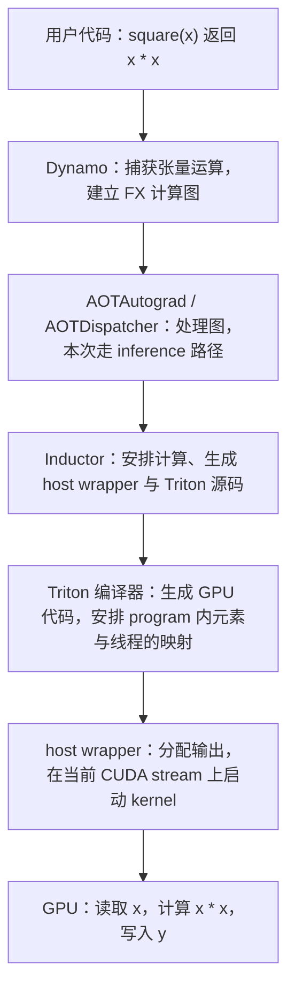

Dynamo 负责捕获图，AOTAutograd 参与图处理，Inductor 是默认生成代码的后端；本次输入没有要求梯度，也没有调用 `backward()`，日志的 `# AOT ID: ['0_inference']` 与此一致。这里的 `AOT` 是编译流程中的标记，不能据此认定运行了独立部署的 AOTInductor 导出。[官方编译流程说明](https://docs.pytorch.org/docs/stable/user_guide/torch_compiler/torch.compiler_faq.html)

#### 8.3.2 哪一行开始编译？以后每次调用都重新编译吗？

把你上面的实际调用拆开：

```python
compiled_square = torch.compile(square)  # 创建可编译的调用包装器
x = torch.randn(1024, 1024, device='cuda', dtype=torch.float32)
y = compiled_square(x)                  # 首次遇到这类输入时捕获图、编译或复用缓存，然后执行
torch.testing.assert_close(y, square(x)) # 在编译函数之外，检查结果
torch.cuda.synchronize()                # 等待 GPU 完成，和“等待编译完成”是两件事
```

为什么不能只看 `torch.compile(square)` 就生成本次完整 kernel？因为编译器需要看到实际输入的形状、dtype、device、stride 等条件。本次这些条件提供了优化依据，例如固定元素总数和把二维连续数据当成一维数组处理。

后续 `compiled_square(x)` 通常先检查编译时的假设是否仍成立，满足条件就复用编译结果。**固定的是输入的结构条件，不是输入的数值**：换一批同类随机数仍可使用同一份代码。改变形状、布局或 dtype 后，可能触发新的编译版本；动态形状策略也会影响这个过程。日志没有证明所有后续输入都能复用本次版本。[torch.compile 的缓存与 guard 说明](https://docs.pytorch.org/docs/2.7/generated/torch.compile.html)

冷启动包含捕获、生成代码、编译以及可能的配置选择；稳态调用主要是检查条件和执行。因此前面的比较实验把首次调用、校验和预热放在正式计时之前。

#### 8.3.3 用计算图注释，把日志对应回 x * x

去掉每行时间戳等前缀，最有用的源代码对应信息是：

```text
# Topologically Sorted Source Nodes: [mul], Original ATen: [aten.mul]
# Source node to ATen node mapping:
#   mul => mul
# Graph fragment:
# %mul : [num_users=1] = call_function[target=torch.ops.aten.mul.Tensor](
#     args = (%arg0_1, %arg0_1), kwargs = {})
```

| 日志 | 对应的意思 |
| --- | --- |
| `Original ATen: [aten.mul]` | 原张量运算是乘法，对应本次 `return x * x` |
| `%arg0_1` | 图中的输入张量，对应你传入的 `x` |
| `args = (%arg0_1, %arg0_1)` | 同一个输入作乘法的两个操作数，所以得到平方 |
| `%mul` | 乘法结果节点，最终成为返回值 |
| `num_users=1` | 图中这个结果被一个后续节点使用；与 GPU 线程数无关 |

两次出现 `%arg0_1` 不代表传入了两份张量，也不代表要启动两个 kernel。下面的 kernel 实际只加载一次 `tmp0`，随后计算 `tmp0 * tmp0`。

前面 Profiler 实验使用 `torch.square(x)`，出现了 `aten::square → aten::pow`。**本节源程序写的是 `x * x`，所以这里映射到 `aten.mul`。**先看具体实验的源代码，再对应算子名字；不能把前一个实验的 `pow` 调用链套到这段生成代码里。

#### 8.3.4 真正的 GPU 计算只有这些行：逐行读 Triton

以下从你的日志提取，恢复 Python 缩进，保留 kernel 函数体；省略外层 `triton_heuristics.pointwise(...)` 配置与通用 import。**这是阅读用摘录**，实际由外层运行时提供 `XBLOCK` 和启动配置，不能仅复制这个函数就当作完整程序。

```python
import triton
import triton.language as tl


@triton.jit
def triton_poi_fused_mul_0(in_ptr0, out_ptr0, xnumel, XBLOCK: tl.constexpr):
    xnumel = 1048576
    xoffset = tl.program_id(0) * XBLOCK
    xindex = xoffset + tl.arange(0, XBLOCK)[:]
    xmask = tl.full([XBLOCK], True, tl.int1)
    x0 = xindex
    tmp0 = tl.load(in_ptr0 + (x0), None)
    tmp1 = tmp0 * tmp0
    tl.store(out_ptr0 + (x0), tmp1, None)
```

| 代码                          | 怎么理解？                                                       |
| --------------------------- | ----------------------------------------------------------- |
| `in_ptr0`、`out_ptr0`        | 输入 `x` 和输出 `y` 在 GPU 上的起始地址                                 |
| `XBLOCK: tl.constexpr`      | 一个 program 处理多少个逻辑元素，类似前文手写 Triton 的 `BLOCK_SIZE`；编译每个配置时已知 |
| `xnumel = 1048576`          | `1024 × 1024` 的元素总数被写成常量；虽然签名中保留参数，这个函数体直接使用固定值             |
| `tl.program_id(0)`          | 当前 program 在一维启动网格中的编号，不是某个 thread 的编号                      |
| `xoffset = ... * XBLOCK`    | 当前 program 负责的数据块起点                                         |
| `tl.arange(0, XBLOCK)`      | 生成这块数据的局部逻辑索引；`[:]` 是完整切片，不会变成二维矩阵                          |
| `xindex = xoffset + ...`    | 当前 program 要处理的全部元素位置                                       |
| `x0 = xindex`               | 生成代码中的索引别名，没有额外复制输入张量                                       |
| `tl.load(..., None)`        | 对这块索引加载输入；第二个参数 `None` 表示没有 load mask                       |
| `tmp1 = tmp0 * tmp0`        | 对这一块元素逐元素平方，不是点积或矩阵乘法                                       |
| `tl.store(..., tmp1, None)` | 写入同位置的输出；没有 store mask                                      |

二维输入为什么没有行列索引？因为 `stride=(1024, 1)` 表明数据按行连续，且平方不需要元素之间的关系。对二维的 `x[row, col]`，线性位置就是 `row * 1024 + col`。这里直接遍历 `0 ... 1048575`，等价地覆盖所有元素，输出张量的二维形状由 host wrapper 保留。

与前文手写 Triton 的对应关系如下：

```text
手写 Triton                          本次 Inductor 生成的 Triton
BLOCK_SIZE                           XBLOCK
pid = tl.program_id(0)                tl.program_id(0)
offsets = pid * BLOCK_SIZE + arange   xindex = xoffset + arange
values = tl.load(...)                tmp0 = tl.load(...)
values * values                      tmp0 * tmp0
tl.store(...)                        tl.store(...)
```

这就是上一节讨论的映射责任：**代码明确指定每个 program 负责哪个元素区间，再对整块数据表达运算；program 内哪个线程持有哪些元素，由 Triton 编译器安排。**`torch.compile` 在此又自动生成了这一层 Triton 表达。

**为什么连 `offsets < n` 都没有？**本次 `xmask` 被写成全 `True`，且 load/store 根本没有使用它。已知长度为 `2^20`，在编译器允许的块大小和网格条件下可以整块覆盖，边界检查便能消除。Inductor 的实现会根据已知元素数和块大小约束判断 mask 是否恒真，再从访存中去掉它；这是对本次输入条件的优化，不能推广到任意长度。[Inductor 的 mask 消除实现，以 v2.7.0 为例](https://github.com/pytorch/pytorch/blob/v2.7.0/torch/_inductor/codegen/triton.py)

例如 **假设** `XBLOCK=256`：第 0 个 program 处理 `0...255`，第 1 个处理 `256...511`，总共 `1048576 / 256 = 4096` 个 program，最后一个正好处理到 `1048575`。这是帮助理解的假设，**日志并未显示本次最终选了 256**。若输入换成 1000 个元素，相同块大小的最后一块会越界，通用实现就需要 mask。不要手动把这里的固定长度改掉并继续使用无 mask 的 kernel。

#### 8.3.5 XBLOCK 和 num_warps 去哪了？那一大串 metadata 怎么读？

你手写 Triton 时是自己给出配置：

```python
grid = lambda meta: (triton.cdiv(n, meta['BLOCK_SIZE']),)
square_kernel[grid](x, y, n, BLOCK_SIZE=256, num_warps=4)
```

本次调用却是：

```python
triton_poi_fused_mul_0.run(arg0_1, buf0, 1048576, stream=stream0)
```

因为外层还有 `@triton_heuristics.pointwise(...)`，Inductor 的运行时包装了配置选择、缓存和 launcher。它负责给出 `XBLOCK`、`num_warps` 以及对应的 grid，再启动 Triton kernel。**`.run(...)` 是这个包装对象的调用入口，并非裸 `@triton.jit` 函数省去了启动参数。**官方运行时实现会构造包含 `XBLOCK` 和 `num_warps` 的配置；具体规则随版本变化。[pointwise 配置与启动实现，以 v2.7.0 为例](https://github.com/pytorch/pytorch/blob/v2.7.0/torch/_inductor/runtime/triton_heuristics.py)

优先看这些字段：

| 实际日志字段 | 有用的信息，以及容易误解的地方 |
| --- | --- |
| `size_hints={'x': 1048576}` | 供配置选择参考的整体计算规模；不是每个 program 的 `XBLOCK` |
| `grid_type='Grid1D'` | 使用一维启动网格，和 kernel 中的 `program_id(0)` 对应 |
| `signature: '*fp32', '*fp32', 'i32', 'constexpr'` | 输入/输出为 FP32 指针，总元素数参数为整数，块大小为编译期参数；`*fp32` 不是 Python 字符串运算 |
| `num_load=1` | 与源码中的一个块级 `tl.load` 对应；不代表全 GPU 只读一次，也不能据此计算硬件访存指令数 |
| `num_reduction=0` | 没有求和等归约，各元素独立平方 |
| `mutated_arg_names=[]` | 输入参数没有被原地修改；输出另行分配 |
| `DeviceProperties(... index=0, cc=86, warp_size=32, multi_processor_count=80 ...)` | 目标设备及硬件资源信息，`cc=86` 对应计算能力 8.6；80 是 SM 数，不是本次 program 数 |
| `autotune_pointwise=True`、`autotune_local_cache=True` | 点运算配置选择与本地缓存相关开关；没有给出最终获选配置，也没有给出调优耗时 |
| `max_autotune=False` | 未开启这个更积极的选项；不能由此推断所有配置选择都被关闭 |
| `min_elem_per_thread=0` | 不额外设置正的“每线程最少元素数”约束；不表示每个线程处理 0 个元素 |
| `tt.divisibility=16` | 编译专门化中的可整除/对齐属性；不是 16 个线程，也不是 `XBLOCK=16` |

这里 `triton_meta['configs']` 中列出的 divisibility 属性，也**不是**最终 `triton.Config(XBLOCK=..., num_warps=...)` 的列表。原始日志没有展示获选的 `XBLOCK` 与 `num_warps`，因此不能写出本次准确的 program 数或每个 program 的物理线程数。前文 `BLOCK_SIZE=256, num_warps=4` 是手写例子的配置，不能直接代入本次实测。

#### 8.3.6 host wrapper 每一行做什么？

同样恢复缩进，保留你日志里的实际包装函数：

```python
def call(args):
    arg0_1, = args
    args.clear()
    assert_size_stride(arg0_1, (1024, 1024), (1024, 1))
    with torch.cuda._DeviceGuard(0):
        torch.cuda.set_device(0)
        buf0 = empty_strided_cuda((1024, 1024), (1024, 1), torch.float32)
        # Topologically Sorted Source Nodes: [mul], Original ATen: [aten.mul]
        stream0 = get_raw_stream(0)
        triton_poi_fused_mul_0.run(arg0_1, buf0, 1048576, stream=stream0)
        del arg0_1
    return (buf0, )
```

| 代码                                 | 对应的行为                                                              |
| ---------------------------------- | ------------------------------------------------------------------ |
| `arg0_1, = args`                   | 从只有一个输入的参数容器中解包出 `x`；逗号表示要求恰好一个元素                                  |
| `args.clear()`                     | 清空传参容器中的引用；没有清零 `x` 的内容，局部变量仍持有输入                                  |
| `assert_size_stride(...)`          | 检查这个生成版本要求的形状与 stride；每一行最后一个元素和下一行第一个元素连续                         |
| `_DeviceGuard(0)`、`set_device(0)`  | 在 CUDA 0 的设备上下文中进行分配和启动，对应前文 C++ 的 device guard 思路                 |
| `empty_strided_cuda(...)`          | 分配连续 FP32 输出，形状仍是 `1024 × 1024`；没有用零初始化，随后 kernel 覆盖全部输出           |
| `get_raw_stream(0)`                | 取 CUDA 0 当前 stream 的原生句柄；`stream0` 的名字不证明它是默认 stream 或 stream ID 0 |
| `.run(arg0_1, buf0, 1048576, ...)` | 输入、输出、总元素数交给 launcher，在指定 stream 上提交计算                             |
| `del arg0_1`                       | 删除局部引用，配合生命周期管理；不是显式清空用户的输入张量，也不是 GPU 同步                           |
| `return (buf0, )`                  | 内部图接口以单元素 tuple 返回；外部编译包装器恢复原函数的返回结构，你得到的 `y` 仍是 Tensor            |

`assert_size_stride` 是这里看得见的布局检查；Dynamo 外层还有用于决定是否复用某个编译版本的 guards。不能把这个函数里的一个断言当成完整的 dtype、device 等所有条件检查。[Dynamo 的 guards 与编译结果调用方式](https://docs.pytorch.org/docs/2.7/torch.compiler_dynamo_overview.html)

再看包装函数之前的两行：

```python
async_compile.wait(globals())
del async_compile
```

这是生成模块加载时等待提交的编译任务完成、取得可调用对象，然后删除编译辅助对象的引用。它与 `.run(...)` 提交 GPU 运算、`torch.cuda.synchronize()` 等待 GPU 运算完成属于不同阶段。名字里的 `async` 指这里的编译任务管理；不能把它解释成 CPU 到 GPU 的异步数据拷贝。[AsyncCompile 的 triton 与 wait 实现，以 v2.7.0 为例](https://github.com/pytorch/pytorch/blob/v2.7.0/torch/_inductor/async_compile.py)

#### 8.3.7 有 fused 就一定发生了融合、一定更快吗？

本次名称是 `triton_poi_fused_mul_0`。可以从代码确认它属于逐元素乘法 kernel；**是否融合多个原始运算，要看源节点列表和函数体，不能只看 `fused` 这个名字。**本次列表只有 `[mul]`，函数体只有平方，所以没有证据说它把多个原本独立的算子合成了一个。

普通 eager 的单个 `x * x` 本来也可以通过一个 GPU kernel 完成。本次编译生成自己的 kernel，固定总元素数、采用线性索引并去掉边界 mask，这些是日志中看得见的结果；是否更快还取决于启动、guard、分配、访存和具体配置等开销，需要用 8.2 的同口径计时确认。对于多个连续点运算，融合才可能进一步减少 kernel 启动与中间张量读写。官方例子把 `cos` 与 `sin` 放在同一个生成 kernel 中，可作为真正的多算子融合对照。[官方生成 Triton 与融合示例](https://docs.pytorch.org/docs/2.7/torch.compiler_get_started.html)

从本次 kernel 的算法看，每个元素加载一个 FP32、做一次乘法、写出一个 FP32。`1048576` 个元素对应输入 4 MiB、输出 4 MiB，合计 **8 MiB 的逻辑读写量**，通常应优先关注访存与调度开销；实际显存流量还受缓存等因素影响，不能直接用 8 MiB 断言 DRAM 读写了多少。

这份包装函数每次执行只出现一个计算 kernel 的 `.run(...)`。**一个 kernel 启动可以包含很多 program；一个 program 又由多个线程执行。**这也不代表整次脚本运行只启动一次 GPU kernel：随机数生成、参考 eager 运算、正确性检查，以及首次运行可能的配置测试，都在这个包装函数之外或由运行时负责。

#### 8.3.8 文件路径、时间戳和其余模板代码，哪些值得继续看？

| 日志中的内容 | 如何使用 |
| --- | --- |
| `# kernel path: .../3s/c3swsw...py` | 生成的 kernel 源码缓存位置，适合查看完整装饰器与函数 |
| `Output code written to: .../kl/cklfzsm...py` | 生成模块位置，包含 imports、编译注册、host wrapper 与 benchmark 入口 |
| 两次相同的 `Output code written to` | 同一路径被不同日志语句报告两次；不能据此认为有两个平方 kernel |
| `20:32:29.823000` 等时间戳 | CPU 日志输出时刻，不是 GPU kernel 执行耗时；两条消息的时间差也不是完整编译时间 |
| `5038`、`graph.py:2104`、`[__output_code]` | 日志进程号、生成器源码位置与日志类别，方便定位来源；不表示 5038 个线程或元素 |
| `benchmark_compiled_module(times=10, repeat=10)` | 自动生成的独立基准入口；仅打印函数定义，不证明你已运行 10×10 次基准 |
| `extern_kernels`、`MultiKernelCall`、`_quantized`、P2P 等 import | 通用生成模板中的依赖；只出现 import 不证明本次调用了外部库、多 kernel、量化或多 GPU 通信 |

路径里的 `/root/gpu-mode-lectures/...` 属于产生日志的远程环境。要查看文件应在那台机器上打开对应路径；它不是本机 `/Users/ljm/...` 下必然存在的文件。缓存里的 Python/Triton 源码还不是最终 PTX 或 GPU 机器码；本段日志也没有展示寄存器数、occupancy、准确线程布局或实际耗时。

读这份日志时，按 **源节点 `aten.mul` → kernel 的 load/mul/store → wrapper 的分配与 `.run` → 输入条件与配置 metadata** 这个顺序即可把高层代码与 GPU 执行接起来。若以后要追查条件变化与重新编译，可以在原命令中使用 `TORCH_LOGS="output_code,guards,recompiles"`，同时记录实际 PyTorch/Triton 版本；本节没有在本机重新执行 CUDA 编译实验。[日志选项说明](https://docs.pytorch.org/docs/main/logging.html)

<a id="inductor-and-modes"></a>

#### 8.3.9 为什么已经有 Dynamo、Triton，还需要 Inductor？

**捕获计算图之后，还需要决定如何执行这个图。Inductor 就负责把张量级的计算图，变成经过优化的 kernel 和调用代码。**Dynamo 捕获“有哪些张量运算、它们怎么连接”；Inductor 决定“哪些运算一起执行、如何索引数据、哪些中间结果要分配内存、如何生成代码”；Triton 再把生成的 GPU kernel 编译到目标硬件。

比如 Dynamo 捕获到 `x * x`，这只能说明需要做张量乘法，还没有写出日志中的 `tl.program_id`、`tl.arange`、`tl.load`、`tl.store`，也没有决定输出的分配和启动流程。Inductor 根据本次形状和 stride 生成了这些内容，于是你才看到 `triton_poi_fused_mul_0` 与 `call(args)`。Triton 可以编译你手写的 kernel，也可以编译 Inductor 生成的 kernel；它的常规输入已经是块级计算程序，不会单独替你捕获任意 PyTorch 模型。[PyTorch 编译组件说明](https://docs.pytorch.org/docs/2.7/torch.compiler.html)

Inductor 单独成层也方便处理 PyTorch 的张量语义：shape、stride、view、共享存储、修改输入，以及训练时的计算图等。它使用中间表示（IR）描述元素计算和索引，再安排融合、内存和不同目标的代码生成；GPU 常用 Triton，CPU 可生成 C++/OpenMP。这些职责跨越了某一个 GPU kernel 的编译。[Inductor 的设计说明](https://dev-discuss.pytorch.org/t/torchinductor-a-pytorch-native-compiler-with-define-by-run-ir-and-symbolic-shapes/747)

**表一：这些名字是什么，彼此如何联系？**它们包括接口、执行方式、编译阶段和语言，属于不同层次。

| 名称 | 是什么？解决什么问题？ | 输入 → 输出 | 与本次实验的联系 |
| --- | --- | --- | --- |
| 普通 PyTorch eager | 即时执行方式；逐个调用框架算子 | 张量运算调用 → 框架现有实现执行 | `square(x)` 直接执行乘法；现有 GPU kernel 本身已经是编译好的机器代码 |
| `torch.compile` | 用户入口，组织捕获、后端编译与结果复用 | Python 函数/模型 → 保持原接口的可调用包装器 | `compiled_square = torch.compile(square)` |
| TorchDynamo | 图捕获前端，并管理 guards 与图断点等 | Python 执行 → FX 图及其适用条件 | 识别 `x * x`，把同一个 `x` 作为两个乘法操作数 |
| AOTAutograd / AOTDispatcher | 处理前向图；需要梯度时捕获、处理前向与反向图，使后端也能优化反向计算 | 图 → 交给后端的图；训练时涉及前向/反向图 | 本次无梯度，日志标记为 `0_inference` |
| TorchInductor | 默认优化后端，降低张量运算层次并生成执行代码 | 图 → kernel 源码、host wrapper、相关配置 | 生成连续的一维平方 kernel，以及分配输出和启动它的代码 |
| Triton | GPU kernel 语言与编译器 | 块级 kernel + 配置 → GPU 可执行代码与 launcher | 编译 `tl.load → tmp0 * tmp0 → tl.store`，安排 program 内线程映射 |
| CUDA C++ / `nvcc` | 另一条编写与编译 GPU kernel 的路径 | 手写 CUDA C++ → GPU 可执行代码 | 前文用 `blockIdx/threadIdx` 写平方；本次日志没有展示自动生成 CUDA C++ 源码 |
| CUDA Graphs | 捕获并重放 GPU 工作提交流程，减少重复提交的 CPU 开销 | 一组 GPU 操作及依赖 → 可重放的执行图 | 某些 `mode` 会尝试开启；它与算子融合可以配合使用 |

默认编译路径可以写成 `torch.compile → Dynamo → AOTAutograd/AOTDispatcher → Inductor → Triton（生成 GPU kernel 时）`。其中 Inductor 也可以调用已有库实现，并非每个算子都必须重写成 Triton。手写 Triton 可直接经过 Triton 编译器，手写 CUDA 则走对应的 CUDA 工具链；两者不必先经过 Inductor。上表的组件分工参考 [编译栈官方说明](https://docs.pytorch.org/docs/2.7/torch.compiler_troubleshooting.html#debugging-deeper)；CUDA Graphs 的捕获与重放机制参考 [CUDA Graphs 文档](https://docs.pytorch.org/docs/2.7/notes/cuda.html#cuda-graphs)。

**一个比平方更能体现 Inductor 价值的例子：**

```python
def square_add_scale(x):
    return (x * x + 1.0) * 2.0
```

下面是连续、普通浮点张量上的示意，说明融合可能减少的工作，并非本次 `compile_codegen.log` 的实测结果：

| 执行方式 | 典型计算过程 | 中间结果 | GPU 启动与逻辑读写 |
| --- | --- | --- | --- |
| 普通 eager | 平方 → 加 1 → 乘 2，分别调用点运算 | 两个完整的中间张量供下一步读取 | 通常 3 个点运算 kernel；每一步读取并写出张量 |
| Inductor 成功融合时 | 在一个 kernel 中加载 `x`，连续做乘、加、乘，最后存输出 | 中间值留在 kernel 内，不必把两个完整中间张量写到全局内存 | 1 个融合 kernel；逻辑上只读输入、写最终输出 |
| 手写 Triton/CUDA 融合 | 你自己把这三个运算写入同一个 kernel | 可实现相同的中间值处理 | 也可做到一次启动，但由你维护 kernel 和配置 |

本次只有 `x * x`，普通 eager 已经只需要一个点运算 kernel，所以没有上面这种“3 个变 1 个”的空间。Inductor 的收益应在具体图上检查和计时，不能由组件名字推断。[官方点运算融合示例](https://docs.pytorch.org/docs/2.7/torch.compiler_get_started.html)

#### 8.3.10 表二：普通 eager、backend="eager"、aot_eager、inductor 有什么区别？

这里比较的是**执行路径与 `backend` 选择**。`backend` 决定捕获图后交给谁处理；其中 `eager` 和 `aot_eager` 经常用于定位编译问题。

| 调用方式                                          | 经过哪些主要阶段？                                          | 是否通过 Inductor 生成优化 kernel？ | 用途与联系                                                    |
| --------------------------------------------- | -------------------------------------------------- | -------------------------- | -------------------------------------------------------- |
| `square(x)`                                   | 普通框架执行，不经过 Dynamo 捕获                               | 否；使用框架现有实现                 | 原始行为与正确性基准                                               |
| `torch.compile(square, backend="eager")`      | Dynamo 捕获图，再用 eager 执行图                            | 否                          | 检查 Dynamo 图捕获；与普通 eager 相比多了捕获和 guards                   |
| `torch.compile(square, backend="aot_eager")`  | Dynamo → AOTAutograd/AOTDispatcher → eager 执行处理后的图 | 否                          | 在上一条基础上检查 AOT 图处理；需要梯度时涉及反向图                             |
| `torch.compile(square, backend="inductor")`   | Dynamo → AOT 图处理 → Inductor → 生成 kernel/调用库        | 是；GPU 常用 Triton            | 默认优化路径，本次实际日志属于这一条                                       |
| `torch.compile(square, backend="cudagraphs")` | Dynamo → AOT 图处理 → CUDA Graphs 后端                  | 不使用 Inductor 的代码生成         | 另一种后端选择；重点在重放 GPU 工作，区别于 Inductor 的 `reduce-overhead` 模式 |

`backend="eager"` 里的名称表示**捕获图以后采用 eager 执行**，所以它仍属于 `torch.compile` 流程。官方用逐层增加组件的方式排查问题：如果 `eager` 后端可以运行、`aot_eager` 失败，关注新增的 AOT 阶段；如果前两者通过而 `inductor` 失败，再关注后端降低、生成代码及其运行环节。这是定位方向，不是对故障原因的最终判定。[后端分层排查说明](https://docs.pytorch.org/docs/2.7/torch.compiler_troubleshooting.html#ablation)、[CUDA Graphs 后端说明](https://docs.pytorch.org/docs/2.7/torch.compiler.html)

#### 8.3.11 表三：Inductor 的四种 mode 区别在哪里？

**这四种 `mode` 使用相同的 Inductor 后端，主要改变配置与优化取舍。**以下按你记录的 PyTorch 2.7.0 环境说明；额外的 `options`、环境配置或版本变化可能改变实际行为。

| `mode` | 主要目标 | 更积极的配置搜索 | 模式是否主动开启 CUDA Graphs？ | 取舍与适用情形 |
| --- | --- | --- | --- | --- |
| `"default"` | 平衡编译开销与运行性能 | 不开启 `max_autotune`；仍可有普通启发式和点运算调优 | 不因该模式额外开启 | 先建立基准，适合学习本次生成代码 |
| `"reduce-overhead"` | 减少 CPU/Python 重复提交 GPU 工作的开销 | 不因该模式开启 `max_autotune` | 尝试开启 | 对小批次、提交开销占比较高的重复 CUDA 工作可能有用；需捕获/预热，可能增加显存占用 |
| `"max-autotune"` | 花更多准备时间寻找运行更快的实现与配置 | 开启 `max_autotune` 与 `coordinate_descent_tuning` | 尝试开启 | 长时间反复运行相似工作时可测试；首次准备更重，收益取决于算子和硬件 |
| `"max-autotune-no-cudagraphs"` | 保留积极调优，单独观察 kernel/实现选择的效果 | 同上 | 不因该模式额外开启 | 与 `max-autotune` 对照，区分调优收益和 CUDA Graphs 重放收益 |

**“尝试开启”不等于保证捕获成功。**GPU 工作能否被捕获，还受图内操作和输入修改等条件影响。CUDA Graphs 重放主要减少主机提交开销，不会自动把图里的多个 kernel 合成一个；算子融合负责减少 kernel 与中间读写。两种优化可以同时发生。[PyTorch 2.7 mode 说明](https://docs.pytorch.org/docs/2.7/generated/torch.compile.html)

`coordinate_descent_tuning` 可以理解为进一步调整配置参数的搜索策略。PyTorch 2.7.0 源码里的模式配置映射如下：

| 模式 | 在基础配置之上应用的配置补丁 |
| --- | --- |
| `default` | `{}` |
| `reduce-overhead` | `{"triton.cudagraphs": True}` |
| `max-autotune` | `{"max_autotune": True, "triton.cudagraphs": True, "coordinate_descent_tuning": True}` |
| `max-autotune-no-cudagraphs` | `{"max_autotune": True, "coordinate_descent_tuning": True}` |

`{}` 表示这个模式没有额外覆盖基础配置，基础配置本身仍有优化。未在补丁中出现某个开关，也不能据此推断用户在其他地方绝对没有开启它。[v2.7.0 的实际 mode 映射](https://github.com/pytorch/pytorch/blob/v2.7.0/torch/_inductor/__init__.py)

在你的 GPU 环境可以这样查看安装版本的配置；这段仅用于查询，不会执行平方基准：

```python
import torch
import torch._inductor

print('PyTorch:', torch.__version__)
for name, settings in torch._inductor.list_mode_options().items():
    print(name, settings)
```

#### 8.3.12 表四：backend、mode、fullgraph、dynamic 为什么能同时设置？

它们控制不同问题，`backend`、`mode`、`fullgraph`、`dynamic` 可以组合；但 **PyTorch 2.7 的同一次调用不能同时传入 `mode` 和 `options`**，应选择配置预设或逐项配置。[v2.7.0 的参数检查实现](https://github.com/pytorch/pytorch/blob/v2.7.0/torch/__init__.py) `fullgraph=True` 中的“一个图”指捕获的计算图，**不要求生成一个 GPU kernel**，也不是开启 CUDA Graphs 的同义词。

| 参数 | 控制哪个问题？ | 典型值 | 容易混淆的地方 |
| --- | --- | --- | --- |
| `backend` | 捕获图交给哪个后端？ | `"inductor"`、`"eager"`、`"aot_eager"` | 换后端会改变处理与执行路径 |
| `mode` | 采用哪套优化配置？本节讨论 Inductor 模式 | `"default"`、`"reduce-overhead"` 等 | 换 mode 通常仍经过同一套编译组件；不能假定所有后端都支持这些 mode |
| `fullgraph` | 是否要求被编译函数完整捕获为一个图？ | 默认 `False`；`True` 时遇到图断点会报错 | 完整计算图仍可能需要多个 kernel 和库调用 |
| `dynamic` | 输入形状变化如何处理？ | `False` 偏向静态专门化；`True` 尽量生成动态形状代码；默认 `None` 自动适应 | 动态形状仍可能存在专门化与重编译，不保证一个版本适配所有输入 |
| `options` | 是否逐项覆盖后端配置？ | 如 `{"triton.cudagraphs": True}` | 比 mode 更细；在本版调用中应在 mode 与 options 两种配置方式之间选择 |

这些参数的具体行为见 [torch.compile 参数文档](https://docs.pytorch.org/docs/2.7/generated/torch.compile.html)。例如下面表示“使用 Inductor、采用默认优化配置、要求完整捕获、按静态形状专门化”：

```python
compiled_square = torch.compile(
    square,
    backend='inductor',
    mode='default',
    fullgraph=True,
    dynamic=False,
)
```

这是参数组合示例，**不是你已运行命令的复述**。原实验只写了 `torch.compile(square)`，因此使用默认后端与默认模式，`fullgraph=False`、`dynamic=None`；日志展示的是这次输入生成的固定形状版本。

#### 8.3.13 对回本次日志：处于哪条路径，能判断到哪一步？

| 本次证据 | 能确认什么？ |
| --- | --- |
| 源程序 `torch.compile(square)` | 使用默认 `inductor` 后端、默认模式；没有显式选择其他 mode |
| `# AOT ID: ['0_inference']` | 本次生成的是 inference 路径的图代码；不表示已经导出独立 AOT 部署包 |
| `Original ATen: [aten.mul]` | 原图包含 `x * x` 对应的乘法 |
| `triton_poi_fused_mul_0` 与 `call(args)` | Inductor 已生成 Triton kernel 和 Python host wrapper |
| `max_autotune=False`、`max_autotune_pointwise=False` | 本次 metadata 未开启这两个积极调优选项 |
| `autotune_pointwise=True` | 普通点运算调优仍被启用；因此 default 不能理解成“完全不选配置” |
| 日志没有 CUDA Graphs 捕获/重放记录 | 不能只根据这个 kernel 源码片段断言发生了重放；需要运行日志或时间线等证据 |

如果以后比较四种 mode，应为每个配置完成编译、正确性检查和预热，再以同样输入和计时方法测量稳态执行，另外记录冷启动成本。本次单个平方没有矩阵乘法候选算法，也没有多算子融合空间，不能预设 `max-autotune` 一定最快。

如果命中缓存而日志不足以展示源码，可以直接查看日志指出的缓存文件，或换一个新的专用缓存目录再运行。不需要清理全局系统缓存。

此时应能分清：

- `05_compile_inspect.py` 是维护的源程序。
- Inductor 输出的 Python/Triton 代码是生成物，用来学习和诊断。
- 再往下的 PTX/机器码也是编译产物。

可以研究生成代码如何做索引，但不要把长期维护逻辑写进临时缓存文件；重新编译后它可能被替换。

### 8.4 为什么原 benchmark 需要调整

原 `triton_square.py` 在计时 lambda 中使用 `torch.compile(torch.square)(x)`。把创建编译包装器放进每次测量调用不利于明确区分 setup 和稳态执行；是否触发实际重编译又受缓存影响。

本文在外部创建一次 compiled 函数，为每个 shape 先调用、校验、预热，再测量。这也避免把某个实现的编译冷启动混进稳态比较。

SSH 环境无需弹出 matplotlib 窗口。以后运行原绘图实验时，可以使用 `MPLBACKEND=Agg`，并把 `benchmark.run` 中的 `show_plots` 改为 `False`、设置报告目录。文件开头的正确性检查通过后，也应补上 benchmark 各个 shape 的校验。

**验收：**拿到四种实现的同口径结果，并找到至少一份编译器生成代码。无需达成“手写实现一定获胜”。

<a id="s9"></a>

## 9. 实验七：Nsight Systems 和 Nsight Compute

前面的 Profiler 已经告诉你有哪些 kernel。现在用两个层次进一步分析：先看整段执行的时间线，再看某个 kernel 的硬件指标。

### 9.1 准备一个可被两种工具采集的目标程序

保存为 `06_profile_target.py`。它把输入构造、编译和预热放在正式采集区间之前，并给目标循环加上 NVTX 标签。

```python
import argparse
import torch


def native_square(x):
    return torch.square(x)


def main():
    parser = argparse.ArgumentParser()
    parser.add_argument('--provider', choices=['torch', 'cuda', 'triton', 'compiled'],
                        default='torch')
    args = parser.parse_args()

    if args.provider == 'cuda':
        from cuda_square_ext import square as fn
    elif args.provider == 'triton':
        from triton_square_impl import square as fn
    elif args.provider == 'compiled':
        fn = torch.compile(native_square)
    else:
        fn = native_square

    x = torch.randn(4096, 4096, device='cuda', dtype=torch.float32)
    torch.testing.assert_close(fn(x), native_square(x))
    for _ in range(20):
        fn(x)
    torch.cuda.synchronize()

    torch.cuda.profiler.start()
    with torch.cuda.nvtx.range('square_only'):
        for _ in range(20):
            y = fn(x)
        torch.cuda.synchronize()
    torch.cuda.profiler.stop()
    print('profile target completed:', args.provider)


if __name__ == '__main__':
    main()
```

先普通运行一次，排除程序自身错误：

```bash
python 06_profile_target.py --provider torch
```

这里没有再嵌套 `torch.profiler.profile`。外部 Nsight 与 PyTorch Profiler 分开运行，可减少采集接口冲突和额外干扰。

### 9.2 Nsight Systems：先问“整体在等什么”

```bash
nsys --version
nsys profile \
  --trace=cuda,nvtx --sample=none \
  --capture-range=cudaProfilerApi --capture-range-end=stop \
  -o artifacts/square_torch \
  python 06_profile_target.py --provider torch

nsys stats artifacts/square_torch.nsys-rep
```

`--capture-range=cudaProfilerApi` 让采集等待代码中的 profiler start/stop，避开初始化；NVTX 给时间线添加可读标签。参数以远程安装版本的 `nsys profile --help` 为准。[Nsight Systems 用户指南](https://docs.nvidia.com/nsight-systems/UserGuide/)

先观察：

1. GPU kernel 是否连续执行，中间有没有明显空档？
2. CPU 在不断发射 kernel，还是在等待同步？
3. 正式区间是否出现了原本不应有的 HtoD 复制？
4. 把 provider 换成 CUDA/Triton 后，launch 数量与间隔是否变化？

这个例子每次输出分配仍保留在 wrapper 中；报告展示的是选定 API 路径。重复采集请换一个输出文件前缀，避免和已有报告重名。

<a id="nsys-screenshots"></a>

#### 9.2.1 先读新补的统计图：到底调用了几次，每次多长？

下面保留你新增的终端统计图和两张 GUI 图。两张 GUI 图打开的都是 `square_torch.nsys-rep`，后一张放大前一张的提交阶段，并显示底部事件表；它们不是两次运行的性能对比。**本次流程是：CPU 提交 20 次平方 → CPU 同步等待期间 GPU 继续计算 → 退出 NVTX 范围 → 采集工具刷新记录。**

![[Pasted image 20261011211249.png]]

三个统计表回答的是不同问题。原始时间单位是 **ns**：`1000 ns = 1 μs`，`1000000 ns = 1 ms`。换算后如下：

| 统计表与行                                  | 实际次数  | 累计时间                       | 平均时间                        | 对应什么？                            |
| -------------------------------------- | ----- | -------------------------- | --------------------------- | -------------------------------- |
| `nvtx_sum`：`square_only`               | 1 个范围 | `3394505 ns = 3.394505 ms` | 同累计值                        | 一次 NVTX 范围包住整个正式循环和同步；不是只计算了一次平方 |
| `cuda_api_sum`：`cudaLaunchKernel`      | 20 次  | `128285 ns = 128.285 μs`   | `6414.3 ns ≈ 6.414 μs`      | CPU 调用启动接口，提交 20 次 GPU 工作        |
| `cuda_api_sum`：`cudaDeviceSynchronize` | 1 次   | `2974043 ns = 2.974043 ms` | 同累计值                        | CPU 在正式循环末尾等待 GPU 完成             |
| `cuda_api_sum`：`cuProfilerStart`       | 1 次   | `2671 ns = 2.671 μs`       | 同累计值                        | 开始采集的接口调用，不是平方                   |
| `cuda_gpu_kern_sum`：平方 kernel          | 20 次  | `3290296 ns = 3.290296 ms` | `164514.8 ns = 164.5148 μs` | GPU 真正执行 20 次平方，每次平均约 164.515 μs |

**为什么 CUDA API 平均 6.414 μs，而 GPU kernel 平均 164.515 μs？**前者测 CPU 提交调用，后者测设备执行。GPU 调用是异步的，CPU 通常在 kernel 完成之前返回并继续提交下一次；提交快不代表 GPU 已经完成计算。

统计表其余列这样读：

| 列 | 含义 | 本次例子 |
| --- | --- | --- |
| `Instances` / `Num Calls` | 当前统计对象发生多少次 | 一个 NVTX 范围、20 次 launch、20 次 GPU kernel，三者不矛盾 |
| `Avg` | 该对象累计 Duration 除以次数 | `3290296 / 20 = 164514.8 ns` |
| `Med` | 单次 Duration 的中位数 | GPU 为 `164502 ns = 164.502 μs` |
| `Min` / `Max` | 最短与最长的一次 | GPU 为 `163.734 / 165.781 μs`；CPU launch 为 `4.945 / 24.892 μs` |
| `StdDev` | 各次 Duration 的标准差 | GPU 为 `502.6 ns = 0.5026 μs`，这 20 次的时长比较接近；不是正确性误差 |
| `Time (%)` | 这一行占**当前这个表**累计时间的比例 | CUDA API 中同步占 95.8%；GPU 表只有一种 kernel 所以占 100%；NVTX 表只有一个范围所以也占 100% |
| `Style=PushPop` | NVTX 范围采用进入/退出的标注方式 | 对应 `with torch.cuda.nvtx.range('square_only')` |

**`95.8%` 不表示整个程序有 95.8% 的时间浪费在同步；GPU 表的 `100%` 也不是 SM 利用率为 100%。**不同表的分母不同，CPU 等待又与 GPU 执行重叠，所以不能横跨这些表相加百分比或 Duration。[Nsight Systems 统计列定义](https://docs.nvidia.com/nsight-systems/AnalysisGuide/index.html#stats-system)

终端最上面的 `Existing SQLite export found` 表示发现并复用已有的 `square_torch.sqlite` 导出；`.nsys-rep` 是报告，SQLite 是便于统计查询的数据格式。如果报告已换成新文件而同名 SQLite 仍是旧导出，可按提示强制重新导出。`SKIPPED ... does not contain OS Runtime trace data` 表示这次没采集 OS Runtime 类别，与 `--trace=cuda,nvtx` 一致，不是平方计算失败。

#### 9.2.2 第一张 GUI 图：从整体看 CPU、GPU 和 Profiler 三条流程
![[Pasted image 20261011212609.png]]

![[Pasted image 20261011210950.png]]

按左侧名称读轨道，而不是只按颜色猜含义：

| 图中的部分                              | 是什么？                   | 本图应怎样理解？                                                                  |
| ---------------------------------- | ---------------------- | ------------------------------------------------------------------------- |
| 顶部 `square_torch.nsys-rep`         | 当前打开的报告                | 与统计截图对应；本节 provider 是 `torch`，函数内部调用 `torch.square`                       |
| 横轴 `+20.5ms ... +27ms`             | 相对于报告时间原点的时刻           | 是当前查看的位置，不是每次平方各用了 20 ms；截取的是时间轴上的局部区间                                    |
| 黑色 `24.053ms` 与竖虚线                 | 光标所在的时间点               | 不是一个 kernel 的 Duration；第二张 `20.6538ms` 同理                                 |
| `CUDA HW (0000:40:00.0 - NVID...)` | GPU 硬件活动分组，括号中含 PCI 地址 | 与下面 CPU 线程分组分开；这个地址不是 thread 或 block 编号                                   |
| 顶部 `Kernel` 浅蓝长条                   | GPU kernel 活动汇总        | 约从 20.8 ms 到 24.05 ms 持续有 kernel 活动；统计图已经确认这里是 20 次平方，不能把汇总条当成一个超长 kernel |
| `Threads (2)`                      | 本视图列出的两个主机线程           | 是 CPU 线程，不是 GPU threads；下方显示还有 `1 thread hidden...`                       |
| `[6152] python`                    | 记录这些 CPU 事件的线程及名称      | 第二张表的 `TID=6152` 对应它；6152 是线程 ID，不是线程数；隐藏线程职责没有展示                         |
| `NVTX`：`square_only [3.395 ms]`    | 你在代码里标出的 CPU 范围        | 包住正式 20 次平方调用和同步；精确值是统计表的 3.394505 ms，GUI 四舍五入显示 3.395 ms                 |
| `CUDA API` 左侧蓝色短条                  | CPU 调用 CUDA 接口的区间      | 本次统计中包含 20 次 `cudaLaunchKernel`，对应循环提交；长度是 CPU 调用时长                       |
| 橙色 `cudaDeviceSynchronize`         | CPU 进入同步接口到返回的区间       | 精确持续 2.974043 ms；期间上方 GPU 还在执行已提交的工作                                      |
| `Profiler overhead` 灰条             | 采集工具自身开销               | 左侧是初始化相关活动，右侧是停止采集时的记录刷新                                                  |
| `CUDA API` 整行蓝色背景                  | 界面选中行的背景               | 真正事件是里面的短条和橙条；背景不表示 CPU 从头到尾都在执行 CUDA                                     |

GPU 分组左侧的小三角仍朝右，说明细节折叠着。浅蓝汇总条首先说明“这个时间段有 kernel 活动”，**不能证明发生了融合，或所有 SM、warp 都满载**。需展开 context/stream 轨道才能看单次 kernel 和间隙；SM、缓存、带宽等问题继续交给 9.3 的 Nsight Compute。

从左往右，第一张图有三个阶段：

1. **进入 NVTX 并提交工作。**CPU 连续提交 kernel，GPU 收到工作便可以开始执行。CPU 不必等一次平方完成才提交下一次。
2. **CPU 等待，GPU 继续执行。**提交完后进入长同步调用；上方 GPU 活动仍在延续。同步右端与 GPU 活动结束接近，符合“之前的工作完成才返回”的关系。
3. **NVTX 结束，工具收尾。**之后才出现 `CUDA profiling data flush on cudaProfilerStop`；第一张右侧截掉了刷新尾部，第二张事件表给出了完整起止时间。

#### 9.2.3 第二张 GUI 图：放大提交阶段，读 Events View 和工具栏

![[Pasted image 20261011211023.png]]

第二张横轴约为 `20.6 ... 21.3 ms`，可分开看到短 API 调用。`void ...`、`...` 是空间不足时的标签截断，不是空函数。Nsight 可在提交事件上显示相关 kernel 的长名称；需要悬停或点事件看完整详情。结合统计图的 `cudaLaunchKernel=20`，这些重复提交与循环的 20 次平方相对应。

短条之间的空白只表示这条 **CUDA API 轨道**没有显示接口调用。CPU 可能正在处理 Python、PyTorch dispatcher 或分配器，不能据此断言 CPU 空闲。采集参数为 `--trace=cuda,nvtx --sample=none`，也没有 OS Runtime 数据，所以这张图并未完整展示 Python 执行或主机线程调度状态。

底部 `Events View` 当前列的是 **Profiler overhead 事件，不是平方 kernel 列表**：

| Name | Start：开始时刻 | Duration：持续时间 | TID | 怎么理解？ |
| --- | --- | --- | --- | --- |
| `Unknown` | `0.0205046 s = 20.5046 ms` | `2.095 μs` | `6152` | 未命名的采集开销；截图不足以确定具体原因 |
| `NVTX profiling initialization` | `0.020611 s = 20.611 ms` | `51.189 μs` | `6152` | NVTX 采集初始化，不是张量计算 |
| `CUDA profiling data flush on cudaProfilerStop` | `0.024087 s = 24.087 ms` | `3.666 ms` | `6152` | 停止采集时刷新 CUDA 活动记录；不是把平方输出从 GPU 拷回 CPU |

右侧 `Description` 给出了选中第三行的完整时间：

```text
Begins: 0.024087 s  = 24.087 ms
Ends:   0.0277527 s = 27.7527 ms
相减:   3.6657 ms ≈ 表格显示的 3.666 ms
```

虽然当前时间线放大到 21 ms 附近，底部仍列出并选中了 24 ms 的事件：两者是不同显示区域，这个选中事件不在当前视口内。可在事件表双击它，让时间线定位到对应区间。**`Start` 表示位置，`Duration` 才表示持续多久。**

| 其他界面提示 | 解释 |
| --- | --- |
| `Timeline View` 下拉框 | 当前看时间线；也可切换到分析概要或诊断页面 |
| `Options...` | 调整时间线显示，例如关联箭头、标签等 |
| 小三角、滚动条、键盘图标 | 展开轨道、移动视口、查看导航快捷键；这些都是观察界面的控制 |
| 顶部 `out of 22 by duration` | 事件选择/导航数量提示；CPU API 统计里 20 次 launch + 1 次同步 + 1 次 profiler start 正好 22 次，与这里相符，但它不是 22 个 GPU kernel |
| 右上滑块的 `1x` | 轨道纵向显示倍率，不是程序加速倍数 |
| `1 error, 3 warnings, 13 messages` | 采集/报告处理的诊断计数；点击或打开 `Diagnostics Summary` 才能知道原因。截图没有正文，不能据此判定平方算错，也不能忽略消息直接认定所有数据完整 |

时间线显示、事件表联动和诊断入口的界面含义见 [Nsight Systems GUI 说明](https://docs.nvidia.com/nsight-systems/UserGuide/index.html#timeline-view)。本节保留截图可见的诊断计数，未推断未展开的消息原因。

#### 9.2.4 把时间线对应回 9.1 代码：同步为什么这么长？

下面摘录正式区间，增加阅读用注释：

```python
# 前面已完成：GPU 输入构造、校验、20 次预热和同步。
torch.cuda.profiler.start()                   # ① 开始外部采集
with torch.cuda.nvtx.range('square_only'):    # ② 进入灰色 NVTX 范围
    for _ in range(20):                      # ③ 正式循环 20 次
        y = fn(x)                            # ④ 提交 GPU 平方并取得输出
    torch.cuda.synchronize()                 # ⑤ 橙色同步调用
                                             # ⑥ 离开 with，灰条结束
torch.cuda.profiler.stop()                    # ⑦ 停止采集，刷新活动记录
```

| 代码 | CPU 侧 | GPU / 工具侧 |
| --- | --- | --- |
| ① `profiler.start()` | 调用开启采集接口 | 工具开启活动采集，不是在这里计算平方 |
| ② NVTX 上下文 | 开始 `square_only` 范围 | NVTX 是标注机制，本身不执行 kernel、也不自动同步 |
| ③④ `y = fn(x)` | 本次 `fn=native_square`，调用 `torch.square`、处理输出分配并提交工作 | 执行 PyTorch 平方 kernel；正式统计为 20 次 |
| ⑤ `synchronize()` | 等待设备此前提交的工作完成 | GPU 继续做尚未完成的平方 |
| ⑥ 离开 `with` | 结束灰色范围 | 因为本例先同步，此时此前 GPU 工作已经完成 |
| ⑦ `profiler.stop()` | 触发停止采集与记录刷新 | 对应范围外的 `data flush`，不是额外一次平方 |

`square_only` 的名字由你写入 NVTX，范围包括什么由 `with` 内代码决定。[PyTorch NVTX range](https://docs.pytorch.org/docs/2.7/generated/torch.cuda.nvtx.range.html) `torch.cuda.synchronize()` 在这里等待当前设备所有 stream 上此前提交的 kernel 工作完成。[PyTorch synchronize](https://docs.pytorch.org/docs/2.7/generated/torch.cuda.synchronize.html)

**同步很长，是因为 CPU 提交很快，GPU 还没做完；这段 CPU 等待和 GPU 计算发生在同一段真实时间内。**它不是等 CPU 把平方算完，也不是同步期间 GPU 停工。CUDA 的设备同步接口直到此前请求的任务完成才返回。[cudaDeviceSynchronize 语义](https://docs.nvidia.com/cuda/cuda-runtime-api/cuda_runtime_api/group__CUDART__DEVICE.html)

```text
时间向右 →
CPU：  提交1 提交2 ... 提交20 | 等待 GPU 完成................ | 返回
GPU：       kernel1 | kernel2 | kernel3 | ... | kernel20     |
NVTX： [--------------- square_only ------------------------]
工具：                                                       [刷新采集记录]
```

CPU 在同步接口中是忙等还是休眠，当前数据不能判断。若删掉同步，CPU 可能更早退出 NVTX，灰条会变短，但 GPU 工作仍可能在范围外继续；这只是移动了等待位置，不能称为平方加速。

本次几种时间要分开：

| 时间 | 数值 | 是否能与其他行直接相加？ |
| --- | --- | --- |
| 整段 NVTX 范围 | `3.394505 ms` | 包含循环提交与末尾等待；不能再把范围内 API 加一遍 |
| 20 次 GPU kernel 累计 Duration | `3.290296 ms` | 与 CPU 提交、同步等待重叠，不应加到 NVTX 或等待时间上 |
| CPU 同步等待 | `2.974043 ms` | 与尚未完成的 GPU 计算重叠，不能理解成额外 2.974 ms 的串行计算 |
| 范围外工具刷新 | `3.6657 ms`，GUI 约 `3.666 ms` | 属于采集收尾，不计入平方 kernel 时间；这里只解释，不拿它评价正常执行速度 |

按精确 NVTX 时长除以 20，可得到整段的平均摊销时间：`3.394505 ms / 20 = 169.72525 μs`。GPU kernel 平均则是 `164.5148 μs`。两者相差约 `5.21045 μs`，**不能把这个差直接叫作每次 CPU 启动开销**：范围跨度与 kernel 累计量不同，且 CPU/GPU 工作重叠；真正的 CPU 启动接口平均值是另一个表中的 6.414 μs。

刷新 `3.666 ms` 比正式范围还长，说明工具收尾对这种短实验很显著；不表示平方额外执行了同样长的时间。前面 4.2 Profiler 实验是 `1024 × 1024`，本次是 `4096 × 4096`，元素数相差 16 倍、工具也不同，不能把前面约 10 μs 与这里约 164.5 μs 直接比较来判定性能退步。

这是compile模式：
![[Pasted image 20261011213111.png]]
#### 9.2.5 完整 kernel 名称、缺失信息与继续查看的方法

统计截图中的 GPU 名称开头是：

```text
void at::native::vectorized_elementwise_kernel<(int)4, ... pow_tensor_scala...
```

它是 PyTorch ATen 原生实现的 GPU kernel：`at::native` 是 C++ 命名空间，`vectorized_elementwise_kernel` 表示向量化逐元素实现，后面的模板参数编码具体实现类型。结合 provider、平方代码与前文 `square → pow` 的调用链，名称中的 `pow_tensor_scala...` 与平方实现相符。截图尾部截断，不能补写完整签名。其中 `(int)4` 对应本版实现的 `vec_size=4`，表示向量化访存以 4 个元素为一组，不是 4 个线程，也不代表一个线程总共只处理 4 个元素。[PyTorch 2.7 的 kernel 模板定义](https://github.com/pytorch/pytorch/blob/v2.7.0/aten/src/ATen/native/cuda/CUDALoops.cuh) 本次名称不是上一节 `torch.compile` 生成的 `triton_poi_fused_mul_0`。

| 要继续回答的问题 | 当前已有证据 | 下一步看哪里？ |
| --- | --- | --- |
| GPU 是否在 CPU 同步时仍工作？ | 时间线可见重叠；同步等待 2.974043 ms | 展开 GPU 轨道，对齐最后一个 kernel 的结束时刻 |
| GPU 是否连续，空档有多大？ | 汇总条较连续，单次平均 164.5148 μs | 展开 context/stream 和实例，放大相邻 kernel 边界；汇总条不能给出精确间隙 |
| 是否有 HtoD 上传？ | 输入在采集前已创建于 GPU；截图底部显示内存复制统计报告被跳过，理由文字未完整显示 | 展开 memcpy 轨道或读完整 `cuda_gpu_mem_time_sum` 输出，确认跳过原因；不从截断行补写结论 |
| GPU 是否满载、是否访存瓶颈？ | kernel 存在不等于所有资源满载 | 9.3 用 Nsight Compute 分析吞吐、缓存、occupancy 等 |
| 正常运行时是否也要这么久？ | 当前时长来自采集中的 20 次执行 | 使用前文独立 benchmark，预热后以相同输入与计时范围比较 |

GUI 中先展开 `CUDA HW` 小三角，找到 context/stream，再点一个平方 kernel：读取完整名称、Start、Duration、grid/block，并通过关联高亮找对应的 CPU 提交。**GPU Duration 回答设备执行多久，CUDA API Duration 回答 CPU 接口调用多久。**

需要重新输出精简统计时，在有 `nsys` 的远程环境、按本节工作目录运行：

```bash
nsys stats \
  --report cuda_gpu_kern_sum,cuda_api_sum,nvtx_sum \
  artifacts/square_torch.nsys-rep
```

本地也已有 [原始 Nsight 报告](reprots/lecture001-reports/square_torch.nsys-rep)。当前本机没有可调用的 `nsys` CLI，没有重新解析二进制报告；上述精确数值来自你新增的统计截图与 GUI 事件表，未补写截图之外的诊断原因。

### 9.3 Nsight Compute：再问“这个 kernel 为什么慢”

先针对 Triton 版本中的一个目标 launch：

```bash
ncu --version
ncu --set basic \
  --nvtx --nvtx-include 'square_only/' \
  --launch-count 1 \
  -o artifacts/square_triton_ncu \
  python 06_profile_target.py --provider triton
```

`square_only/` 中的末尾 `/` 是 NCU 对 NVTX push/pop range 的过滤语法；`--launch-count 1` 避免把整个循环的每个 kernel 都详细采集。需要更多指标时，再改为 `--set full`，并换一个报告名。[Nsight Compute CLI](https://docs.nvidia.com/nsight-compute/NsightComputeCli/index.html)

导出终端可阅读的内容：

```bash
ncu --import artifacts/square_triton_ncu.ncu-rep --page details
```

入门先读以下指标，不要试图一次理解所有表：

| 指标/区块                    | 它能提示什么             | 不能直接得出的结论                  |
| ------------------------ | ------------------ | -------------------------- |
| Duration                 | 本次被分析 kernel 的执行时间 | 不等于未分析时整个程序耗时              |
| Grid Size / Block Size   | 启动规模               | block 多不一定快                |
| Registers Per Thread     | 每线程寄存器需求           | 寄存器少不一定更快                  |
| Memory / DRAM Throughput | 内存系统或显存带宽利用情况      | 不要混淆缓存吞吐与 DRAM 吞吐          |
| Occupancy                | 活跃 warp 数与可支持上限的关系 | occupancy 高不是性能优的充分条件      |
| Waves Per SM / Tail      | 工作量能否均匀铺满 GPU      | padding 可能增加无效工作，不能只看提示就照做 |

NCU 为采集不同指标可能多次 replay kernel，因此运行会变慢。带 NCU 的整段脚本耗时不能用于比较正常运行速度。它的缓存与采集行为也可能不同于连续重复访问同一张量的 benchmark。[Nsight Compute Profiling Guide](https://docs.nvidia.com/nsight-compute/ProfilingGuide/)

遇到 `ERR_NVGPUCTRPERM`，说明平台没有授予对应硬件计数器权限。向平台申请支持或更换允许性能分析的环境；可以先继续 PyTorch Profiler 和其余实验，不要把这个错误当作 kernel 算错。

### 9.4 下载和查看报告

本地终端执行：

```bash
scp -P PORT 'USER@GPU_HOST:~/gpu-mode-lectures/lecture_001/study_work/artifacts/*.nsys-rep' lecture001-reports/
scp -P PORT 'USER@GPU_HOST:~/gpu-mode-lectures/lecture_001/study_work/artifacts/*.ncu-rep' lecture001-reports/
```

在对应支持的本地系统上，用兼容版本的 Nsight Systems/Compute UI 打开各自报告；本地不方便安装 GUI 时，远程 `nsys stats` / `ncu --import` 已能完成本章的基础阅读。`.json`、`.nsys-rep`、`.ncu-rep` 属于不同工具的报告格式，不能任意互换。

原 `ncu_logs` 和 `triton_profile` 都包含随机数生成 kernel 的记录。读它们时先看 kernel 名，确认当前页分析的是平方；不能看到第一张表就当作平方性能。

**验收：**能从整体时间线描述一次执行，再从 NCU 报告找到目标 kernel 的 grid、block 和耗时。若平台不给计数器权限，应记录这一限制，无需因此停下主线学习。

<a id="s10"></a>

## 10. 读懂性能数字，避免“假加速”

### 10.1 平方为什么常常受访存影响

一个 `float32` 元素的平方至少需要逻辑上读 4 字节、写 4 字节，只做一次乘法。因此本章使用的逻辑数据量估计是：

```text
logical_bytes = 元素数 × 元素字节数 × 2
effective_GB_per_s = logical_bytes / 耗时秒数 / 10^9
```

对于 `1024 × 1024` 的 float32 输入，读写逻辑数据量是 `8,388,608` 字节。假设一次耗时为 `0.02 ms`，有效带宽约为 `419.4 GB/s`。这只是演算例子，不是本次实测。

算术强度在这个粗略模型中约为 `1 / 8 = 0.125 FLOP/byte`。工作量足够大且确实从显存读写时，访存很可能成为重要限制；小输入则可能主要受 launch 延迟与调度开销影响。

这里的 GB/s 是**按任务逻辑数据量计算的有效带宽**，不是 NCU 直接测到的 DRAM 流量。连续多次访问同一块输入可能命中缓存，不能只凭这个数字断言突破了显存物理带宽。

### 10.2 改参数时，先问覆盖范围有没有变

一个特别危险的错误来自原 Triton 布局：

```text
原设计：每行一个 program，BLOCK_SIZE >= n_cols
错误修改：每行仍一个 program，但 BLOCK_SIZE 固定为 1024

当 n_cols = 8192 时，只处理了每行前 1024 个元素。
若 GB/s 的分子仍按完整 8192 列计算，会得到虚高的“带宽”。
```

PDF 第 15 页展示了修改块大小后的异常高曲线。仅凭截图不能确定当时具体发生了什么；但对于仓库这一行式 kernel，直接固定 1024 而不改覆盖方式，确实会产生上述漏算问题。学习这页时应先检查完整输出和工作量，再讨论加速。

### 10.3 三个最值得自己尝试的对照实验

**对照 A：输入规模。**从几百元素到几百万元素，记录 us 和有效 GB/s。观察小规模时 launch 开销的影响，以及规模增加后是否逐渐接近某个平台期。

**对照 B：完整流程与单算子。**比较“CPU 生成 → HtoD → 平方”和“输入已在 GPU → 平方”。说明优化 kernel 对整个流程最多能带来多大收益。

**对照 C：连续逐元素计算。**在另外的实验文件中写 `y = x * x + x`，比较 eager 与 `torch.compile` 的 trace。检查是否减少 kernel 启动和中间数据读写，再测量；不要只根据表达式猜测发生了融合。

上面的 C 是进阶练习，改了任务后应使用新的 PyTorch 参考结果。若进一步改手写 CUDA/Triton，也要一起改实现和校验，不能与“只计算平方”的时间直接比较。

### 10.4 每份性能记录至少写这些信息

| GPU / 软件版本 | shape / dtype / layout | 实现及参数 | 校验 | 计时范围 | us | 有效 GB/s |
|---|---|---|---|---|---|---|
| 自己填写 | `(1823, 781)` / float32 / contiguous | Triton / BLOCK_SIZE=256 / num_warps=4 | 通过 | 已分配输入，返回新输出；预热后 Event | 实测 | 计算 |

同样的代码在不同 GPU、软件版本、频率、共享负载、缓存状态下都可能出现不同结果。值得保留的是可复现的过程和解释，而不是一张脱离环境的性能排行榜。

<a id="s11"></a>

## 11. Numba、PTX 与调试：第二遍再学

### 11.1 Numba：同一种线程思想的另一种表达

原 `numba_square.py` 的路径是：

```text
NumPy CPU 数组
    -> cuda.to_device
GPU 输入与输出数组
    -> @cuda.jit kernel[grid, block](...)
GPU 平方结果
    -> copy_to_host
NumPy CPU 数组
```

`cuda.grid(2)` 计算二维全局线程坐标，作用可以对应到 CUDA 中的 `blockIdx * blockDim + threadIdx`。该文件使用 `(row, col)` 与 shape 的对应方式来覆盖矩阵；不要只改变量名而打乱 grid 与维度的对应。

它让你用 Python 语法编写遵循 CUDA 线程模型的 kernel；Triton 则让你主要描述一块数据上的操作。二者都不是把任意 Python 函数无条件搬到 GPU。

如果想运行这个支线，在远程当前环境安装兼容依赖后执行：

```bash
python -m pip install numba-cuda numpy
python ../numba_square.py
```

当前 Numba 官方说明：内置 CUDA target 已弃用，后续开发移到 NVIDIA 的 `numba-cuda` 包，但继续使用 `numba.cuda` 命名空间。[Numba CUDA 维护说明](https://numba.readthedocs.io/en/latest/cuda/overview.html)

这条支线不作为前面 PyTorch/Triton 实验的依赖。原脚本的数据拷贝也不能与“输入已在 GPU”的平方 benchmark 混在一起比较。

### 11.2 PTX：看懂自己处于编译链哪一层

可以把 NVIDIA 路径粗略理解为：

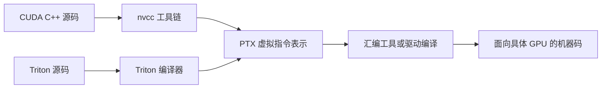

这是学习用的简化图，实际编译链中还有其他中间表示，产物也可能同时携带不同形式的代码。PTX 不是 GPU 最终执行的 SASS 机器指令。

打开原 `square_kernel.ptx`，只需要找三个关键动作：

- `ld.global`：从 global memory 地址读取。
- `mul.f32`：做单精度乘法。
- `st.global`：写回 global memory 地址。

其中 `mul.f32 %f9, %f1, %f1` 表示把一个值乘以自身，结果写入另一个 PTX 寄存器。PTX 寄存器是虚拟寄存器，不能仅靠文本中 `%f` 名称数量断定最终物理寄存器占用；实际占用看编译器信息或 NCU。

文件头有 `Generated by LLVM NVPTX Back-End`、`.target sm_86`，是编译生成物的直接证据。它包含历史源路径，仓库没有给出一个可证明与当前脚本完全同步的导出流程，因此把它当作教学样本，不当作当前 GPU 的最新产物。

第一遍不需要自己编写 PTX。参考 [NVIDIA PTX ISA](https://docs.nvidia.com/cuda/parallel-thread-execution/) 只查感兴趣的指令即可。

### 11.3 调试顺序

首先缩小输入到能打印清楚的规模，和 PyTorch 参考结果对比。然后使用非整块尺寸，例如 15、257、`(3, 5)`。边界测试比只盯着大张量更容易定位错误。

若 CUDA 报错位置滞后，可在**调试运行**时使用：

```bash
CUDA_LAUNCH_BLOCKING=1 python cuda_square_ext.py
```

它让错误更接近发起调用的位置；测性能时取消这个环境变量，否则执行方式已经被改变。[PyTorch CUDA 环境变量](https://docs.pytorch.org/docs/stable/cuda_environment_variables.html)

Triton 可以通过解释模式检查索引和中间值：

```bash
TRITON_INTERPRET=1 python triton_square_impl.py
```

解释模式用 CPU 上的模拟帮助调试，有类型和操作限制，也不能代表 GPU 上的真实性能。本文 wrapper 仍要求 CUDA Tensor，因此这条命令并不把整套实验转换成 Mac 上的无 GPU 程序。原 PDF 中的 `@triton.jit(interpret=True)` 和变量包装细节是历史用法，按当前版本文档使用。[Triton 调试指南](https://triton-lang.org/main/programming-guide/chapter-3/debugging.html)

必要时再用 NVIDIA 的内存检查工具：

```bash
compute-sanitizer --tool memcheck python cuda_square_ext.py
compute-sanitizer --tool memcheck python triton_square_impl.py
```

这些是正确性调试运行，不参与速度比较。当前机器没安装工具时可以先完成 PyTorch 数值校验和边界检查。

<a id="s12"></a>

## 12. 原代码和 PDF 的阅读提醒

### 12.1 原目录不是按顺序执行的教学工程

它包含演示脚本、历史构建目录、性能日志和零散尝试，因此“所有 `.py` 都跑一遍”不是合理的第一步。

| 位置 | 具体提醒 | 本文如何处理 |
|---|---|---|
| `pytorch_square.py` | CUDA Event 每种只测一次，返回值没有打印；大输入先在 CPU 创建再复制 | 实验一输出多轮统计，输入提前在 GPU 创建 |
| `pt_profiler.py` | 循环内混有 CPU 随机数、HtoD 和平方 | 实验二把两种测量范围分开展示 |
| `hello_load_inline.py` | 相对构建目录 `./tmp` 受当前工作目录影响 | 使用基于 `__file__` 的专用目录，并主动创建 |
| `load_inline.py` | 演示输入约束、当前 stream 等处理不完整；尾部是历史错误日志 | 实验四补充基本边界与集成检查；日志只作历史记录 |
| `main.py` | 缺失合法 host wrapper/绑定声明/launch 路径；CPU fallback 也不能让 CUDA kernel 在 CPU 上执行 | 不作为实验入口 |
| `nsys_square.py` | 末尾 `model(inputs)` 未定义 | 用独立、可控范围的采集程序替代 |
| `triton_square.py` | 沿用 softmax 注释；行式布局有列 stride 前提；计时内创建 compile wrapper；只校验单个 shape | 实验五、六逐项解释并建立新的最小程序 |
| `build.ninja`、对象文件 | 固化了历史 Python、编译器和机器路径 | 远程从源程序重新生成 |
| 历史性能日志 | 不同 GPU、不同 kernel 混在一起 | 先核对设备与 kernel 名，再读指标 |

### 12.2 PDF 页码索引：什么时候回看哪一页

页码按 PDF 阅读器从 1 开始计数。

| PDF 页码 | 内容 | 建议回看时机 |
|---|---|---|
| 1～2 | 标题、课程组织 | 略读 |
| 3 | 两个课程目标 | 学习开始时 |
| 4 | 简单 PyTorch 平方 | 实验一之后 |
| 5～6 | Profiler、HtoD、ATen/kernel | 实验二之后；注意第 6 页 `<4>` 的纠正 |
| 7～8 | C++ 扩展和绑定生成 | 实验三之后，对照生成的 `main.cpp` |
| 9 | CUDA 接入 PyTorch | 实验四之后 |
| 10 | Numba | 主线做完后选读 |
| 11～12 | Triton kernel 和性能图 | 实验五、六之后 |
| 13 | `torch.compile` | 实验六之后 |
| 14～15 | 不同 GPU、修改块大小后的结果 | 理解正确性、工作量和缓存影响之后 |
| 16 | Triton 调试 | 遇到索引问题时；接口按当前文档 |
| 17 | PTX | 能读懂 Triton kernel 后选读 |
| 18 | 输出编译生成代码 | `05_compile_inspect.py` 之后；原页代码是示意片段 |
| 19～20 | NCU 命令和界面 | 实验七之后 |
| 21 | occupancy、tail、stall 等优化提示 | 第二遍学习，结合自己的报告 |

第 21 页中“尝试 padding”“使用 shared memory”等提示属于待验证的优化方向，不能当成看到该指标就必须实施的处方。逐元素平方通常没有跨线程复用输入的需求，增加 shared memory 搬运未必有益。Triton 负责许多低层安排，但你选择的布局、tile、访问方式和 launch 配置仍会影响结果。

<a id="s13"></a>

## 13. 分次学习计划与验收

### 13.1 建议拆成四次，不要一天扫完所有工具

| 次数  | 内容                        | 结束时手里应该有什么                     |
| --- | ------------------------- | ------------------------------ |
| 第一次 | 第 0～4 节：环境、平方、计时、Profiler | 一份环境记录、一组基线时间、两份 trace         |
| 第二次 | 第 5～6 节：C++、PyBind、CUDA   | Hello 模块、自己的 CUDA 扩展、通过的正确性检查  |
| 第三次 | 第 7～8 节：Triton、compile、比较 | 三到四种实现的比较表、一份生成代码日志            |
| 第四次 | 第 9～12 节：Nsight、性能解释、支线   | 一份目标 kernel 报告或明确的平台权限限制、自己的结论 |

最重要的产出是能够解释“我运行了什么、验证了什么、测到了什么”，不需要每个工具都记住所有选项。

### 13.2 从零复跑的命令顺序

先根据各节将示例保存到 `study_work/` 并完成环境检查，再在该目录执行：

```bash
python 01_baseline.py
python 02_profile.py
MAX_JOBS=2 python 03_hello_cpp.py
MAX_JOBS=2 python cuda_square_ext.py
python triton_square_impl.py
MAX_JOBS=2 python 04_compare.py
python 05_compile_inspect.py
python 06_profile_target.py --provider torch
```

上面的 `05_compile_inspect.py` 普通执行只检验编译结果；要看到代码日志，使用第 8.3 节带 `TORCH_LOGS` 的命令。随后按第 9 节独立运行 Nsight 命令。

### 13.3 自测问题与参考要点

| 问题 | 能说出的要点 |
|---|---|
| `a * a` 为什么不等于矩阵乘法？ | 对应元素相乘，不做行列内积 |
| 为什么 `.cuda()` 不应放进“只测平方”的计时区？ | 它涉及数据转移和分配，改变了被测任务 |
| Event 的时间单位是什么？ | `elapsed_time` 返回毫秒；展示微秒时乘 1000 |
| Python 拿到输出 Tensor，能否保证 GPU 已完成？ | 不能；同流后续工作有顺序，需要在适当边界等待 |
| PyBind 直接绑定什么？ | CPU 侧 C++ 函数；由 host wrapper 启动 kernel |
| `load_inline_cuda/cuda.cu` 要不要改？ | 维护原 Python 中的源码字符串，在目标机器重新生成 |
| 为什么 `n=1000, threads=256` 仍要边界检查？ | 4 个 block 有 1024 个线程，末尾 24 个越界 |
| Triton `BLOCK_SIZE=1024` 是 1024 个线程吗？ | 不是；它表示 program 覆盖的元素数量 |
| `mask` 是为了解决什么？ | 不足整块的尾部不能读写越界地址 |
| `torch.compile` 的代码谁写？ | 高层计算自己写；后端生成/选择低层执行代码 |
| GB/s 突然大涨首先检查什么？ | 全部 shape 的结果、覆盖范围、计时口径、缓存影响 |
| 为什么 CUDA 扩展不能自动反向传播？ | 原始 kernel 写内存没有自动提供 backward/算子注册 |

### 13.4 一份简短的实验结论模板

```text
环境：GPU 型号；驱动；torch / CUDA Toolkit / Triton 版本。
任务：连续 float32 张量逐元素平方；shape 列表。
正确性：哪些普通/边界输入与 torch.square 比较通过。
测量：输入是否预先在 GPU；是否包含输出分配；预热/重复次数。
结果：各实现的 us 和有效 GB/s；是否反复运行仍有一致趋势。
Profile 观察：目标 kernel 名；有无复制；CPU/GPU 是否出现空闲。
下一步：只改变一个参数或一项实现，并解释希望验证什么。
```

<a id="s14"></a>

## 14. 常见故障与排查顺序

先普通运行，再计时，最后 profile；先小张量，再大张量。

| 现象 | 优先检查 |
|---|---|
| `torch.cuda.is_available()` 为 False | 是否在远程 GPU 节点；驱动/GPU 是否可见；是否装了 CUDA 版 torch；容器是否获得 GPU |
| PyTorch 能运行，但扩展提示找不到 CUDA/nvcc | Toolkit 与运行库是两回事；检查 `nvcc --version`、`CUDA_HOME` 和平台开发镜像 |
| 提示找不到 C++ 编译器或 Ninja | 检查 `c++` 与 `ninja`；pip 的 ninja 包可补构建工具，系统编译器需要系统/平台提供 |
| `CUDA_HOME` 不正确 | 指向实际 Toolkit 根目录，不是 `bin/nvcc` 文件；不要凭空设置到不存在的 `/usr/local/cuda` |
| 编译报告 CUDA/编译器版本不兼容 | 对照 torch 构建 CUDA、nvcc、host compiler；优先恢复平台支持的组合 |
| 编译进程被 Killed | 可能是主机内存不足，先试 `MAX_JOBS=1`；这与 GPU 显存不足不同 |
| `undefined symbol` 或加载旧 `.so` 失败 | 是否复用了别的机器或 torch 版本的构建物；换新的专用 build 目录重新构建 |
| `no kernel image` / unsupported architecture | GPU 架构与当前编译工具/包不兼容；核对支持矩阵，勿照抄历史 PTX 的目标架构 |
| illegal memory access / CUDA 错误稍后才出现 | 检查索引、mask、dtype、device、stride；小输入重现；调试时同步；出现访问错误后重启该 Python 进程 |
| contiguous 检查失败 | 输入可能是转置/切片；可在计时前显式 `x = x.contiguous()`，或以后实现通用 stride kernel |
| CUDA out of memory | 先降到 `1024 × 1024`；检查是否保留了很多输出、同时运行其他进程；不要直接照搬所有大规模扫描 |
| Profiler 没有 CUDA 活动 | 检查 CUDA activity、实际执行设备、CUPTI 支持和警告；不能凭 CPU 时间推断 GPU 时间 |
| `self_cuda_time_total` 等字段变化 | 使用当前版本的 device 命名或本文的兼容选择；表头名称也可能变化 |
| `nsys_square.py` 出现 NameError | 原文件留有 `model(inputs)`；用本文完整目标程序 |
| NCU 只看到随机数 kernel | 没有正确限制范围/目标；使用本文 NVTX 区间，确认 kernel 名 |
| NCU 提示计数器无权限 | 平台权限问题，参照其管理员/服务商流程；并非加一个 Python 包就能解决 |
| SSH 上没有图窗 | 输出报告到文件，下载查看；文本比较无需显示服务器 |
| 首次运行特别慢、第二次快很多 | 编译、上下文初始化、缓存等冷启动；把冷启动与稳态分别记录 |

调试完恢复性能实验条件：取消 `CUDA_LAUNCH_BLOCKING` 和 `TRITON_INTERPRET`，不在 NCU/memcheck 下做正常速度比较。

<a id="s15"></a>

## 15. 官方资料与后续章节

遇到具体问题时查对应文档即可，不必按列表全部读完。

| 想查什么 | 资料 |
|---|---|
| PyTorch 安装组合 | [Get Started](https://pytorch.org/get-started/locally/) |
| `load_inline` 的声明、生成绑定、编译行为 | [C++ Extensions](https://docs.pytorch.org/docs/stable/cpp_extension.html) |
| Python/C++ 绑定基础 | [pybind11 First steps](https://pybind11.readthedocs.io/en/stable/basics.html) |
| Profiler 采集与 trace | [PyTorch Profiler recipe](https://docs.pytorch.org/tutorials/recipes/recipes/profiler_recipe.html) |
| CUDA 异步、stream 和同步 | [PyTorch CUDA semantics](https://docs.pytorch.org/docs/stable/notes/cuda.html) |
| Triton 最小模型 | [Vector Addition](https://triton-lang.org/main/getting-started/tutorials/01-vector-add.html) |
| 原 Triton 行式代码的来源 | [Fused Softmax](https://triton-lang.org/main/getting-started/tutorials/02-fused-softmax.html) |
| 编译器日志 | [torch._logging / TORCH_LOGS](https://docs.pytorch.org/docs/main/logging.html) |
| Nsight 时间线 | [Nsight Systems User Guide](https://docs.nvidia.com/nsight-systems/UserGuide/) |
| Nsight kernel 指标与过滤 | [Nsight Compute CLI](https://docs.nvidia.com/nsight-compute/NsightComputeCli/index.html) |
| 进一步做规范的 PyTorch 自定义算子 | [Custom C++ and CUDA Operators](https://docs.pytorch.org/tutorials/advanced/cpp_custom_ops.html) |

本讲之后，按仓库内容继续：

- `lecture_002`、`lecture_003`：补 CUDA 基础、线程索引与简单 kernel。
- `lecture_004`：补硬件与内存层次，理解访存性能。
- `lecture_008`：系统学习 CUDA 性能优化方法。
- `lecture_014`：深入 Triton 编程。
- `lecture_018`：学习算子融合，让“减少 launch 和中间内存访问”变成具体优化。

完成本讲最有价值的标志，是你能拿到一个新算子，先写参考、验证、测量和 profile，再决定是否以及怎样编写自己的 kernel。
