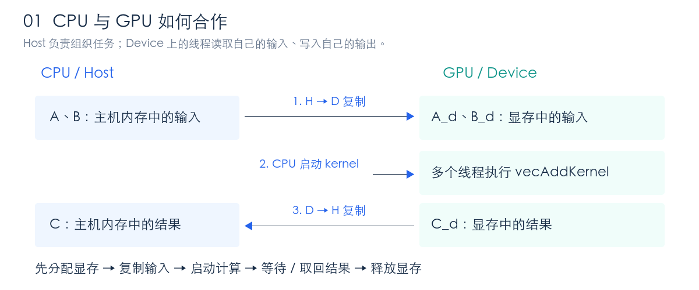
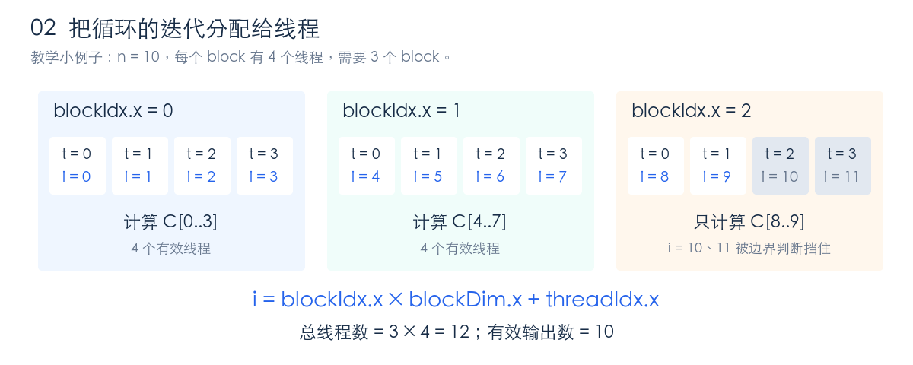
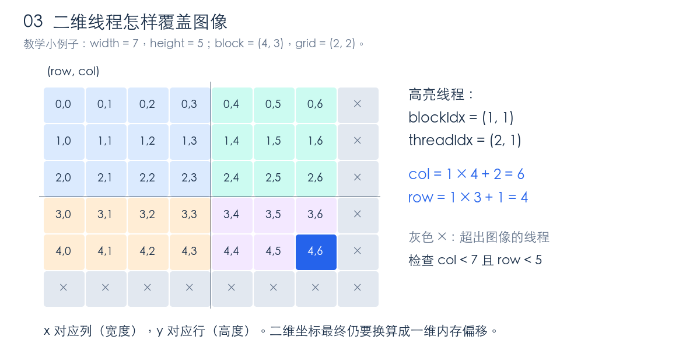
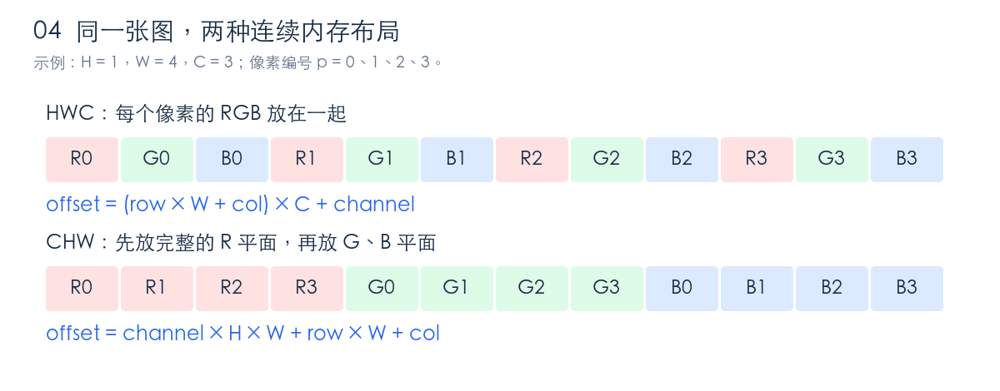
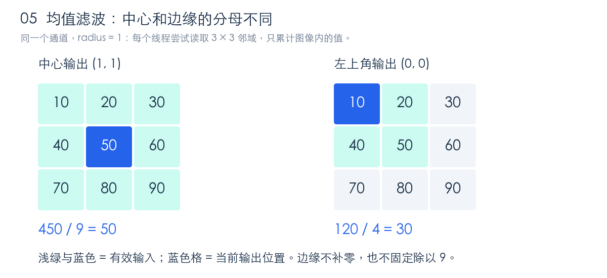

# Lecture 002 入门指南：把数据分给 GPU 线程

> 对应本仓库 Lecture 2：PMPP 第 1～3 章回顾。本文根据本目录的 33 页 PPT 和三个代码示例整理，补充了图解、手算例子和练习。先理解工作如何拆分，再读代码，最后动手验证。
>
> 阅读只需要会看简单的 `for` 循环、数组和函数。运行实验需要 NVIDIA GPU 与 CUDA 开发环境，可在远程 Linux GPU 机器上完成；Mac 可以用来阅读。本文没有在 GPU 上实际编译、运行这些例子，文中的数值例子是手算或 CPU 核对结果。

**这一讲最重要的能力：给定一个输出位置，能够说清楚哪个线程计算它、它读取哪些输入，以及它把结果写到哪里。**

如果上一讲让你看到了“Python 可以调用自己的 GPU kernel”，这一讲就来解释：kernel 内部的工作究竟怎样分配。

## 阅读路线

第一次按顺序读第 1～8 节，先不追求速度优化；第 9 节用矩阵乘法检验理解，第 10 节动手，第 11 节做自测。整份指南围绕下面这条线展开：

```text
工作能否独立拆分？
       ↓
一个线程负责哪个输出？
       ↓
用 grid / block / thread 给它定位
       ↓
把数据坐标换成内存偏移
       ↓
检查边界 → 读取输入 → 计算 → 写回输出
```

- [1. GPU 为什么适合这些任务](#s1)
- [2. CPU、GPU 与 kernel 如何合作](#s2)
- [3. 向量加法：把循环拆给线程](#s3)
- [4. 二维图像：线程坐标与内存地址](#s4)
- [5. 图像布局：HWC、CHW 与 stride](#s5)
- [6. 灰度转换：一个线程生成一个灰度像素](#s6)
- [7. 均值滤波：一个线程读取多个输入](#s7)
- [8. Python 怎样调用这些 CUDA 代码](#s8)
- [9. 用矩阵乘法迁移这套思路](#s9)
- [10. 三个循序渐进的动手实验](#s10)
- [11. 自测与答案](#s11)
- [12. 代码地图与延伸阅读](#s12)

<a id="s1"></a>

## 1. GPU 为什么适合这些任务

### 1.1 先判断工作之间有没有依赖

想计算两个向量的和：

```text
A = [1, 2, 3, 4]
B = [10, 20, 30, 40]
C = [11, 22, 33, 44]
```

CPU 上最直接的写法是：

```cpp
for (int i = 0; i < n; ++i) {
    C[i] = A[i] + B[i];
}
```

关键观察：计算 `C[2]` 不需要等待 `C[0]` 或 `C[1]` 算完。每次迭代读取自己的输入、写自己的输出，可以把这些迭代分给很多线程。

这就是本讲所说的**数据并行**：对不同的数据，执行相同的计算规则。这里与深度学习中“多张 GPU 各处理一部分 batch”的数据并行训练有关联，但本讲讨论的是单个 kernel 内部的任务拆分。

对比下面这个循环：

```cpp
for (int i = 1; i < n; ++i) {
    A[i] = A[i - 1] + B[i];
}
```

这次 `A[i]` 依赖前一步更新后的 `A[i - 1]`。直接让所有线程同时执行这句，会破坏原来的计算顺序。这类任务需要重新设计并行算法，不能机械地把循环变量换成线程编号。

### 1.2 CPU 与 GPU 的分工

可以把 CPU 理解为擅长组织和处理复杂流程的少量工作者，把 GPU 理解为擅长同时处理大量相似工作的执行系统。GPU 的优势来自整体吞吐量；少量计算或频繁的数据搬运可能抵消这份优势。

课程第 1 章讨论功耗与散热对提升频率的限制，由此引出并行计算的意义。这里需要记住的结论是：**想更快完成大规模计算，往往要增加同时处理的工作量，而不只是让一个线程跑得更快。**

### 1.3 为什么 kernel 快 100 倍，整个程序不一定快 100 倍

假设一个程序原来运行 100 毫秒：

- 10 毫秒用于其他部分；
- 90 毫秒用于可以加速的计算。

即使计算部分快了 100 倍，总时间也是：

```text
新时间 = 10 + 90 / 100 = 10.9 ms
整体加速比 = 100 / 10.9 ≈ 9.17 倍
```

忽略额外开销时，Amdahl 定律可写为：

```text
整体加速比 = 1 / ((1 - p) + p / s)
p = 原运行时间中可被加速的比例
s = 这部分自身的加速倍数
```

`p = 0.9` 时，即使计算无限快，整体加速比的极限也只有 10 倍。实际还有传输、启动等成本。因此读后面的显存复制代码时，要把“搬数据”也视为程序工作的一部分。

<a id="s2"></a>

## 2. CPU、GPU 与 kernel 如何合作

### 2.1 先认识三个词

| 术语 | 在本讲中的含义 | 例子 |
|---|---|---|
| Host，主机 | CPU 及其执行的代码 | 分配内存、准备输入、启动 kernel |
| Device，设备 | GPU 及其执行的代码 | 很多线程并行计算数组元素 |
| Kernel，核函数 | 启动后由一批 GPU 线程执行的函数 | `vecAddKernel` |

**Kernel 是代码，thread 是执行这份代码的一个实例。**启动同一个 kernel，很多线程会运行相同的函数体，但通过各自的编号处理不同的数据。



图 1：本讲向量加法的完整数据路径。后缀 `_d` 是“设备端指针”的命名习惯。

### 2.2 对照原代码读完整流程

打开 [vector_addition.cu](vector_addition/vector_addition.cu)，先看 `vecAdd()`，它是运行在 CPU 上的包装函数。

| 步骤 | 代码中的操作 | 意义 |
|---|---|---|
| 1 | `size = n * sizeof(float)` | 计算字节数；`n = 1000` 时，每个向量占 4000 字节 |
| 2 | `cudaMalloc(&A_d, ...)` 等 | 为输入、输出在 GPU 显存分配空间 |
| 3 | `cudaMemcpy(..., cudaMemcpyHostToDevice)` | 把 A、B 从 CPU 复制到 GPU |
| 4 | `vecAddKernel<<<...>>>(...)` | 指定线程组织方式，启动计算 |
| 5 | 检查错误并 `cudaDeviceSynchronize()` | 检查启动状态，等待 GPU 工作完成并检查执行错误 |
| 6 | `cudaMemcpy(..., cudaMemcpyDeviceToHost)` | 把结果复制回 CPU |
| 7 | `cudaFree(...)` | 释放设备内存 |

这里的 `cudaMalloc((void**)&A_d, size)` 看起来复杂，是因为函数要把新分配的地址写入变量 `A_d`，所以需要传入“这个指针变量的地址” `&A_d`。第一遍理解这个目的即可。

上表对分配调用做了简写，完整语法以源文件为准。原例只显式包装了启动检查和同步检查；练习扩展时，`cudaMalloc`、`cudaMemcpy`、`cudaFree` 的返回值也应该检查。

### 2.3 “CPU 发起计算”不等于“GPU 已算完”

Kernel 启动通常相对于 CPU 是异步的：CPU 提交任务后可以继续执行，而 GPU 在相应 stream 中执行它。原向量例子用 `cudaDeviceSynchronize()` 明确等待。

因此，仅测量 `kernel<<<...>>>()` 这条语句在 CPU 上返回的时间，不能代表完整的 GPU 执行时间。上一讲的 CUDA Event、同步和预热方法仍然适用。这里先以结果正确为目标。[CUDA 异步执行文档](https://docs.nvidia.com/cuda/cuda-programming-guide/02-basics/asynchronous-execution.html)

<a id="s3"></a>

## 3. 向量加法：把循环拆给线程

### 3.1 Grid、block、thread 是怎样的层级

一次 kernel 启动会创建一个 **grid（网格）**。Grid 由多个 **block（线程块）**组成，每个 block 包含多个 **thread（线程）**。

```text
一次 vecAddKernel 启动
└── grid
    ├── block 0：thread 0、1、2、3 ...
    ├── block 1：thread 0、1、2、3 ...
    └── block 2：thread 0、1、2、3 ...
```

每个 block 内的线程编号都会从 0 重新开始，所以只用 `threadIdx.x` 无法定位整个向量中的元素。

| CUDA 变量 | 回答的问题 | 注意 |
|---|---|---|
| `threadIdx.x` | 我是本 block 的第几个线程？ | 从 0 开始 |
| `blockIdx.x` | 我所在的 block 是第几个？ | 从 0 开始 |
| `blockDim.x` | 每个 block 的 x 方向有多少线程？ | 是数量，不是编号 |
| `gridDim.x` | Grid 的 x 方向有多少 block？ | 是 block 数，不是线程总数 |

它们还都有 `.y`、`.z` 分量。向量先使用 `.x` 即可；默认未使用的维度大小为 1。[CUDA 线程层级文档](https://docs.nvidia.com/cuda/cuda-programming-guide/02-basics/writing-cuda-kernels.html#thread-hierarchy)

### 3.2 推导全局索引，而不是背公式

假设每个 block 有 4 个线程，当前线程位于 `block 2`，块内编号为 `1`：

```text
前面的 block 已经覆盖：2 × 4 = 8 个位置
再加块内位置：1
所以当前线程负责：i = 9
```

得到公式：

```cpp
int i = blockIdx.x * blockDim.x + threadIdx.x;
```



图 2：这里的 4 线程 block 只用于把索引画清楚。原代码使用 256 个线程。

### 3.3 逐行看懂 kernel

下面就是原例的核心逻辑：

```cpp
__global__ void vecAddKernel(float *A, float *B, float *C, int n) {
    int i = threadIdx.x + blockDim.x * blockIdx.x;
    if (i < n) {
        C[i] = A[i] + B[i];
    }
}
```

- `__global__`：声明 GPU kernel；本例由 CPU 使用启动语法调用。
- `float *A` 等：设备内存中的数组首地址。本例不能把普通 CPU 数组指针直接传来使用。
- `int i = ...`：每个线程算出自己的工作位置。
- `if (i < n)`：只允许有效位置访问数组。
- `C[i] = ...`：当前线程只负责这一个输出。

把 CPU 循环里的 `i`，换成每个线程独立算出的 `i`，就完成了这次任务拆分。每个线程有自己的局部变量 `i`，不会因为变量同名而互相覆盖。

顺便区分几个函数修饰符：普通 C++ 函数默认运行在 CPU；`__device__` 函数供 GPU 代码调用；`__host__ __device__` 表示同时编译 CPU 和 GPU 版本。`__global__` 与“全局内存”中的 global 是不同概念。

### 3.4 为什么需要向上取整和边界判断

启动语法中，前一个参数是 block 数，后一个是每个 block 的线程数：

```cpp
vecAddKernel<<<numBlocks, numThreads>>>(A_d, B_d, C_d, n);
```

原例中：

```cpp
numThreads = 256;
numBlocks = (n + numThreads - 1) / numThreads;
```

对于正整数 `n` 和 `numThreads`，这就是整数的向上取整除法。以原例 `n = 1000` 为例：

```text
numBlocks = (1000 + 255) / 256 = 4   ← 整数除法
总线程数 = 4 × 256 = 1024
有效线程：i = 0 ... 999
多余线程：i = 1000 ... 1023，只通过边界判断，不读写数组
```

如果直接用 `1000 / 256`，只会创建 3 个 block，后面的 232 个元素没有线程计算。如果向上取整却去掉 `if (i < n)`，最后 24 个线程会越界访问。

**向上取整负责“全部覆盖”，边界判断负责“安全访问”。两者要配套。**

### 3.5 线程数量与硬件核心数量是什么关系

线程是逻辑上的工作实例，不要求与 GPU 物理计算核心一一对应。GPU 可以分批调度大量线程；不用担心启动的总线程数超过核心数。

硬件把一个 block 内的线程组成每组 32 个的 **warp**；block 被安排到 **SM（流式多处理器）**上执行，一个 SM 可以容纳多个 block，具体受资源限制。普通 kernel 中，不同 block 的执行顺序不能作为算法依赖。[CUDA 编程模型](https://docs.nvidia.com/cuda/cuda-programming-guide/01-introduction/programming-model.html)

这一遍先记住：`grid → block → thread` 用来组织工作，warp 和 SM 用来理解执行硬件。原例的 256 线程是教学起点，并不保证对所有 kernel 都最快。
![[Pasted image 20261021211954.png|920]]

<a id="s4"></a>

## 4. 二维图像：线程坐标与内存地址

向量只有位置 `i`，图像通常要用 `(row, col)`。我们自然地让线程的 x 方向对应列、y 方向对应行：

```cpp
int col = blockIdx.x * blockDim.x + threadIdx.x;
int row = blockIdx.y * blockDim.y + threadIdx.y;
```

这只是把一维的“块起点 + 块内位置”分别沿两个方向计算了一遍。

### 4.1 二维启动参数如何计算

灰度例子采用：

```cpp
dim3 threads_per_block(16, 16);
dim3 number_of_blocks(
    cdiv(width,  threads_per_block.x),
    cdiv(height, threads_per_block.y)
);
```

一个 block 有 `16 × 16 = 256` 个线程。注意 `dim3(16, 16)` 的第三维默认为 1；`dim3` 并不表示一定要使用三个维度。

为了看清边界，我们把图缩小，使用 `7 × 5` 图像和 `4 × 3` 的 block：



图 3：四种底色对应四个 block。线程坐标采用 `(x, y)`，图像格子标注 `(row, col)`，因此阅读时注意顺序。

这时 `grid = (ceil(7/4), ceil(5/3)) = (2, 2)`，创建 48 个线程处理 35 个像素。边界条件应当同时检查两个方向：

```cpp
if (col < width && row < height) {
    // 访问有效像素
}
```

线程计算出的 row、col 都非负，因此这里不必额外检查负数；后面滤波中的邻居坐标可能为负，需要再检查。

### 4.2 二维坐标最终怎样落到一维内存

对连续、按行排列的单通道图像：

```text
图像：                 内存顺序：
a b c d                a b c d e f g h i j k l
e f g h
i j k l                ← 这一行的起点是 2 × 4 = 8
```

行宽 `width = 4` 时，像素 `(row = 2, col = 1)` 的位置为：

```text
offset = row × width + col = 2 × 4 + 1 = 9
```

一般公式：

```cpp
int offset = row * width + col;
```

这里要区分三个动作：**线程坐标用于确定谁干活，数据坐标用于确定算哪里，内存偏移用于确定读写地址。**二者在简单例子里恰好对应，但并不是天生相同。

<a id="s5"></a>

## 5. 图像布局：HWC、CHW 与 stride

本目录两个图像例子使用的布局不同，这是最容易“shape 看起来正确，结果却错了”的地方。

### 5.1 H、W、C 表示什么

- `H`：height，高度，即行数。
- `W`：width，宽度，即列数。
- `C`：channels，通道数；RGB 图像有红、绿、蓝三个通道。

相同的彩色图像可以以不同顺序放进一维内存：



图 4：`R0` 表示第 0 个像素的红色通道。HWC 相邻的是同一像素的通道；CHW 相邻的是同一通道的像素。

对**连续存储**的数据：

| 布局  | Tensor shape | 地址偏移                              | 本目录用途      |
| --- | ------------ | --------------------------------- | ---------- |
| HWC | `[H, W, C]`  | `(row * W + col) * C + channel`   | 灰度转换的输入    |
| CHW | `[C, H, W]`  | `channel * H * W + row * W + col` | 均值滤波的输入、输出 |

举例：`H = 2, W = 3, C = 3`，访问 `(row = 1, col = 2, channel = 1)`：

```text
HWC 偏移 = (1 × 3 + 2) × 3 + 1 = 16
CHW 偏移 = 1 × 2 × 3 + 1 × 3 + 2 = 11
```

坐标描述同一个图像元素，偏移却不同，因为存储规则不同。这些是**元素偏移**；若要换成字节偏移，还要乘以元素大小。本讲图像是 `uint8`，每个元素刚好 1 字节。

### 5.2 Shape 不足以描述布局，还要看 stride

理解这一节，先把 **“用什么坐标访问元素”** 和 **“元素实际放在内存哪里”** 分开：

- `shape`：每个维度有多少元素，决定合法的索引范围。
- `stride`：某个维度的索引加 1，其他索引不变时，内存位置要前进多少个**元素**。单位不是字节，也不是这一维的长度。[PyTorch stride 文档](https://docs.pytorch.org/docs/stable/generated/torch.Tensor.stride.html)

**① 先从二维数组理解：stride 就是把坐标换成内存偏移的系数**

假设一个连续二维张量 `a`，`shape = (2, 3)`：

```text
按行列看：              底层一维内存：
[[10, 11, 12],          元素偏移   0   1   2   3   4   5
 [13, 14, 15]]          存储的值  10  11  12  13  14  15
```

从 `a[0, 0]` 到 `a[1, 0]`，要前进 3 个元素；从 `a[0, 0]` 到 `a[0, 1]`，只前进 1 个元素，所以 `stride = (3, 1)`。

```text
a[row, col] 的元素偏移 = row × stride[0] + col × stride[1]
a[1, 2]    的元素偏移 =   1 × 3         +   2 × 1         = 5
```

前面熟悉的 `row * width + col`，就是把连续二维数组的 `stride = (width, 1)` 代入了这个公式。推广到三维：

```text
x[i, j, k] 的元素偏移 = i × stride[0] + j × stride[1] + k × stride[2]
```

这里偏移相对于该张量首元素，即 `x.data_ptr()` 指向的位置；换算成字节地址，还要乘以 `x.element_size()`。如果从整块底层 storage 的起点计算，则还要加上 `x.storage_offset()`，因为切片的首元素可能位于 storage 中间。

**② 再看连续 CHW：为什么 stride 是 `(H × W, W, 1)`？**

沿用上一节的 `H = 2, W = 3, C = 3`。为了容易辨认，令红色通道的值为 `10～15`，绿色为 `20～25`，蓝色为 `30～35`。连续 CHW 张量 `x` 的内存如下：

```text
元素偏移：  0  1  2  3  4  5 |  6  7  8  9 10 11 | 12 13 14 15 16 17
存储的值： 10 11 12 13 14 15 | 20 21 22 23 24 25 | 30 31 32 33 34 35
通道：     ------ R ------   | ------ G ------   | ------ B ------
```

`x` 用 `x[channel, row, col]` 访问：

| 哪个索引加 1 | 内存前进多少元素 | 原因 |
|---|---|---|
| `channel` | `H × W = 6` | 跨过一整张单通道图 |
| `row` | `W = 3` | 跨过同一通道的一行 |
| `col` | `1` | 同一通道、同一行的相邻元素紧挨着 |

因此 `shape = (3, 2, 3)`，`stride = (6, 3, 1)`。

**③ `permute` 改变了索引的顺序，内存里的值仍按原顺序摆放**

执行 `y = x.permute(1, 2, 0)`，表示新张量的第 0、1、2 维，分别取原张量的第 1、2、0 维。shape 和 stride 都按这个顺序重排：

```text
                    原 x：CHW              新 y：HWC 视图
索引方式            x[channel, row, col]   y[row, col, channel]
shape               (C, H, W)              (H, W, C)
stride              (H×W, W, 1)            (W, 1, H×W)
本例具体 stride     (6, 3, 1)              (3, 1, 6)
```

“视图”表示 `x` 和 `y` 共享底层存储。`permute` 没有把上面内存中的 `10, 11, 12, ...` 搬成 RGB 交错的顺序。[PyTorch permute 文档](https://docs.pytorch.org/docs/stable/generated/torch.permute.html)

例如第 0 行、第 1 列像素的绿色值，用两种索引都能正确读到：

```text
x[1, 0, 1]：偏移 = 1×6 + 0×3 + 1×1 = 7 → 值为 21
y[0, 1, 1]：偏移 = 0×3 + 1×1 + 1×6 = 7 → 值为 21
```

所以 **`y` 已经可以按 HWC 的坐标取值，但同一像素的 R、G、B 在物理内存中仍相隔 6 个元素。**PyTorch 的索引操作会使用 stride，所以 `y[0, 1, :]` 正确得到 `[11, 21, 31]`。

**④ `.contiguous()` 按当前维度顺序整理内存，shape 和元素值保持不变**

执行 `z = y.contiguous()` 后，本例会分配新存储，把同一像素的三个通道放到一起：

```text
y 的底层存储：10 11 12 13 14 15 | 20 21 22 23 24 25 | 30 31 32 33 34 35
z 的底层存储：10 20 30 | 11 21 31 | 12 22 32 | 13 23 33 | 14 24 34 | 15 25 35
                       每组是一个像素的 R、G、B
```

`z` 的列索引加 1 要跨过 3 个通道，行索引加 1 要跨过 `W × C = 9` 个元素，因此：

| 张量 | shape | stride | 默认 `is_contiguous()` |
|---|---|---|---|
| `x`：连续 CHW | `(3, 2, 3)` | `(6, 3, 1)` | `True` |
| `y`：由 `x` permute 得到的 HWC 视图 | `(2, 3, 3)` | `(3, 1, 6)` | `False` |
| `z`：连续 HWC | `(2, 3, 3)` | `(9, 3, 1)` | `True` |

**`y` 和 `z` 的 shape 完全相同，逐坐标取出的值也完全相同，但内存排列不同。**这就是“shape 不足以描述布局”的具体含义。

这里的“连续”指默认 `torch.contiguous_format`：按当前维度顺序遍历时，最后一维变化最快，元素在内存中依次相邻。一般连续 HWC 的 stride 为 `(W × C, C, 1)`。`.contiguous()` 根据张量当前的维度顺序整理数据；若输入已经符合要求，就返回输入本身。[PyTorch contiguous 文档](https://docs.pytorch.org/docs/stable/generated/torch.Tensor.contiguous.html)

注意：上表中 `x` 也是连续的，所以只检查 `is_contiguous()` 还不够，还要确认维度的含义和 shape 符合 kernel 的要求。直接对 CHW 的 `x` 调 `.contiguous()` 仍然是 CHW；本例要先 `permute`，再 `.contiguous()`。

**⑤ 为什么 PyTorch 取值正确，手写 CUDA kernel 却可能算错？**

本讲灰度 kernel 用的是裸指针，写死了 `input[(row * W + col) * 3 + channel]`，没有读取 Tensor 的 stride。对刚才的绿色值 `(row=0, col=1, channel=1)`：

```text
y 的正确偏移：0×3 + 1×1 + 1×6 = 7 → 值为 21
kernel 的偏移：(0×3 + 1)×3 + 1 = 4 → 在 y 的存储中读到 14，错了
kernel 的偏移：(0×3 + 1)×3 + 1 = 4 → 在 z 的存储中读到 21，正确
```

这类错误可能不会越界，也不会报错，只是把其他位置的值当成了当前像素的通道。要支持 `y` 这样的布局，kernel 就需要接收并使用实际 stride：

```cpp
// 对按 [H, W, C] 索引的输入，sH、sW、sC 分别来自 stride(0)、stride(1)、stride(2)
int offset = row * sH + col * sW + channel * sC;
```

本讲选择先整理为连续 HWC，让已有 kernel 的固定索引公式成立。

**可以在 CPU 上运行这个小例子，不需要 CUDA：**

```python
import torch

x = torch.tensor([
    [[10, 11, 12], [13, 14, 15]],  # R
    [[20, 21, 22], [23, 24, 25]],  # G
    [[30, 31, 32], [33, 34, 35]],  # B
], dtype=torch.uint8)
y = x.permute(1, 2, 0)
z = y.contiguous()

for name, t in [("x", x), ("y", y), ("z", z)]:
    print(name, tuple(t.shape), t.stride(), t.is_contiguous())

print(y[0, 1, :].tolist(), z[0, 1, :].tolist())
print(torch.equal(y, z))
print(x.data_ptr() == y.data_ptr(), y.data_ptr() == z.data_ptr())
```

预期输出：

```text
x (3, 2, 3) (6, 3, 1) True
y (2, 3, 3) (3, 1, 6) False
z (2, 3, 3) (9, 3, 1) True
[11, 21, 31] [11, 21, 31]
True
True False
```

最后两行说明：`y` 和 `z` 的逐元素值相等；本例 `x` 和 `y` 的首元素地址相同，而 `z` 使用了新的存储。

### 5.3 原灰度脚本的一处重要提醒

原 [rgb_to_grayscale.py](rgb_to_grayscale/rgb_to_grayscale.py) 写的是：

```python
x = read_image("Grace_Hopper.jpg").permute(1, 2, 0).cuda()
```

这里没有显式保证连续 HWC。`.cuda()` 默认使用 `torch.preserve_format`，不能把它当成“自动整理为 HWC 连续存储”。结合上面的 stride 规则，可以看出这条路径存在布局不匹配的风险。[Tensor.cuda 文档](https://docs.pytorch.org/docs/stable/generated/torch.Tensor.cuda.html)

`read_image` 返回张量的实际 stride 取决于解码实现；有的返回值虽为 CHW 形状，底层已经按 HWC 排列，此时 permute 后恰好连续。因此，不能仅凭这行代码断定原照片必然算错，应该检查实际的 `x.stride()` 和 `x.is_contiguous()`。

**学习时建议明确写出：**

```python
x = read_image("Grace_Hopper.jpg").permute(1, 2, 0).contiguous().cuda()
assert x.is_contiguous()
```

本文第 10 节会这样运行灰度示例，不需要改动原脚本。遇到自定义 kernel 时，先检查 `device / dtype / shape / stride`，不要只看它有没有报错。原包装函数只检查 CUDA 和字节类型，并未完整验证三通道、维数和连续性。

<a id="s6"></a>

## 6. 灰度转换：一个线程生成一个灰度像素

打开 [grayscale_kernel.cu](rgb_to_grayscale/grayscale_kernel.cu)。每个线程负责一个输出位置 `(row, col)`，读这个像素的三个输入通道，写一个灰度值。
![[Pasted image 20261021213012.png]]
### 6.1 先做一个手算

原 kernel 使用：

```text
gray = 0.21 × R + 0.71 × G + 0.07 × B
```

若某像素是 `R = 100, G = 150, B = 200`：

```text
gray = 21 + 106.5 + 14 = 141.5
转换成 unsigned char 后得到 141
```

绿色权重较大，用加权和近似亮度。这里先关注这个计算怎样分配到线程。

**讲义与代码有一个差异：**PPT 第 9 页写绿色系数 `0.72`，源码写 `0.71`。本文按源码解释和验证，所以权重之和是 `0.99`；纯白输入 `(255,255,255)` 会得到约 `252.45`，再截断为 `252`。不要拿另一套灰度系数的图像库输出要求它逐像素完全相等。

### 6.2 代码中的每个偏移为什么这样写

```cpp
int outputOffset = row * width + col;
int inputOffset  = (row * width + col) * 3;

unsigned char r = input[inputOffset + 0];
unsigned char g = input[inputOffset + 1];
unsigned char b = input[inputOffset + 2];

output[outputOffset] =
    (unsigned char)(0.21f * r + 0.71f * g + 0.07f * b);
```

输入是连续 HWC，三个通道紧挨着，所以先找到第几个像素，再乘以 3。输出每个像素只有一个通道，所以不用乘以 3。包装函数为输出创建的 shape 是 `[H, W, 1]`。

`unsigned char` 对应这里的 `torch.uint8`，范围是 0～255；`0.21f` 中的 `f` 表示单精度浮点常量。对本例的非负且在范围内的结果，转为字节会舍去小数部分。

### 6.3 为什么线程之间不需要等对方

计算像素 `(2, 3)` 的灰度值，不需要其他像素的输出。所有线程只读输入，每个线程写不同的输出位置，因此本 kernel 不需要线程间同步。

先记住这份任务说明：

```text
一个线程 → 一个输出像素
读取输入 → 同一像素的 R、G、B
计算规则 → 加权求和
输出地址 → row × width + col
```

<a id="s7"></a>

## 7. 均值滤波：一个线程读取多个输入

均值滤波就是：用一个像素附近的平均值，替换它原来的值。周围的亮暗差异被平均后，图像看起来更模糊。

打开 [mean_filter_kernel.cu](mean_filter/mean_filter_kernel.cu)。与灰度例子相比，它的关键变化是：**一个输出要读取一片邻域，但每个输出仍然可以独立计算。**

### 7.1 Radius 决定邻域大小

```text
radius = 1 → 向上下左右各扩 1 个位置 → 3 × 3 邻域
radius = 2 → 5 × 5 邻域
radius = 8 → 17 × 17 邻域
一般边长 = 2 × radius + 1
```

原 Python 脚本传入 `radius = 8`。为了理解，先从 `radius = 1` 开始。



图 5：图中只画一个通道。中心位置读 9 个值，左上角只读 4 个有效值。

### 7.2 手算中心与边缘

输入一个通道：

```text
10 20 30
40 50 60
70 80 90
```

中心输出 `(1, 1)` 可以读取完整的 3×3 窗口：

```text
(10 + 20 + 30 + 40 + 50 + 60 + 70 + 80 + 90) / 9 = 50
```

左上角 `(0, 0)` 的邻域有一部分落在图像外。原代码跳过这些位置，只对有效值求平均：

```text
(10 + 20 + 40 + 50) / 4 = 30
```

它采用“有效区域平均”，不是补零后固定除以 9。两种方法会让边缘亮度不同，做正确性比较时要采用相同规则。

对这个输入，完整输出应为：

```text
30 35 40
45 50 55
60 65 70
```

### 7.3 第三个线程维度在这里做什么

原例输入为连续 CHW，并使用：

```cpp
dim3 threads_per_block(16, 16, channels);
```

对于 RGB，`channels = 3`，每个 block 有 `16 × 16 × 3 = 768` 个线程。每个空间位置对应三个线程，分别计算 R、G、B 的均值。

```cpp
int col = blockIdx.x * blockDim.x + threadIdx.x;
int row = blockIdx.y * blockDim.y + threadIdx.y;
int channel = threadIdx.z;
int baseOffset = channel * height * width;
```

为什么 channel 没有 `blockIdx.z`？因为这份实现的 `gridDim.z = 1`，一个 block 的 z 维已经覆盖全部通道；若以后把通道拆到多个 z 方向 block，就要重新设计索引。

当前线程负责的是 **一个 `(channel, row, col)` 输出元素**，不是一次处理完整 RGB 像素。

### 7.4 双重循环仍然存在，为什么还叫并行

下面是原逻辑的等价整理，保留了核心计算：

```cpp
int sum = 0;
int count = 0;

for (int dy = -radius; dy <= radius; ++dy) {
    for (int dx = -radius; dx <= radius; ++dx) {
        int r = row + dy;
        int c = col + dx;
        if (r >= 0 && r < height && c >= 0 && c < width) {
            sum += input[baseOffset + r * width + c];
            count += 1;
        }
    }
}
output[baseOffset + row * width + col] = (unsigned char)(sum / count);
```

并行的是**不同输出位置之间的计算**；一个线程内部仍然顺序遍历自己的邻域。GPU kernel 完全可以有循环。这里 `sum`、`count` 都是整数，整数除法会截掉小数；用整数累加也避免了把总和直接放进 8 位变量造成溢出。

需要区分两种边界检查：外层的 `row / col` 检查决定“当前线程是否有有效输出”，内层的 `r / c` 检查决定“当前邻居是否可以读取”。

### 7.5 大家读了同一个像素，会产生冲突吗

相邻输出的邻域会重叠，所以多个线程会读取同一个输入元素。**共同读取本身没有数据竞争**；它们又写入各自独立的输出数组位置，因此这里无需线程间同步。

但若把输入、输出改成同一块内存，一个线程写出的滤波结果可能被另一个线程当成原始输入读走，结果就依赖执行顺序。原代码分配独立 `result`，保留了所有线程读取的原图。

### 7.6 为什么它比灰度转换更值得优化访存

灰度转换每个线程读取三个通道值。均值滤波在图像内部，每个线程会读取 `(2r+1)²` 个值；`r = 8` 时为 289 个，而且相邻线程反复读取重叠区域。

这引出了后续章节的 shared memory 与 tiling：让一组线程合作载入一片输入，再复用它。本讲先写对直接读取版本。三个原例都没有使用 `__shared__` 或 `__syncthreads()`。

线程块的维度也有实际限制：总线程数要满足设备与 kernel 的限制。`16×16×C` 对 RGB 是 768；不能把它无条件推广到任意通道数，例如 `C = 8` 会得到 2048 个线程，超过本课程所用常规 CUDA block 的 1024 上限。上限也不是推荐值或速度保证。

<a id="s8"></a>

## 8. Python 怎样调用这些 CUDA 代码

两个图像例子沿用了上一讲的 `load_inline` 路径：

```text
Python：ext.mean_filter(x, radius)
    ↓ 自动生成的 Python / C++ 绑定
C++ host 包装函数：mean_filter(torch::Tensor image, int radius)
    ↓ 检查输入、创建输出、计算 grid 和 block
CUDA 启动：mean_filter_kernel<<<grid, block, 0, stream>>>(...)
    ↓
GPU：每个线程计算一个输出元素
```

注意包装函数和 kernel 的区别：它们都在 `.cu` 文件中，但包装函数没有 `__global__`，运行在 CPU 上。文件后缀并不意味着文件里的所有函数都运行在 GPU。

### 8.1 `load_inline` 做了哪些事

Python 的 `compile_extension()` 读取 `.cu` 文件，提供 C++ 函数声明，再调用 `load_inline` 编译扩展。`functions=["mean_filter"]` 指定需要暴露给 Python 的 host 函数。

第一次运行包含编译和加载时间，后续可复用构建缓存。它并不是在每个像素计算时重新编译代码。安装 PyTorch 不等于已经具备编译扩展所需的 `nvcc` 和 C++ 编译器。[PyTorch C++ Extensions](https://docs.pytorch.org/docs/stable/cpp_extension.html)

### 8.2 启动语法的四个参数

```cpp
kernel<<<grid, block, shared_memory_bytes, stream>>>(arguments);
```

| 参数 | 本例中的意义 |
|---|---|
| `grid` | 每个方向有多少 block |
| `block` | 每个 block 在每个方向有多少线程 |
| 第三个参数 `0` | 请求的动态共享内存为 0 字节 |
| 第四个参数 | 使用 PyTorch 当前 CUDA stream |

`image.data_ptr<unsigned char>()` 取得 Tensor 的设备数据指针；`result` 创建在 GPU 上，kernel 会直接把结果写入它。返回 Python 的 `y` 仍是 GPU Tensor，直到 `.cpu()` 才复制回 CPU。

### 8.3 错误检查和等待不是同一回事

`C10_CUDA_KERNEL_LAUNCH_CHECK()` 检查 CUDA 启动错误状态，不等同于等待所有 GPU 工作完成。做小规模调试验证时，可在调用后添加 `torch.cuda.synchronize()`，让执行阶段的问题尽早出现。

这些代码适合作为教学起点。原包装函数没有完整的输入形状、连续性检查，也未展示通用的多 GPU 设备切换处理；本文练习限定在当前单 GPU、三通道、非空连续张量。先在这个明确的范围内理解索引。

<a id="s9"></a>

## 9. 用矩阵乘法迁移这套思路

PPT 最后引入矩阵乘法；本目录没有独立的矩阵乘法 `.cu` 文件。下面是帮助理解的补充推导，不是原仓库实现。

设 `A` 为 `M × K`，`B` 为 `K × N`，输出 `C` 为 `M × N`。仍然先决定：**一个线程负责一个输出 `C[row, col]`。**

```text
             B 的第 col 列
                   ↓
A 的第 row 行 → 点积 → C[row, col]
```

例如：

```text
A = [1 2]     B = [5 6]     C = [19 22]
    [3 4]         [7 8]         [43 50]

C[0,1] = 1×6 + 2×8 = 22
```

对应的 kernel 核心可以写成下面这样，假设三个矩阵都是连续、按行存储的 `float`：

```cpp
// kernel 内部的核心片段；不是完整可编译文件
int col = blockIdx.x * blockDim.x + threadIdx.x;
int row = blockIdx.y * blockDim.y + threadIdx.y;
if (row < M && col < N) {
    float sum = 0.0f;
    for (int k = 0; k < K; ++k) {
        sum += A[row * K + k] * B[k * N + col];
    }
    C[row * N + col] = sum;
}
```

和均值滤波一样，一个输出要读多个输入，线程内部也保留一个累加循环。差别在于：滤波读空间邻域，矩阵乘法读一行和一列。后续的矩阵分块优化会改变“如何高效读取与复用输入”，这里先掌握最直接的任务划分。

<a id="s10"></a>

## 10. 三个循序渐进的动手实验

以下命令在**远程 NVIDIA GPU 机器**上运行，假设仓库位于 `~/gpu-mode-lectures`；若实际位置不同，替换命令中的路径。使用已经配置好的兼容 PyTorch、torchvision 和 CUDA Toolkit 环境。原 README 记录的是 PyTorch 2.1.2，它是课程当时的环境说明，不必为了阅读本文先降级现有环境。

先检查：

```bash
nvidia-smi
nvcc --version
c++ --version
ninja --version
python -c "import torch, torchvision; print(torch.__version__, torchvision.__version__); print(torch.cuda.is_available())"
```

如果 PyTorch 能用 CUDA，但找不到 `nvcc`，说明“能运行已有 CUDA 算子”和“能编译自己的 CUDA 扩展”这两个条件还没有同时满足。

### 实验一：向量加法，先预测再运行

```bash
cd ~/gpu-mode-lectures/lecture_002/vector_addition
make NVCC="$(command -v nvcc)"
./vector_addition
```

Makefile 默认的 CUDA 路径是 `/usr/local/cuda`；上面的参数可覆盖编译器路径。如果 Toolkit 安装在其他位置，Makefile 的 include / library 路径也要相应匹配。

原输入是 `A[i] = i`，`B[i] = i / 1000.0f`，所以输出前三项应约为：

```text
0.000, 1.001, 2.002
```

先回答，再运行：`n = 1000`，block 大小 256，应该有多少个 block？最后一个 block 有多少个线程真正计算？答案是 **4 个 block，最后一个有 232 个有效线程**。

接着可把 `numThreads` 改为 128，再编译运行。输出应保持一致，block 数变成 8。这说明计算结果应由任务与输入决定，而不是由你选择的 block 大小决定。

### 实验二：灰度转换，显式保证布局并验证

这段命令复用原编译函数，但明确添加 `.contiguous()`；不会修改原脚本。会在该目录写出 `output.png`。

```bash
cd ~/gpu-mode-lectures/lecture_002/rgb_to_grayscale
python - <<'PY'
import torch
from torchvision.io import read_image, write_png
from rgb_to_grayscale import compile_extension

ext = compile_extension()
x = read_image("Grace_Hopper.jpg").permute(1, 2, 0).contiguous().cuda()
assert x.ndim == 3 and x.shape[2] == 3
assert x.dtype == torch.uint8 and x.is_contiguous()
y = ext.rgb_to_grayscale(x)
torch.cuda.synchronize()

# 按源码的同一组系数生成参考；浮点融合可能在整数截断边界造成 1 的差别。
f = x.float()
ref = (0.21 * f[..., 0] + 0.71 * f[..., 1] + 0.07 * f[..., 2]).to(torch.uint8)
error = (y[..., 0].to(torch.int16) - ref.to(torch.int16)).abs()
print("shape / stride:", x.shape, x.stride())
print("max pixel error:", error.max().item())
assert error.max().item() <= 1

# 单像素手算例子：141.5 截断成 141。
pixel = torch.tensor([[[100, 150, 200]]], dtype=torch.uint8, device="cuda")
assert ext.rgb_to_grayscale(pixel).item() == 141
write_png(y.permute(2, 0, 1).contiguous().cpu(), "output.png")
print("单像素验证通过；已保存 output.png")
PY
```

看图之外，还做数值比较：内存布局出错有时仍能生成一张图片，“成功保存文件”并不能证明算法正确。若误差超过 1，优先检查输入的 shape、dtype、连续性和系数。

### 实验三：用九个数验证滤波边界

先用小数据验证规则，然后再跑大图。小图更容易发现分母或偏移写错的问题。

```bash
cd ~/gpu-mode-lectures/lecture_002/mean_filter
python - <<'PY'
import torch
from mean_filter import compile_extension

ext = compile_extension()
plane = torch.tensor([[10, 20, 30], [40, 50, 60], [70, 80, 90]], dtype=torch.uint8)
# 连续 CHW；三个通道使用相同的小矩阵，便于同时检查通道索引。
x = plane.unsqueeze(0).repeat(3, 1, 1).contiguous().cuda()
y = ext.mean_filter(x, 1)
expected = torch.tensor([[30, 35, 40], [45, 50, 55], [60, 65, 70]], dtype=torch.uint8)
expected = expected.unsqueeze(0).repeat(3, 1, 1)
assert torch.equal(y.cpu(), expected)
print("中心、边缘、三个通道的结果均符合手算")
PY

python mean_filter.py
```

第二个命令对原照片执行 `radius = 8` 的滤波并保存 `output.png`。两个图像子目录各有自己的输出文件。

想继续练习，可以把三个输入通道分别设为不同常数，例如 R 全 10、G 全 20、B 全 30。滤波后各通道应保持原常数，边缘也不应变暗；这能进一步检查通道是否混淆。

**关于速度，先带走一个判断：**向量加法每个 `float` 输出只做一次加法，却要读两个 4 字节输入、写一个 4 字节输出。按源码访问量估算是 12 字节对应 1 次浮点加法，通常更值得关注数据传输和访存，而不是加法指令本身。具体速度仍需测量，本指南没有给出 GPU 实测加速比。

<a id="s11"></a>

## 11. 自测与答案

先遮住答案，尝试自己说出来。能够解释原因，比记住术语更有用。

1. 为什么 `threadIdx.x` 不能单独作为整个向量的下标？
2. `blockIdx.x = 3`、`blockDim.x = 256`、`threadIdx.x = 17`，全局索引是多少？
3. `n = 1025`、每 block 256 个线程，需要几个 block？多创建多少线程？
4. 二维图像里，为什么 `row * height + col` 通常是错的？
5. HWC 输入的某像素编号是 10，它的 B 通道偏移是多少？假设 RGB 连续存储。
6. `permute` 后得到 `[H,W,3]`，为什么还要检查连续性？
7. 均值滤波 `radius = 2` 时，内部像素读多少个值？若图像宽高都至少为 3，左上角读多少个值？
8. 相邻线程读同一个输入像素，是否必须同步？为什么原图不能直接被输出覆盖？
9. `dim3 block(16,16,3)` 一共有多少个线程？
10. 为什么 kernel 内部还有循环，也可以是并行程序？

<details>
<summary>展开答案</summary>

1. 每个 block 的块内编号都从 0 开始，会重复；还要加上所在 block 的起点。
2. `3 × 256 + 17 = 785`。
3. 5 个 block，共 1280 个线程；多出 `1280 - 1025 = 255` 个。
4. 跨过一行要跳过 width 个元素，因此应乘 width。
5. `10 × 3 + 2 = 32`。
6. Shape 只描述逻辑维度；permute 通常不重排底层数据，而 kernel 的地址公式假设连续 HWC。
7. 内部 25 个；左上角有效邻域为 3×3，共 9 个。小于该尺寸的图像还会进一步裁剪。
8. 共同读取不需要同步；若读写同一数组，邻居可能读到已被更新的输出，破坏“基于原图求均值”的规则。
9. `16 × 16 × 3 = 768` 个。
10. 不同线程并行计算不同输出，每个线程内部仍可用循环完成自己的局部工作。

</details>

给任意一个新 kernel，试着填写下面四行：

```text
一个线程负责：________
需要读取的输入：________
输入 / 输出的地址公式：________
必须检查的边界：________
```

如果能不看源码，为向量加法、灰度转换和均值滤波分别填写这四行，就已经理解了本讲的主干。

<a id="s12"></a>

## 12. 代码地图与延伸阅读

### 12.1 建议按这个顺序阅读原文件

| 顺序 | 文件 | 重点 |
|---|---|---|
| 1 | [vector_addition.cu](vector_addition/vector_addition.cu) | 先 kernel，再 `vecAdd()`，最后 `main()` |
| 2 | [grayscale_kernel.cu](rgb_to_grayscale/grayscale_kernel.cu) | 二维索引、HWC 输入、单通道输出 |
| 3 | [rgb_to_grayscale.py](rgb_to_grayscale/rgb_to_grayscale.py) | 编译、布局转换、保存图像；留意本文说明的连续性问题 |
| 4 | [mean_filter_kernel.cu](mean_filter/mean_filter_kernel.cu) | CHW、z 方向通道、邻域遍历、两层边界检查 |
| 5 | [mean_filter.py](mean_filter/mean_filter.py) | 连续 CHW 输入与 radius 参数 |
| 6 | [原始讲义](cuda_mode_lecture2.pptx) | 用已有理解回看图示与章节组织 |

### 12.2 本文与 PPT 的对应关系

| PPT 页码 | 内容 | 本文位置 |
|---|---|---|
| 3～8 | 并行计算动机、Amdahl 定律、性能挑战 | 第 1 节 |
| 9～16 | 数据并行、host/device、显存管理、向量加法流程 | 第 2、3、6 节 |
| 17～23 | Kernel、线程坐标、启动语法、编译器 | 第 3、8 节 |
| 24～28 | 多维 grid、内置坐标、数组内存布局 | 第 4、5 节 |
| 29～31 | 图像均值滤波与边界 | 第 7 节 |
| 32～33 | 矩阵乘法 | 第 9 节 |

关于 PPT 第 23 页的编译器，第一遍知道 `nvcc` 负责编译 CUDA 源码即可。PTX 是中间指令表示，SASS 是实际 GPU 机器指令；实际构建可以包含预编译设备机器码及/或 PTX，不应理解成所有程序每次运行都必须从 PTX 开始编译。

### 12.3 遇到具体问题时再查

- 想查线程与索引：[CUDA Writing SIMT Kernels](https://docs.nvidia.com/cuda/cuda-programming-guide/02-basics/writing-cuda-kernels.html)。
- 想查 stream、异步与等待：[CUDA Asynchronous Execution](https://docs.nvidia.com/cuda/cuda-programming-guide/02-basics/asynchronous-execution.html)。
- 想查 Python 如何编译扩展：[PyTorch C++ Extensions](https://docs.pytorch.org/docs/stable/cpp_extension.html)。
- 想查维度重排与连续性：[PyTorch Tensor Views](https://docs.pytorch.org/docs/stable/tensor_view.html)。

Shared memory、tiling、occupancy 和复杂访存优化可以留到后续章节。接下来再读 Lecture 003 时，继续用“线程负责的输出、输入地址、边界条件”这几个问题检查自己的理解。
