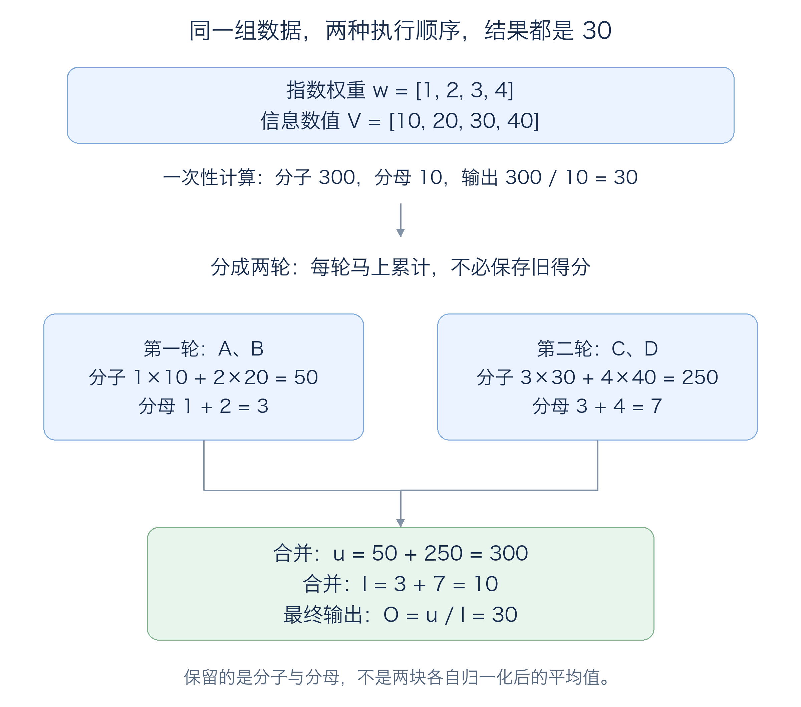
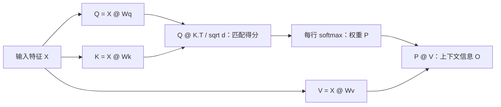
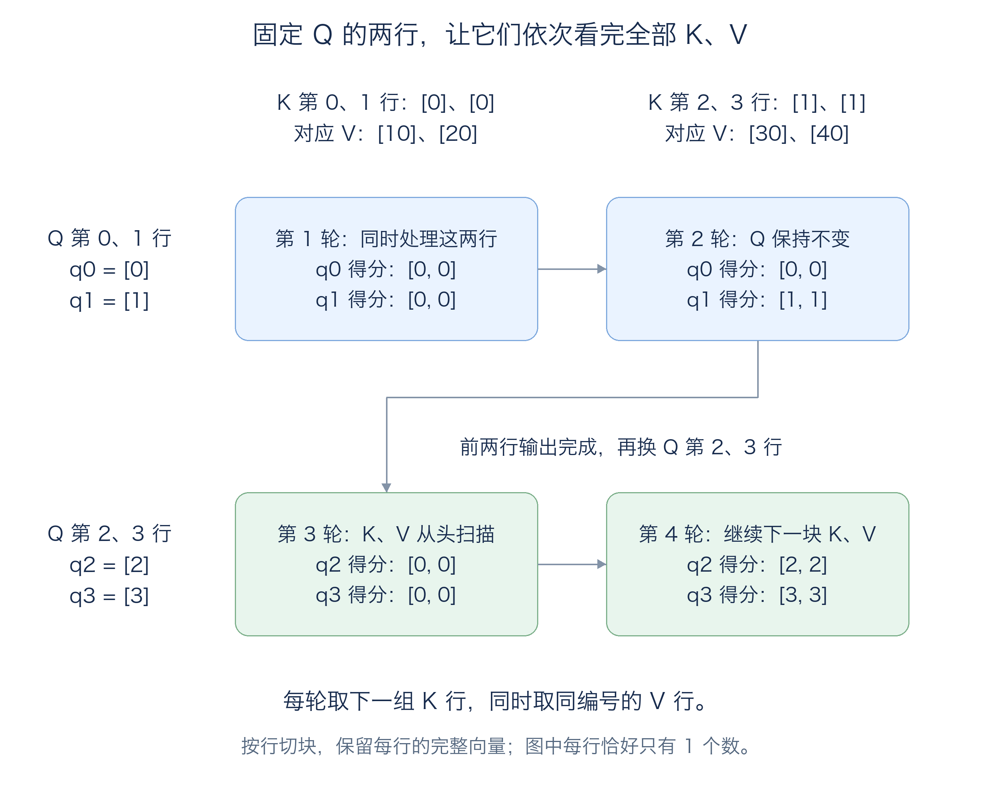

# 从矩阵乘法理解 FlashAttention

> 这是 [Lecture 004 指南第 7 节](STUDY_GUIDE.zh-CN.md#flash-attention)的展开版。只需要了解矩阵乘法和上一节的 tiling；先看单个 attention head 的前向计算，暂不展开多头、dropout 和反向求导公式。
>
> 配套 [flash_attention_demo.py](flash_attention_demo.py) 只使用 Python 标准库，可在 Mac 上运行。它用相同的 Q、K、V 对照普通计算和分块计算，输出每轮统计量；这是已核对的 CPU 算法演示，不是 GPU 性能实现。
>
> 配套 [flash_attention_sdpa_demo.py](flash_attention_sdpa_demo.py) 演示实际的 PyTorch SDPA 调用：有 CUDA 时强制选择 FlashAttention 后端，CPU 时使用数学后端。该脚本已通过 Python 语法检查；本次整理环境没有安装 PyTorch，尚未实测 SDPA 运行结果。

**先记住两个目标：Attention 让每个位置从其他位置聚合信息；FlashAttention 高效地完成这次聚合，减少巨大中间结果在显存中的保存和往返。**

如果你卡在“分块后为什么还能算出同一个结果”，先读下面的**第 0 节**：先把 V 简化为一个数，用整数看清分块合并，再理解缩放。原来的二维向量和 ln 例子在第 3、6 节，可以等入门例子看懂后再读。

文中的存储流程图已保存为实际 PNG 图片，直接嵌入 Markdown，查看时不需要额外的 Mermaid 渲染支持。第 5.3～5.5 节详细解释显存、smem 和寄存器；第 8 节给出实际应用接口。

如果还不清楚“一块 Q 到底是哪几行、扫描 K/V 是怎么移动”，直接看 [第 5.1 节：4 行数据的逐轮扫描](#q-kv-scan)。那里把完整 Q、K、V、每次切出的行以及对应计算全部列出来，不需要先理解分块符号。

<a id="block-equivalence"></a>

## 0. 先算懂一个数：分块后为什么答案相同？

### 0.1 先把输入简化，只保留“加权汇总”

沿用电商推荐的业务背景：要按相关程度，汇总 4 件历史商品的信息。先假设每件商品只有一个特征数值，暂时不使用二维向量，也暂时跳过从 Q、K 计算得分的步骤。

| 商品 | A | B | C | D |
|---|---:|---:|---:|---:|
| 用于汇总的特征 V | 10 | 20 | 30 | 40 |
| 已经计算出的指数权重 w | 1 | 2 | 3 | 4 |

这里的 **w 是 `exp(score)`，不是最终 softmax 概率**。先把它当作上一步已经算出的输入，就能只关注你困惑的“如何分块合并”。它们的总和是 10，因此最终概率才是 `0.1、0.2、0.3、0.4`。

### 0.2 一次算完，答案是 30

先按熟悉的方式，用最终概率加权：

```text
O = 0.1×10 + 0.2×20 + 0.3×30 + 0.4×40
  = 1 + 4 + 9 + 16
  = 30
```

同一个式子，也可以把最后的除法提到外面：

```text
O = (1×10 + 2×20 + 3×30 + 4×40) / (1+2+3+4)
  = (10 + 40 + 90 + 160) / 10
  = 300 / 10
  = 30
```

后一种写法告诉我们：**需要的是分子总和与分母总和，可以先不做除法。**

### 0.3 每次只读两件商品，最后仍然是 30



**开始时**，准备两个累计变量，都是 0：

```text
u = 0      # 已处理商品的“权重×特征”总和，即分子
l = 0      # 已处理商品的权重总和，即分母；这是小写字母 L
```

**第一轮只读 A、B：**

```text
当前权重：[1,2]       当前 V：[10,20]

分子贡献 = 1×10 + 2×20 = 50
分母贡献 = 1 + 2       = 3

累计 u = 50
累计 l = 3
```

到了这里，A、B 的旧得分和权重就可以丢掉：它们对最终答案的贡献，已经保存为 `u=50、l=3`。**不是把贡献丢了，而是换成了累计量。**

**第二轮只读 C、D：**

```text
当前权重：[3,4]       当前 V：[30,40]

分子贡献 = 3×30 + 4×40 = 250
分母贡献 = 3 + 4       = 7

累计 u = 旧 u + 当前贡献 = 50 + 250 = 300
累计 l = 旧 l + 当前贡献 =  3 +   7 = 10
```

**所有商品处理完，再做唯一一次最终除法：**

```text
O = u/l = 300/10 = 30
```

这就是“小块得分，马上用于小块加权和”：当前块的权重算出来，就马上乘对应的 V 并加进 u，无需等所有商品的最终概率都计算完。

### 0.4 为什么这不是近似？因为原式只改变了加法的分组

```text
一次算完的分子：10 + 40 + 90 + 160
分块计算的分子：(10 + 40) + (90 + 160)

一次算完的分母：1 + 2 + 3 + 4
分块计算的分母：(1 + 2) + (3 + 4)
```

数学上分子、分母没有改变，输出自然相同。浮点实现可能因计算顺序有细微误差，但算法没有省掉某件商品，也没有截断它的贡献。

一个常见误区是每块先算自己的平均值，再把两块平均：

```text
第一块局部平均 = 50/3  ≈ 16.6667
第二块局部平均 = 250/7 ≈ 35.7143

直接对两块平均：(16.6667 + 35.7143)/2 ≈ 26.1905   # 不等于 30
```

原因是两块的权重总量不同，分别是 3 和 7，不能各占一半。若一定使用局部平均，就还需要按 `3/10、7/10` 重新加权。直接保存 u 和 l，可以更容易地合并。

### 0.5 再看缩放：为什么实际代码的 u=75、l=2.5，也得到 30？

真实 FlashAttention 还要防止指数溢出，因此会统一缩放权重。先不看 ln，只看下面这个最简单的事实：

```text
300 / 10 = 30
150 /  5 = 30     # 分子、分母同时除以 2
 75 /2.5 = 30     # 分子、分母同时除以 4
```

**只要分子、分母使用同一个缩放基准，商就不变。**用权重最大值 C 帮助理解，两轮可以这样算：

第一轮权重是 `[1,2]`，当前最大权重 `C=2`，先把它们都除以 2：

```text
当前缩放权重 = [1/2, 2/2] = [0.5,1]
l = 0.5 + 1 = 1.5
u = 0.5×10 + 1×20 = 25
```

第二轮看到了权重 `[3,4]`，现在最大权重变成 `C=4`。旧累计量原来按“除以 2”计算，现在必须改成“除以 4”，所以再乘 `2/4=0.5`：

```text
旧分母换基准：1.5 × 0.5 = 0.75
旧分子换基准：25  × 0.5 = 12.5

当前块也使用相同基准：w = [3/4, 4/4] = [0.75,1]
当前分母贡献 = 0.75 + 1 = 1.75
当前分子贡献 = 0.75×30 + 1×40 = 62.5

合并 l = 0.75 + 1.75 = 2.5
合并 u = 12.5 + 62.5 = 75

最终 O = 75/2.5 = 30
```

对照两种累计方式：

| 阶段      | 未缩放的 u、l     | 统一缩放后的 u、l         |
| ------- | ------------ | ------------------ |
| 处理完 A、B | `u=50、l=3`   | 都除以 2：`u=25、l=1.5` |
| 处理完 C、D | `u=300、l=10` | 都除以 4：`u=75、l=2.5` |
| 最终输出    | `300/10=30`  | `75/2.5=30`        |

上面使用 C 只是为了讲清楚换基准。真实实现不会先算出可能溢出的完整指数权重再找最大值，而是保存**最大分数 m**，直接计算 `exp(score-m)`。概念上 `C=exp(m)`，旧量换基准的系数就是 `alpha=exp(old_m-new_m)`。先理解“分子、分母同时换基准”，第 6 节的公式就对应上了。

### 0.6 对应到你问的那张存储图


在这张简化图里，把两轮计算这样对应起来：

| 时刻  | 当前处理的数据块                          | 保留到下一轮的累计状态                        |
| --- | --------------------------------- | ---------------------------------- |
| 第一轮 | A、B 的 K、V 块；由分数得到相对权重 `[0.5,1]`   | `u=25、l=1.5`，以及第一轮最大分数 m           |
| 第二轮 | smem 中 K、V 换成 C、D；相对权重 `[0.75,1]` | 旧量乘 `0.5` 后合并，得到 `u=75、l=2.5`，更新 m |
| 结束  | 当前块已使用完毕                          | `O=u/l=30` 写回显存                    |

图里的“继续下一块”并不表示清零 u、l、m，也不表示把它们变成 K、V。它表示：**保留历史累计状态，换入下一块 K、V，继续更新这同一份累计状态。**输入 K、V 在显存中的完整数据通常仍然保留，只是片上缓冲区被复用。

### 0.7 可以直接运行的最小代码

先只验证“不缩放时分子、分母如何合并”，下面这段不依赖 PyTorch：

```python
weights = [1, 2, 3, 4]    # 已算出的 exp(score)，尚未归一化
values = [10, 20, 30, 40]
u, l = 0.0, 0.0

for start in (0, 2):
    for j in range(start, start + 2):
        u += weights[j] * values[j]
        l += weights[j]
    print("累计分子", u, "累计分母", l)

print("最终输出", u / l)   # 30.0
```

配套 [flash_attention_beginner.py](flash_attention_beginner.py) 进一步用**同一组数据**对照未缩放累计、换基准累计、真实的稳定 attention 算法三条路径：

```bash
python3 lecture_004/flash_attention_beginner.py
```

三条路径的最终结果都是 30，脚本已在 CPU 上运行核对。它只解释算法，不模拟 GPU 的实际线程、smem 或寄存器。

原文后面的 V 是二维向量，例如 `[10,0]`；当前入门例子把 V 改成了单个数 10，因此输出是 30，原例输出是 `[10,20]`。二者输入不同，不要求输出相同；向量版只需对每个分子分量分别累计，再共同除以同一个 l。

## 1. Attention 的功能：先判断“关注谁”，再汇总“取什么”

一个句子可以转成一串向量，每个位置有自己的特征。Attention 的作用是：对当前位置，根据它与其他位置的匹配程度，把其他位置的信息按不同权重混合进来，产生一个带有上下文信息的新向量。

可以把它理解为一次“带权重的信息查询”：

| 名称         | 含义           | 在计算中做什么          |
| ---------- | ------------ | ---------------- |
| Q：Query／查询 | 当前位置希望匹配什么信息 | 与每个 K 做点积，得到匹配分数 |
| K：Key／键    | 各位置用于匹配的特征   | 决定这个位置得到多大权重     |
| V：Value／值  | 各位置实际提供的信息   | 按权重参与最终加权和       |

这是帮助理解的类比。实际的 Q、K、V 都是数值向量；它们不是人手写的关键词或语句。

在常见的 self-attention 中，它们来自同一组输入向量 X，通过不同的、训练得到的矩阵映射而成：

```python
Q = X @ Wq
K = X @ Wk
V = X @ Wv
```

所以你已经认识了前半段：它们也是矩阵乘法。下面的 attention 计算接收生成好的 Q、K、V；通常讨论 FlashAttention 核心时，不包含上面这三次投影。

本篇先取 `Q、K、V` 都为 `(L, d)`：L 是位置数，d 是每个向量的长度。每一行对应一个位置。同一 head 中，Q 与 K 的向量长度必须匹配；V 的向量长度可以不同，为了起步简单先设相同。这里 K 是 Key 矩阵的名称，不是前面 GEMM 中表示内积长度的整数 K。

### 1.1 放进业务：根据历史浏览商品做推荐

假设推荐系统要根据用户当前需求，汇总最近浏览的 4 件商品的信息，再交给后面的网络给候选商品打分。这里是一个帮助理解的 attention 模块示例，不是在还原某个具体线上推荐系统。

```text
用户当前需求 ──→ 编码器 ──→ q：现在想找什么
4 件历史商品 ──→ 编码器 ──→ K：每件商品如何与需求匹配
                       └→ V：每件商品实际提供的信息

q、K、V ──→ Attention 汇总向量 O ──→ 后续打分网络 ──→ 候选商品排序
```

Q、K 决定“哪件历史商品更相关”，V 决定“汇总哪些信息”。输出 O 是一个向量，后面的网络会继续使用它，不是直接返回商品编号。

下面的手算例子只取 1 个 query 和 4 个 key，因此实际形状是 `Q=(1,2)、K=(4,2)、V=(4,2)、O=(1,2)`。它与前面 `L×L` 的方阵例子采用相同公式；query 数量和 key 数量本来就可以不同。数值是为了方便手算而构造的，V 的两个维度只是模型特征，不代表价格或概率。

## 2. 从熟悉的 matmul 出发，attention 只有三步

### 2.1 第一次 matmul：计算每个 query 与每个 key 的匹配分数

```python
S = Q @ K.T / sqrt(d)      # (L, L)
```

`S[i,j]` 是第 i 个 query 与第 j 个 key 的缩放点积分数。固定 i 看一行，就是“当前位置对所有位置的匹配打分”。

转置 K，是为了把“一个 Q 行向量点乘一个 K 行向量”组织成矩阵乘法。除以 `sqrt(d)` 用来调节点积分数的尺度，减少维度变大时 softmax 过于极端的问题。

### 2.2 每行 softmax：把分数变成一组权重

```python
P = softmax(S, dim=-1)     # (L, L)，每一行的权重之和为 1
```

对某一行分数 `s`：

```text
p[j] = exp(s[j]) / sum(exp(s[t]) for t in 全部 key)
```

分数较大的 key 获得较大的权重。这里通常不是只挑一个 key，而是对多个位置分配不同权重。

### 2.3 第二次 matmul：用权重混合 V

```python
O = P @ V                 # (L, d)
```

第 i 个输出向量是：

```text
O[i] = P[i,0] × V[0] + P[i,1] × V[1] + ... + P[i,L-1] × V[L-1]
```

因此 **P 回答“各位置占多大权重”，O 才是汇总后的信息向量**。Attention 这一层的输出仍是向量；后续网络还会处理它。



这就是 scaled dot-product attention：**matmul → softmax → matmul**。可对照 [PyTorch 官方文档中的计算定义](https://docs.pytorch.org/docs/stable/generated/torch.nn.functional.scaled_dot_product_attention.html)。

## 3. 手算一行：输出到底是什么？

先只取 Q 的一行，把它与 4 个 key 比较；其他 query 行的处理方式相同。为使指数权重容易手算，刻意构造下面的数值，向量长度 `d=2`：

```text
q  = [sqrt(2), 0]

k0 = [ln(1), 0]       v0 = [10,  0]
k1 = [ln(2), 0]       v1 = [ 0, 20]
k2 = [ln(3), 0]       v2 = [30,  0]
k3 = [ln(4), 0]       v3 = [ 0, 40]
```

把这 4 行分别看成历史商品 A、B、C、D。`ln` 是自然对数，近似值与最终权重如下：

| 商品 | 缩放点积分数 | 指数权重 | 最终 softmax 权重 |
|---|---:|---:|---:|
| A／key 0 | `ln1 = 0` | `1` | `0.1` |
| B／key 1 | `ln2 ≈ 0.6931` | `2` | `0.2` |
| C／key 2 | `ln3 ≈ 1.0986` | `3` | `0.3` |
| D／key 3 | `ln4 ≈ 1.3863` | `4` | `0.4` |

第一步，点积再除以 `sqrt(2)`，刚好得到：

```text
scores      = [ln(1), ln(2), ln(3), ln(4)]
exp(scores) = [1,     2,     3,     4    ]
```

第二步，分母是 `1+2+3+4=10`，因此 softmax 权重为：

```text
P = [0.1, 0.2, 0.3, 0.4]
```

第三步，按权重混合 V：

```text
O = 0.1×[10,0] + 0.2×[0,20] + 0.3×[30,0] + 0.4×[0,40]
  = [1,0] + [0,4] + [9,0] + [0,16]
  = [10,20]
```

注意输出是一个二维向量 `[10,20]`，并没有直接返回某个 key 的编号，也没有直接返回某个词。这一行 query 综合了 4 个 value 的信息。

对应刚才的业务，这个 `[10,20]` 就是本次需求下的历史商品汇总特征，可以继续送入候选商品打分网络。FlashAttention 要计算的仍然是这个结果。

## 4. 普通实现的代价：为什么两次 matmul 很快，整体还值得优化？

最直观的实现按下面顺序执行：

```text
计算完整 S → S 写入显存 → 读取 S 做 softmax
          → 完整 P 写入显存 → 读取 P、V，计算 O
```

瓶颈之一是 S 和 P 的尺寸：每个 query 都要与每个 key 比较，二者都是 `L×L`。

例如 `L=4096、d=64、FP32、单 head`：

| 数据 | 元素数 | 容量 |
|---|---:|---:|
| Q、K、V、O 各自 | `4096×64` | 各 1 MiB |
| S | `4096×4096` | 64 MiB |
| P | `4096×4096` | 64 MiB |

如果 S、P 同时保存，就仅这两项占 128 MiB；多个 head、多个 batch 还会放大需求。具体实现可以覆盖或复用缓冲区，这里用于看清尺寸差异。序列长度翻倍，S、P 的元素数变为 4 倍。

**最终需要的是 O；S、P 是生成 O 时用过的中间数据。FlashAttention 抓住的机会，就是让这些中间数据按块生成后立即使用。**原论文把重点放在减少显存与片上存储之间的 IO，而不只是减少显存占用。[FlashAttention 论文](https://arxiv.org/html/2205.14135v2#S3)

## 5. FlashAttention 的流程：小块得分，马上用于小块加权和

先把“块”变成看得见的行。下面用一组独立的一维小数据，专门说明 Q 取哪几行、K/V 取哪几行，以及什么时候换下一块。这里的数字和前文二维例子不同，最后的输出也不同。

<a id="q-kv-scan"></a>

### 5.1 固定一块 Q，依次扫描 K、V：用 4 行数据逐轮看清楚

#### 第一步：把完整 Q、K、V 摆出来

假设输入有 4 个位置，编号从 0 开始。每个位置都有一行 q、一行 k、一行 v。为了容易写，每行向量恰好只有 1 个数：

| 行号／输入位置 | Q 的这一行 | K 的这一行 | V 的这一行 |
|---|---|---|---|
| 0 | `q0=[0]` | `k0=[0]` | `v0=[10]` |
| 1 | `q1=[1]` | `k1=[0]` | `v1=[20]` |
| 2 | `q2=[2]` | `k2=[1]` | `v2=[30]` |
| 3 | `q3=[3]` | `k3=[1]` | `v3=[40]` |

也就是：

```text
       Q            K             V
行0   [0]          [0]           [10]
行1   [1]          [0]           [20]
行2   [2]          [1]           [30]
行3   [3]          [1]           [40]
```

Q、K、V 都是 `4 行 × 1 列`。每个 q 都要根据全部 4 个 K 分配权重，再汇总对应的 4 个 V，因此最后会得到 4 行输出 O：`O[0]、O[1]、O[2]、O[3]`。

这里先看没有因果掩码的情况，允许每个 q 关注全部 4 个位置。业务里可以把 q 看成当前这条记录的汇总需求，K/V 看成可供它匹配和读取的记录信息；数值是人为构造的。

#### 第二步：“一块 Q”就是取出 Q 的连续几行

这次约定：**Q 每块取 2 行，K、V 每块也取 2 行。**两行只是本例的选择，不是 FlashAttention 的固定规定。

先取 Q 的第 0、1 行：

```text
Q_block = Q[0:2] = [[0],      ← q0，接下来算 O[0]
                    [1]]      ← q1，接下来算 O[1]
```

Python 的 `0:2` 表示从第 0 行取到第 2 行之前，因此取到的是第 0、1 行。

**“固定这块 Q”就是：先拿着 q0、q1 不换，把它们各自需要的全部 K、V 都看完，完成 O[0]、O[1]。**

这里按行切块，每一行向量保持完整。真实例子若每行有 64 个数，取两行就是 `2×64` 的 Q 块；不是只取每行的前两个特征。本例每行只有 1 个数，所以 Q 块是 `2×1`。

#### 第三步：第一轮，Q 不变，读取 K/V 的第 0、1 行

```text
当前 Q 块                 当前 K 块              对应的 V 块
[[0],  ← q0              [[0],  ← k0           [[10], ← v0
 [1]]  ← q1               [0]]  ← k1            [20]] ← v1
```

K 和 V 必须按同一组行号一起取：k0 算出的权重用于 v0，k1 算出的权重用于 v1。

这一轮让**当前每个 q 与当前每个 k 都配对**，一共计算 4 个分数：

```text
q0 与 k0：0×0 = 0       q0 与 k1：0×0 = 0
q1 与 k0：1×0 = 0       q1 与 k1：1×0 = 0
```

每个向量长度 `d=1`，所以除以 `sqrt(d)` 就是除以 1。当前小得分矩阵为：

```text
             k0     k1
q0           0      0
q1           0      0
```

它的两行分别属于 q0、q1，两列分别属于 k0、k1。不是只算 q0 对 k0、q1 对 k1。

现在先只跟着 **q0** 这一行算。它看到的分数是 `[0,0]`，`exp(0)=1`，因此：

```text
q0 的当前指数权重：[1,1]     # 还没做最终归一化

累计分子 = 1×10 + 1×20 = 30
累计分母 = 1 + 1 = 2
```

先保存这两个累计数。q0 还没看见 k2、k3，所以现在还不能输出最终答案。q1 也单独保存自己的分子、分母；这一轮它恰好也得到 30、2。

#### 第四步：第二轮，Q 仍不变，只把 K/V 换成第 2、3 行

```text
当前 Q 块：与上一轮相同     新的 K 块              新的 V 块
[[0],  ← q0              [[1],  ← k2           [[30], ← v2
 [1]]  ← q1               [1]]  ← k3            [40]] ← v3
```

这次继续配对：

```text
q0 与 k2：0×1 = 0       q0 与 k3：0×1 = 0
q1 与 k2：1×1 = 1       q1 与 k3：1×1 = 1
```

得到新的小得分矩阵：

```text
             k2     k3
q0           0      0
q1           1      1
```

继续跟着 **q0**：新分数仍为 `[0,0]`，指数权重是 `[1,1]`。注意，这次乘的是新读入的 v2、v3：

```text
当前块增加的分子 = 1×30 + 1×40 = 70
当前块增加的分母 = 1 + 1 = 2

加到上一轮的累计量上：
累计分子 = 旧的 30 + 新的 70 = 100
累计分母 = 旧的  2 + 新的  2 = 4
```

现在 q0 已经看完全部 4 个 key，才能做最终除法：

```text
O[0] = 100/4 = 25
```

一次性算 q0 时，它对 4 个 key 的分数全为 0，softmax 权重就是 `[1/4,1/4,1/4,1/4]`。因此 `(10+20+30+40)/4=25`，与两轮结果相同。

**到这里，“扫描 K、V”已经做完了一次：固定 q0、q1，先读 K/V 第 0、1 行，再读第 2、3 行。**这就是按顺序读取下一组行，没有额外的搜索过程。

#### 第五步：同一个 Q 块里的 q1，独立算出自己的输出

q1 的两轮数据如下：

| 轮次 | 当前 key | q1 的分数 | 当前指数权重 | 分子贡献 | 分母贡献 |
|---|---|---|---|---|---|
| 第一轮 | k0、k1 | `[0,0]` | `[1,1]` | `1×10+1×20=30` | `2` |
| 第二轮 | k2、k3 | `[1,1]` | `[e,e]` | `e×30+e×40=70e` | `2e` |

这里 `e=exp(1)≈2.718282`，所以：

```text
O[1] = (30 + 70e) / (2 + 2e)
     ≈ 220.279728 / 7.436564
     ≈ 29.621172
```

当前这个 Q 块的两行输出都完成了：

```text
O[0:2] = [[25],
          [29.621172]]
```

q0、q1 可以一起复用读入的 K/V，但它们的分数、分子、分母分别计算，不能混成一份。

本节的分数很小，因此直接用 `exp(score)` 展开手算。真实稳定实现会同时缩放累计分子、分母：q1 最后可能显示为 `81.036383/2.735759`，比值仍是 `29.621172`。第 6 节再解释这种换基准；现在先看清行号和读取顺序。

#### 第六步：换下一块 Q，然后让 K、V 从头再扫描一遍

前两行完成后，再取 Q 的第 2、3 行：

```text
新的 Q 块 = Q[2:4] = [[2],   ← q2，接下来算 O[2]
                      [3]]   ← q3，接下来算 O[3]
```

q2、q3 也要读取全部 4 个 key，因此 K、V 要重新从第 0 行开始：

| 总轮次 | 固定的 Q 行 | 当前 K 行 | 同时读取的 V 行 | 正在累计哪些输出 |
|---|---|---|---|---|
| 第 1 轮 | q0、q1 | k0、k1 | v0、v1 | O[0]、O[1] |
| 第 2 轮 | q0、q1，保持不变 | k2、k3 | v2、v3 | 完成 O[0]、O[1] |
| 第 3 轮 | 换成 q2、q3 | 重新从 k0、k1 开始 | 重新从 v0、v1 开始 | O[2]、O[3] |
| 第 4 轮 | q2、q3，保持不变 | k2、k3 | v2、v3 | 完成 O[2]、O[3] |



同样的方法继续算，全部输出约为：

```text
O = [[25],
     [29.621172],
     [32.615942],
     [34.051483]]
```

这里按顺序列出两个 Q 块，便于说明数据关系。实际 GPU 可以让不同 CUDA block 并行负责不同 Q 块；每块 Q 需要访问哪些 K/V 的关系不变，不要求整张 GPU 串行执行这 4 轮。

#### 第七步：把“取哪几行”直接写成代码

下面的代码只展示读取顺序，不进行 attention 数值计算：

```python
Q = [[0], [1], [2], [3]]
K = [[0], [0], [1], [1]]
V = [[10], [20], [30], [40]]

for q_start in (0, 2):
    q_block = Q[q_start:q_start + 2]
    print("现在固定的 Q 块：", q_block)

    for kv_start in (0, 2):
        k_block = K[kv_start:kv_start + 2]
        v_block = V[kv_start:kv_start + 2]
        print("  Q 不变，当前 K、V 块：", k_block, v_block)
        # 用 q_block 与 k_block 得分，再用权重乘 v_block。
        # 此处把贡献并入这块 Q 各行自己的累计量。

    # 这一块 Q 看完全部 K/V 后，归一化并完成对应的输出行。
```

最外层循环决定“这次算哪两行输出”；内层循环决定“为这两行输出，当前读取哪两行 K/V”。

配套 [flash_attention_scan_demo.py](flash_attention_scan_demo.py) 不仅打印切片，还实际计算每轮得分、累计分子、累计分母和最终输出。只需要 Python 标准库：

```bash
python3 lecture_004/flash_attention_scan_demo.py
```

该脚本已在 CPU 上运行，全部 4 行结果与一次性 attention、稳定分块 attention 核对一致。CPU 列表切片只是帮助辨认数据；GPU 中，完整 Q/K/V 在显存里，kernel 将当前数据块加载到 smem、寄存器等片上资源中，详细对应见第 5.3 节。

本节表达的是一种方便理解的前向组织方式；不同 FlashAttention 版本会调整循环和流水线。[Triton 的融合 attention 示例](https://triton-lang.org/main/getting-started/tutorials/06-fused-attention.html)可以看到按 Q 块负责输出、循环处理 K/V 块的对应关系。

### 5.2 与前面的 matmul tiling 有什么联系？

现在再给刚才的“每次取几行”起名字：`Br` 是 Q 块的行数，`Bc` 是 K/V 块的行数。第 5.1 节中 `Br=2、Bc=2、d=1`，所以 Q 块是 `2×1`，K/V 块是 `2×1`，当前得分块是 `2×2`。这些尺寸分别对应“当前两个 query”和“当前两个 key”的全部配对。

普通矩阵乘法 tiling 中，一个 block 在片上累加一块输出。这里同样把 Q、K、V 和输出工作集分块，但还要解决 **softmax 的分母依赖整行所有 key** 这一问题。

| 当前处理的数据           | 尺寸       | 用完后是否必须保存完整历史？     |
| ----------------- | -------- | ------------------ |
| `Q_block`         | `Br×d`   | 扫描这一组输出对应的 K、V 时复用 |
| `K_block、V_block` | 各 `Bc×d` | 本轮使用后可以换下一块        |
| `S_block` 及指数权重   | `Br×Bc`  | 消费后不必保留            |
| 每行最大值 m、分母 l      | 各 `Br`   | 跨块持续更新             |
| 输出分子 u            | `Br×d`   | 跨块持续累加，最后归一化       |

真实 GPU 中这些工作集使用 shared memory、寄存器等片上资源，具体分工取决于 kernel。输入和输出仍位于显存，K、V 也可能被不同 Q 块再次读取；“少搬数据”不意味着每个输入在整个计算中只读取一次。

### 5.3 存在哪里：显存、L2、smem、寄存器

以常见的 FlashAttention-2 风格前向实现理解，各类存储的角色如下。这里描述的是常见安排，具体 kernel 可以调整布局和数据流。

| 存储                            | 保存什么                              | 谁使用、何时释放或覆盖                            |
| ----------------------------- | --------------------------------- | -------------------------------------- |
| Global memory／GPU 显存；论文常写 HBM | 完整 Q、K、V，最终输出 O；训练时还可能保存逐行归一化统计量  | 输入通常需要保留，输出供后续网络使用                     |
| L2 cache                      | 显存数据的缓存副本                         | 通常由硬件管理，不是代码里显式声明的 tile 缓冲区            |
| **smem／shared memory／共享内存**   | 当前要复用的 Q、K、V 块；部分实现也在这里放局部得分或输出暂存 | 同一 CUDA block 的线程合作加载和使用；当前块消费完后才能安全覆盖 |
| **Registers／寄存器**             | 各线程负责的分数片段、指数权重片段、`m、l、u` 等累计量    | 线程持有；累计状态跨 K、V 分块保留，临时分数用完即可丢弃         |

**smem 位于 SM 内，通常供同一 block 的线程共享；寄存器由各线程持有。**不同 block 不能把普通 shared memory 当成公共数组直接使用。论文图里的“片上 SRAM”是更宽泛的说法，不能全部等同于 smem。显存则可能使用 HBM 或 GDDR，取决于 GPU。


图片文件：[PNG](assets/flash-attention-memory.png)；可放大的矢量版：[SVG](assets/flash-attention-memory.svg)。图片已直接嵌入，不依赖 Mermaid 渲染。

图中省略了线程间通信、Tensor Core 操作数布局和流水线细节。多行 Q 共用加载的 K、V，但**每一行 query 都维护自己的 m、l 和向量 u**；逻辑上的一块 u 通常由多个线程分摊保存。

### 5.4 对照仓库 CUDA 代码，辨认 smem 和累计量

仓库的 [lecture_012/flash_attention.cu](../lecture_012/flash_attention.cu) 是一个教学实现，下面这些原始声明很适合辨认数据位置：

```cpp
// 当前数据块：显式声明为 shared memory
__shared__ float Q_i[B_r][d];
__shared__ float K_j[B_c][d];
__shared__ float V_j[B_c][d];
__shared__ float S[B_r][B_c];

// 各线程负责的局部累计量：设计为保存在寄存器
float l_i[B_r_over_bdy];
float m_i[B_r_over_bdy];
float O_i[B_r_over_bdy][d_over_bdx];
```

对应关系是：

| CUDA 变量 | 本文变量 | 含义 |
|---|---|---|
| `Q_i、K_j、V_j` | `Q_block、K_block、V_block` | 当前参与两次小矩阵乘法的数据 |
| `S` | `S_block` | 当前 Q 块与 K 块的得分 |
| `m_i` | `m` | 每行当前最大分数 |
| `l_i` | `l` | 每行累计分母 |
| `O_i` | `u` | 尚未归一化的输出分子；名字虽带 O，结束时仍要除以 `l_i` |

这个教学版本连得分小块 S 都放在 smem。优化实现常把分数和权重片段保存在寄存器里；可对照 [FlashAttention CUDA 实现](https://github.com/Dao-AILab/flash-attention/blob/main/csrc/flash_attn/src/flash_fwd_kernel.h)。普通局部变量最终是否留在寄存器中，还取决于编译器和寄存器压力，声明局部数组并不是绝对保证。

上述教学文件设置 `Br=8、Bc=32、d=128`，使用 FP32，因此这些显式 shared 数组的容量为：

```text
Q_i： 8 × 128 × 4 字节 =  4 KiB
K_j：32 × 128 × 4 字节 = 16 KiB
V_j：32 × 128 × 4 字节 = 16 KiB
S  ： 8 ×  32 × 4 字节 =  1 KiB
合计：37 KiB / CUDA block
```

这不是把整张 attention 矩阵塞进 smem，而是只放当前工作块。代码中合作加载完成后的 `__syncthreads()` 用来协调同一 block 的线程：读共享数据前要确保写入完成，复用缓冲区前也要确保旧数据已被所有使用者读完。这里借用该文件辨认存储声明，没有把整个教学 kernel 作为已验证的生产实现。

### 5.5 同一组数字，在两轮之间究竟保留什么？

结合第 6.3 节的稳定计算，存储状态可以这样读。表中的 `m、l、u` 是一个 query 行的逻辑状态，不表示每个线程都各自保存完整的 u。

| 阶段 | 片上当前数据块 | 跨块保留的累计状态 | 显存写回 |
|---|---|---|---|
| 开始 | 加载 q | `m=-∞、l=0、u=[0,0]` | 无最终输出 |
| 第一轮 | A、B 的 K、V；临时得分为 `[ln1,ln2]` | `m=ln2、l=1.5、u=[5,20]` | 不必写完整得分或概率矩阵 |
| 第二轮 | 换成 C、D 的 K、V；临时得分为 `[ln3,ln4]` | `m=ln4、l=2.5、u=[25,50]` | 不必写完整得分或概率矩阵 |
| 结束 | 临时块不再需要 | 计算 `u/l=[10,20]` | 写入最终 O |

因此，上一块的得分和权重可以丢弃，但上一块对答案的贡献并没有丢失：它已经被合并进 m、l、u。GPU 后端的实际分块大小未必是两行，这里用两行只是为了手算。

## 6. 精髓：不知道最终分母，怎样边读边算？

### 6.1 先忽略数值稳定性，实际上只需要“分子与分母”

对第 3 节的同一行：

```text
O = sum(exp(score[j]) × V[j]) / sum(exp(score[j]))
             向量分子                    标量分母
```

把 4 个 key 分两轮，每轮 2 个：

| 当前块 | 分母贡献 | 向量分子贡献 |
|---|---:|---|
| key 0、1 | `1+2=3` | `1×[10,0]+2×[0,20]=[10,40]` |
| key 2、3 | `3+4=7` | `3×[30,0]+4×[0,40]=[90,160]` |
| 合计 | `10` | `[100,200]` |

最后 `[100,200]/10 = [10,20]`。整行概率不必先存下来，后续的 matmul 可以在统计权重的同时逐块完成。

把“马上用于小块加权和”展开成第一轮的小矩阵乘法，就是：

```text
第一轮只读取 A、B：
  当前指数权重 w = [1,2]                  # 尚未除以最终分母
  当前 V 块     = [[10, 0],
                  [ 0,20]]

  w @ V_block   = [10,40]                 # 马上计算分子贡献
  保留 l=3、u=[10,40]
  当前得分和 w 用完就可以丢弃，暂不输出最终结果

第二轮读取 C、D：
  当前指数权重 w = [3,4]
  w @ V_block   = [90,160]
  更新 l=3+7=10、u=[10,40]+[90,160]=[100,200]

全部完成：
  O = u/l = [10,20]
```

**后半块还没算出来，只意味着现在不能确定最终归一化分母；不妨碍先累计前半块的分子贡献。**真实实现再加上下一节的最大值缩放，解决数值稳定性。

但不能把每块分别 softmax 后，直接把局部输出相加或取平均：两块的归一化分母分别是 3、7，**权重需要在整行范围内归一化**。

### 6.2 再解决 exp 溢出：维护一个统一的缩放基准

直接计算 `exp(1000)` 会溢出。稳定 softmax 会先减去整行最大值 m：

```text
exp(s[j] - m) / sum(exp(s[t] - m))
```

所有项同乘 `exp(-m)`，分子分母一起缩放，所以结果不变。分块时尚未看到整行，可以先使用“目前遇到的最大值”，后续发现更大值时，把之前的累计量一起换算到新基准。

对每个 query 行，只需持续保存三项：

- **m**：已处理分数中的最大值，是当前缩放基准。
- **l**：`sum(exp(score - m))`，缩放后的标量分母。
- **u**：`sum(exp(score - m) × V)`，缩放后的向量分子；它还不是最终 O。

假设新块的分数为 s，新块对应的值为 Vb，更新规则是：

```text
new_m = max(旧 m, 当前块最大分数)
alpha = exp(旧 m - new_m)              # 旧累计量换到新基准的系数
w     = exp(s - new_m)                 # 当前块的指数权重，尚未归一化

new_l = alpha × 旧 l + sum(w)
new_u = alpha × 旧 u + w @ Vb

所有块结束后：O = u / l
```

`alpha` 为什么正确？旧累计量里的某一项原来是 `exp(score-old_m)`，换到新基准后应是：

```text
exp(score-new_m) = exp(score-old_m) × exp(old_m-new_m)
```

因此所有旧项统一乘一次 alpha 即可，无需把以前的 scores 找回来重新逐项计算。这就是 **online softmax** 的关键；online 在这里指逐块更新统计量。

### 6.3 同一组数字，走一遍稳定版本

初始 `m=-∞、l=0、u=[0,0]`。

**第一轮，key 0、1：**

```text
m = ln(2)
w = [exp(ln1-ln2), exp(ln2-ln2)] = [0.5, 1]
l = 0.5 + 1 = 1.5
u = 0.5×[10,0] + 1×[0,20] = [5,20]
```

**第二轮，key 2、3：**新最大值为 `ln(4)`，旧基准是 `ln(2)`：

```text
alpha = exp(ln2-ln4) = 0.5
w     = [exp(ln3-ln4), exp(ln4-ln4)] = [0.75, 1]

# 先把旧累计量从 ln2 基准换到 ln4 基准：
# 旧分母变成 0.5×1.5=0.75，旧分子变成 0.5×[5,20]=[2.5,10]。
# 再加上当前块的贡献：
l = 0.5×1.5 + 0.75 + 1 = 2.5
u = 0.5×[5,20] + 0.75×[30,0] + 1×[0,40]
  = [25,50]

O = [25,50] / 2.5 = [10,20]
```

这次分子、分母是上一小节未缩放结果的四分之一，但比值完全相同。两轮只留下 m、l、u，没有保存完整的 4 项概率向量；多行时，每个 query 行各自维护一组统计量。

## 7. 核心代码：从一个 q 算出一个输出向量

下面刻意使用 Python 列表，只表达算法，不涉及 GPU 线程和性能调优：

```python
import math

def flash_one_query(q, K, V, block_size=2):
    m, l = -math.inf, 0.0
    u = [0.0] * len(V[0])

    for start in range(0, len(K), block_size):
        kb = K[start:start + block_size]
        vb = V[start:start + block_size]
        # 一行 Q 与当前 K 块的点积，相当于第一次小 matmul。
        scores = [sum(a * b for a, b in zip(q, key)) / math.sqrt(len(q))
                  for key in kb]
        new_m = max(m, max(scores))
        alpha = math.exp(m - new_m)
        w = [math.exp(s - new_m) for s in scores]

        l = alpha * l + sum(w)
        # w @ V_block，相当于第二次小 matmul；每个输出特征分别累计。
        u = [alpha * old + sum(weight * value[c] for weight, value in zip(w, vb))
             for c, old in enumerate(u)]
        m = new_m

    return [x / l for x in u]
```

代码接受非空、维度匹配的输入，不含 mask 或 dropout。为多个 query 重复该过程就能得到完整 O；GPU 实现则会把多个 query 组织成块，合作加载和复用 K、V，而不是机械地把这个 Python 循环搬到 GPU。

配套脚本同时提供显式保存 S、P 的参考实现，以及多 query 的分块实现：

```bash
python3 lecture_004/flash_attention_demo.py
```

你会看到：

```text
完整 softmax 权重: [0.1, 0.2, 0.3, 0.4]
普通 attention 输出: [[10.0, 20.0]]
key 0..1: m=0.693147, alpha=0.000000, l=1.500000, u=[5.0, 20.0]
key 2..3: m=1.386294, alpha=0.500000, l=2.500000, u=[25.0, 50.0]
分块 attention 输出: [[10.0, 20.0]]
```

脚本还核对了多个 query、向量 V、非整除边界、不同 tile 大小，以及超过 1000 的大幅分数。它验证前向算法的数值关系，不能代替 GPU kernel 的同步正确性和性能测试。

## 8. 实际应用代码：通过 PyTorch SDPA 调用 FlashAttention

### 8.1 应用层负责传入 Q、K、V，后端负责分块和存储

实际应用可以使用 `torch.nn.functional.scaled_dot_product_attention`。普通调用由 PyTorch 根据输入和环境选择后端；为了明确验证 FlashAttention，可以用 `sdpa_kernel` 强制选择它。使用方式和后端限制可对照 [PyTorch 官方文档](https://docs.pytorch.org/docs/stable/generated/torch.nn.functional.scaled_dot_product_attention.html)。

下面在支持该后端的 NVIDIA CUDA 环境中，计算与前文相同的例子：

```python
import math
import torch
import torch.nn.functional as F
from torch.nn.attention import SDPBackend, sdpa_kernel

# 维度：[batch, head, query/key 数量, head_dim]
q = torch.zeros((1, 1, 1, 64), device="cuda", dtype=torch.float16)
k = torch.zeros((1, 1, 4, 64), device="cuda", dtype=torch.float16)
v = torch.zeros_like(k)

# 其余维度补零；8 / sqrt(64) = 1，仍得到 ln1、ln2、ln3、ln4。
q[0, 0, 0, 0] = 8
k[0, 0, :, 0] = torch.tensor(
    [math.log(x) for x in (1, 2, 3, 4)], device="cuda", dtype=torch.float16
)
v[0, 0, :, :2] = torch.tensor(
    [[10, 0], [0, 20], [30, 0], [0, 40]],
    device="cuda", dtype=torch.float16,
)

with sdpa_kernel(backends=[SDPBackend.FLASH_ATTENTION]):
    out = F.scaled_dot_product_attention(
        q, k, v, dropout_p=0.0, is_causal=False,
    )

print(out[0, 0, 0, :2])   # 约为 tensor([10., 20.], device='cuda:0', ...)
```

这里把二维向量补到 64 维，是为了使用常见 CUDA FlashAttention 后端支持的 head 尺寸。与此同时把 q 的第一个元素从 `sqrt(2)` 改成 `8`，抵消缩放因子从 `1/sqrt(2)` 到 `1/sqrt(64)` 的变化。新增维度全为零，因此原来的数学结果不变；FP16 表示和运算可能带来微小误差。

应用层这段代码中看不到 `__shared__`，因为 smem、寄存器、线程协作和 tile 大小都由所选择的 GPU kernel 处理。不能把 `q` 这个 Python 变量直接理解成寄存器：CUDA tensor 的完整数据在设备显存中，kernel 执行时才会分块加载到片上。

### 8.2 为什么这里设置 is_causal=False？

这个例子只有一个 query，并允许它看到全部 4 个历史商品。它没有未来位置需要屏蔽，因此使用 `is_causal=False`。

不能因为“只有一个 query，像生成最后一个 token”就机械设置 `is_causal=True`。对非方阵输入，SDPA 的因果对齐有具体定义；query 长度为 1、key 长度为 4 时，默认因果掩码并不表示允许访问全部 4 个 key。真实语言模型的 prefill、decode 和 KV cache 需要使用与位置对应的掩码或接口。

### 8.3 运行配套脚本并核对结果

完整脚本 [flash_attention_sdpa_demo.py](flash_attention_sdpa_demo.py) 还提供显式 attention 参考计算，并检查输出是否接近手算结果：

```bash
python3 lecture_004/flash_attention_sdpa_demo.py
```

- 有 CUDA 时：使用 FP16，强制选择 `SDPBackend.FLASH_ATTENTION`。如果当前硬件、PyTorch 构建或输入不支持该后端，会报出相应问题，不会在此分支静默回退到数学后端。
- 没有 CUDA 时：使用 CPU FP32 和 `SDPBackend.MATH`，只能验证数学关系，不能验证 CUDA FlashAttention。
- 仍需安装 PyTorch；本次整理环境没有 PyTorch，因此只完成了这个脚本的语法检查，没有宣称它已通过 GPU 运行验证。

脚本为了对照，会显式构造这个极小例子的 scores 和 probabilities。那是参考路径的核对开销；调用 FlashAttention 计算输出时，应用不需要先构造这两个完整矩阵。实际内部分块由后端决定，不保证每块两个 key。

## 9. 需要记住的边界：功能相同，执行方式更节省 IO

| 问题 | 核心回答 |
|---|---|
| 它算的是 attention 吗？ | 是，目标仍为 `softmax(Q @ K.T / sqrt(d)) @ V`。 |
| 为什么更省显存？ | 不必在显存中保存完整的 `L×L` scores 和概率中间矩阵。 |
| 为什么能更快？ | 局部得分生成后立即用于输出累加，减少显存往返，并融合计算阶段。 |
| 是否减少为线性计算量？ | 完整稠密 attention 仍处理 query-key 配对，计算量仍为平方级；节省中间矩阵不等于省掉这些配对。 |
| 数值会完全逐位一样吗？ | 数学目标相同；浮点计算的顺序和精度可能使结果有微小差别。 |
| 可以同时返回完整的 P 吗？ | 核心流程直接计算 O；要求保存完整 P，会重新引入平方级输出存储。 |

还有两件常见事项，现在只需知道它们的位置：

**Causal mask：**自回归模型的第 i 个位置只能关注允许的历史位置。可在局部 scores 上屏蔽不允许的位置，再参与 softmax；概念上把这些分数设为 `-∞`，让其指数权重为 0。本文演示先省略 mask，实际 kernel 还要处理相应的块和数值边界。

**训练的 backward：**反向传播也需要一些前向中间量。FlashAttention 保存输入、输出及归一化统计等所需数据，反向时按块重算局部得分／概率，避免长期保存大矩阵。多做一些计算，可以换取更少的显存读写；不能把 FlashAttention 只理解为前向时丢弃缓存。[论文关于 tiling 与重计算的说明](https://arxiv.org/html/2205.14135v2#S3.SS1)

回看核心代码时，可以用三个问题检查自己：**当前得分块用完后能否丢弃？跨块留下的是哪三项？为什么分子和分母必须一起乘 alpha？**能回答这三个问题，就掌握了本节最关键的算法。
