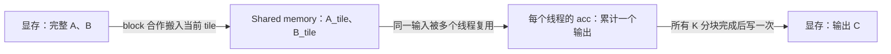
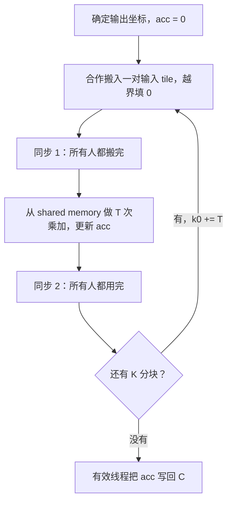
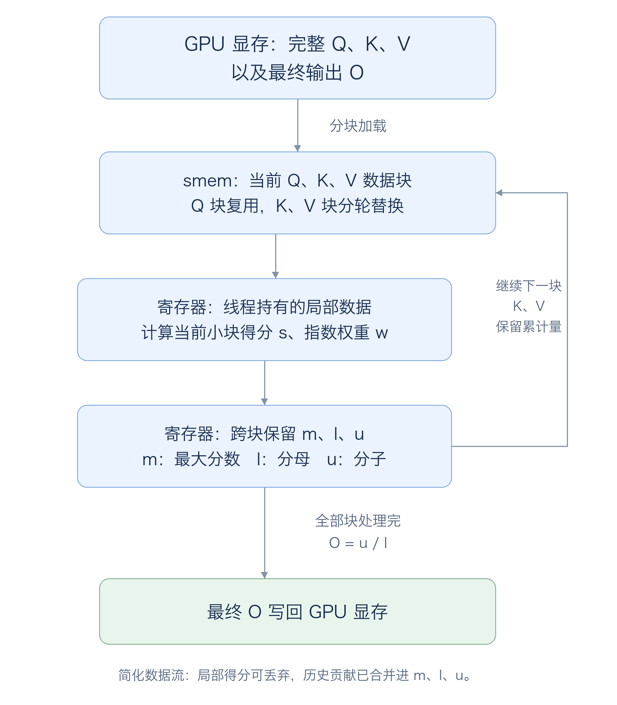
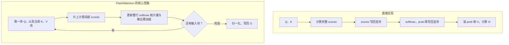

# Lecture 004：从 Tiling – why? 理解“少搬数据，多做计算”

> 对应 [原讲义](cuda-mode-2024-02-03.pdf) 第 22～27 页，以及 [原 Notebook](cuda-mode-session-4.ipynb) 中的 `Matmul`、`Tiled matmul`、`Occupancy?`。本文先讲为什么分块，再讲代码如何实现，最后解释 FlashAttention 为什么出现在这里。
>
> 配套 [tiling_demo.py](tiling_demo.py) 包含 CPU 演示和 CUDA 对照实验。CPU 演示已运行核对；当前环境没有 NVIDIA GPU、PyTorch 和 nvcc，CUDA 部分未在本机编译或测速。文中的读取次数是明确假设下的计算，不是硬件实测。

**这一段课的核心：相同数据会被反复使用时，让一组线程先把它搬到片上存储，再就地复用，避免每次计算都访问显存。**

你需要已有的知识只有：线程如何定位输出，矩阵乘法是一行乘一列，以及数组的行优先地址公式。原课件里的 `M`、`N` 有时是矩阵名称；本文统一用 `A`、`B` 表示输入矩阵，用 `M, N, K` 表示尺寸：

```text
A 的 shape = (M, K)
B 的 shape = (K, N)
C = A @ B，shape = (M, N)
```

建议依次阅读第 1～7 节，再运行第 8 节的例子。第 9 节用于检查自己是否理解。

## 1. Tiling – why?：为什么已经并行了，还要分块？

### 1.1 一个线程算一个输出，没有解决“重复读取”

矩阵乘法中，一个输出是：

```text
C[row, col] = A[row, 0] × B[0, col]
            + A[row, 1] × B[1, col]
            + ...
            + A[row, K-1] × B[K-1, col]
```

最直接的 CUDA 实现如下。这里假设输入是连续、行优先的 FP32 矩阵：

```cpp
__global__ void naive_kernel(const float* A, const float* B, float* C,
                             int M, int N, int K) {
    int row = blockIdx.y * blockDim.y + threadIdx.y;
    int col = blockIdx.x * blockDim.x + threadIdx.x;
    if (row >= M || col >= N) return;

    float acc = 0.0f;
    for (int k = 0; k < K; ++k)
        acc += A[row * K + k] * B[k * N + col];
    C[row * N + col] = acc;
}
```

算法正确，输出也可以并行计算，但相邻线程正在读取大量相同数据：

- 算 `C[0,0]` 和 `C[0,1]`，都需要 **A 的第 0 行**。
- 算 `C[0,0]` 和 `C[1,0]`，都需要 **B 的第 0 列**。

例如计算 `4×4` 方阵乘法：一共有 16 个输出，每个输出读取 4 个 A 元素和 4 个 B 元素，共 `16 × 8 = 128` 次逻辑输入读取。输入实际上只有 `16 + 16 = 32` 个元素。

**这里可优化的是数据搬运，乘加本身仍然需要完成。**

### 1.2 要把什么数据搬到哪里？

先记住三层存储的角色：

| 存储 | 本例保存什么 | 谁能使用 | 重要特点 |
|---|---|---|---|
| Global memory／显存 | 完整的 A、B、C | 所有 block 通过指针访问 | 容量较大，反复搬运有成本 |
| Shared memory／共享内存 | 当前的一小块 A 和 B | 同一 block 的线程 | 片上存储，容量有限，由代码组织复用 |
| Registers／寄存器 | 每个线程自己的 `acc` | 该线程 | 保存局部累加值，避免每次乘加写回显存 |

显存在不同 GPU 上可能是 GDDR 或 HBM；课件引用 FlashAttention 的图时写的是 HBM。这里“主存／main memory”的讨论指矩阵所在的 GPU 显存，不是让每次乘法去读取 CPU 内存。



Shared memory 可以理解为**由程序明确安排的数据暂存区**。它的意义不只是“访问更快”，还在于我们知道这批数据马上要被谁复用，因此可以主动安排搬运。NVIDIA 的[矩阵乘法示例](https://docs.nvidia.com/cuda/cuda-c-best-practices-guide/index.html#shared-memory-in-matrix-multiplication-c-ab)也用它消除重复读取。

## 2. Tiling：把一大次点积，拆成几轮小块计算

### 2.1 一个 block 负责一个输出 tile

取 `TILE_SIZE = T = 2`，把 `4×4` 输出切成四个 `2×2` tile。为了讲清楚，先只看左上角：

```text
C = [ C00 | C01 ]     每个 Cij 都是一块 2×2 矩阵
    [ ----+---- ]
    [ C10 | C11 ]

一个 block 计算 C00；block 中有 2×2 = 4 个线程。
每个线程仍然只负责 C00 中的一个输出元素。
```

同样把 A、B 分块后：

```text
C00 = A00 @ B00 + A01 @ B10
      └─第 0 轮─┘   └─第 1 轮─┘
```

这里 `@` 是小矩阵乘法。**分块后仍是一行乘一列，只是把长度为 4 的求和，拆成两段长度为 2 的求和。**

输出 tile 固定不动；为了完成它，A 的 tile 沿 K 方向向右走，B 的 tile 沿 K 方向向下走。

### 2.2 用具体数字走完两轮

使用下面两个矩阵：

```text
A = [  1   2 |  3   4 ]     B = [ 1  0 | 2  1 ]
    [  5   6 |  7   8 ]         [ 0  1 | 3  2 ]
    [ -------+------- ]         [ -----+----- ]
    [  9  10 | 11  12 ]         [ 4  0 | 1  0 ]
    [ 13  14 | 15  16 ]         [ 0  5 | 0  1 ]
```

**第 0 轮：使用 k=0、1。**四个线程合作，把 `A00`、`B00` 搬进 shared memory：

```text
A_tile = [1 2]     B_tile = [1 0]
         [5 6]              [0 1]

本轮贡献 = A_tile @ B_tile = [1 2]
                             [5 6]
```

以线程 `(ty=0, tx=1)` 为例，它负责 `C[0,1]`，本轮计算：

```text
acc = 1×0 + 2×1 = 2
```

这个线程搬入的是 `A_tile[0,1]` 和 `B_tile[0,1]`，但计算时还会读取其他线程搬来的元素。**线程负责哪个输出，与它负责搬运哪两个输入，是两件事。**

**第 1 轮：使用 k=2、3。**等所有线程用完旧 tile，再用新数据覆盖 shared memory：

```text
A_tile = [3 4]     B_tile = [4 0]
         [7 8]              [0 5]

本轮贡献 = [12 20]     前后两轮相加：C00 = [13 22]
           [28 40]                         [33 46]
```

刚才的线程继续算 `acc += 3×0 + 4×5`，最后得到 `C[0,1] = 22`。它的 `acc` 一直保存到两轮结束，随后才写回 C。

### 2.3 复用究竟发生在哪里？

在第 0 轮中：

- `A_tile[0,0] = 1`，会被算 `C[0,0]` 和 `C[0,1]` 的两个线程使用。
- `B_tile[0,0] = 1`，会被算 `C[0,0]` 和 `C[1,0]` 的两个线程使用。

一般情况下，一个 `T×T` tile 中：**每个 A 元素沿输出列方向复用 T 次，每个 B 元素沿输出行方向复用 T 次。**这种合作发生在一个 block 内；普通 shared memory 不会自动让不同 block 共享同一份 tile。

## 3. 如何提升：算一下少读了多少

先只统计**代码要求读取的输入元素次数**，暂不考虑缓存、边界补零，也不计输出写入。

| 为一个 `T×T` 输出 tile 完成一轮 K 分块 | 朴素版 | Tiling 版 |
|---|---|---|
| 这一轮处理的 K 长度 | `T` | `T` |
| 输入读取次数 | `T²` 个输出各读 `2T`，共 `2T³` | 读入两个 `T×T` 输入 tile，共 `2T²` |
| 浮点运算量，乘加按 2 FLOPs 计 | 约 `2T³` | 约 `2T³` |
| 关键变化 | 每个输出自己重复取数 | 同一输入先搬一次，再让多个线程使用 |

因此输入读取次数约缩小为原来的 `1/T`。在刚才 `T=2` 的例子里，为 C00 完成两轮：朴素版读 `4×4×2=32` 次，tiling 读 `2轮×2块×4元素=16` 次。

对 `n×n` 方阵且 `T` 整除 `n` 的情况：

```text
朴素版：输入读取约 2n³ 个元素
Tiling：输入读取约 2n³/T 个元素
两者：输出都写 n² 个元素，计算量都约 2n³ FLOPs
```

这也解释了课件的 “read each input only n/TILE_SIZE times”：一个 A 元素需要服务 n 列输出，每个 block 负责其中 T 列，所以大约由 `n/T` 个 block 各读入一次。它并非在整个 GPU 上只读一次。

例如 `n=1024、T=16、FP32`，上述输入读取量对应约 `8 GiB → 512 MiB`；两者另有约 `4 MiB` 的输出写入。

**这不能推导出程序一定快 16 倍。**朴素版读取相同地址时，缓存、warp 内广播等机制可能已经减少了实际显存访问；tiling 又增加了 shared memory 读写、同步和索引工作。这里的次数是理解复用的模型，不是 DRAM 事务计数，更不是计时结果。

从前面的 Roofline 思路看，这相当于提高计算强度：同样搬一批数据，完成更多乘加。在“FP32、忽略输出、忽略缓存”的模型下，朴素版约 `0.25 FLOP/Byte`，tiling 约 `T/4 FLOP/Byte`；`T=16` 时是 `4 FLOP/Byte`。当访存是瓶颈时，这为提速创造了条件；瓶颈转到计算、同步或其他资源后，还要继续判断。

## 4. Practical implementation：把刚才的过程写成 CUDA

下面是配套脚本中的核心 kernel。`T` 是编译期 tile 大小；launch 时必须配套使用 `dim3 threads(T, T)`。

```cpp
template<int T>
__global__ void tiled_kernel(const float* A, const float* B, float* C,
                             int M, int N, int K) {
    __shared__ float As[T][T];
    __shared__ float Bs[T][T];

    int ty = threadIdx.y, tx = threadIdx.x;
    int row = blockIdx.y * T + ty;
    int col = blockIdx.x * T + tx;
    float acc = 0.0f;

    for (int k0 = 0; k0 < K; k0 += T) {
        // 每个线程搬入 A、B 各一个元素；越界部分填 0。
        As[ty][tx] = (row < M && k0 + tx < K)
            ? A[row * K + k0 + tx] : 0.0f;
        Bs[ty][tx] = (k0 + ty < K && col < N)
            ? B[(k0 + ty) * N + col] : 0.0f;

        __syncthreads();  // 第一次：等整块搬完。
        for (int t = 0; t < T; ++t)
            acc += As[ty][t] * Bs[t][tx];
        __syncthreads();  // 第二次：等整块用完。
    }

    if (row < M && col < N)
        C[row * N + col] = acc;
}
```

不要一开始逐字符背索引，先对上下面三件事：

| 代码                     | 对应刚才的动作                         |
| ---------------------- | ------------------------------- |
| `blockIdx` 与 `row/col` | 找到该 block 的输出 tile，以及本线程负责的输出   |
| `k0` 外层循环              | 输出 tile 不变，沿 K 方向依次取输入 tile     |
| `t` 内层循环               | 用当前两个输入 tile，给本线程的 `acc` 增加一段点积 |

两个输入的搬运坐标不同：

```text
As[ty,tx] ← A[row,     k0+tx]     固定输出行，沿 A 的列取一段
Bs[ty,tx] ← B[k0+ty,  col]       沿 B 的行推进，固定对应输出列

acc += As[ty,t] × Bs[t,tx]       shared memory 中的一行乘一列
```

加载时，相邻 `tx` 会读取 A、B 中相邻的列元素，有利于合并访存。这就是课件最后预告的 coalesced memory access：**tiling 关注重复数据少搬几次；coalescing 关注一次搬运能否高效地服务相邻线程。**它们可以配合。

注意 `16×16` block 中，一个 warp 会覆盖两行、每行 16 个线程，不能把这里简化为“32 个线程永远在同一行”。本节只需要理解相邻地址的意义，不展开内存事务细节。

## 5. 两个同步和边界补零，分别在保护什么？

### 5.1 第一次同步：防止“没搬完就开始用”

不同 warp 的进度不必相同。线程 A 已经搬好自己的两个数，不代表线程 B 也搬好了；而 A 的计算可能依赖 B 搬进来的数。

所以先执行 `__syncthreads()`，让整个 block 的线程会合，确保本轮共享数据准备好、对其他线程可见，再开始计算。[CUDA 的同步说明](https://docs.nvidia.com/cuda/cuda-programming-guide/02-basics/writing-cuda-kernels.html)

### 5.2 第二次同步：防止“别人还在用，就覆盖成下一轮”

假设 warp 0 完成本轮乘加，warp 1 还在读取 `Bs`。如果 warp 0 直接进入下一轮，它会往同一块 shared memory 写新数据，warp 1 就可能混用两轮的数据。

第二次同步保证所有线程都用完旧 tile，才允许进入下一轮覆盖。**两次同步都在 block 内，不是在等待整个 grid，更不是 CPU 的 `torch.cuda.synchronize()`。**



### 5.3 不能整除 tile 大小时，为什么填 0？

比如 `K=3、T=2`，两轮分别覆盖 `k=0,1` 和 `k=2,3`，但 `k=3` 不存在。把这一项的 A、B 元素填成 0，额外计算对结果的贡献就是 0。M、N 方向也可能有不完整的输出 tile，因此最后只写有效输出。

这里是**在加载到 shared memory 时补零**，无需先在显存里创建一个更大的补零矩阵。

不能照搬朴素 kernel 开头的 `if (row >= M || col >= N) return;`：一个线程虽然没有有效输出，仍可能负责搬运其他线程需要的输入。

例如 `M=N=K=3、T=2`，某个 block 计算输出的第 2、3 行：全局输出坐标 `(row=3,col=0)` 无效，但该线程在第 0 轮负责搬 `B[1,0]`，这是有效线程计算 `C[2,0]` 所需的数据。提前退出会漏掉它。保持所有线程执行同一套阶段和 block 同步，最后再判断是否写回，是这个实现清楚可靠的做法。

## 6. Balance shmem use for occupancy：为什么 tile 不能无限变大？

### 6.1 更大的 tile 提高复用，也占用更多资源

本例每个 block 使用两个 FP32 tile，且一个线程负责一个输出：

```text
shared memory / block = 2 × T² × 4 字节
threads / block       = T²
```

| T | 线程数／block | Shared memory／block | 每个输入在本块中的复用次数 |
|---|---:|---:|---:|
| 16 | 256 | 2 KiB | 16 |
| 32 | 1024 | 8 KiB | 32 |
| 64 | 4096 | 32 KiB | 64，但本例线程配置无法这样启动 |

为什么 64 不行？CUDA 的每 block 线程数有硬件限制，常见上限是 1024；`64×64=4096` 超过它。将来可以让一个线程算多个输出，从而扩大 tile 而不等比例增加线程数，这就是课件提到的 **thread coarsening**。本节先保留一个线程算一个输出的简单版本。

### 6.2 “64k/2k → 32” 还不是最终驻留 block 数

原 Notebook 的最后一个说明写了：

```text
shared memory: 64k / 2k -> 32
threads:       1536 / 256 -> 6
```

它的意思是：**假设**一个 SM 可用于这些 block 的 shared memory 是 64 KiB、最大驻留线程数是 1536，那么 `T=16` 时：

- 只按 shared memory 算，可容纳 32 个这样的 block。
- 只按线程数算，最多容纳 6 个。
- 实际还要同时满足寄存器、每 SM 的 block 数等限制，因此是各限制共同决定的结果，至多为 6。

换成 `T=32`，仅按同样两项限制算：shared memory 可容纳 8 个 block，线程数却只容纳 `floor(1536/1024)=1` 个 block。更大的 tile 可能让同一个 SM 上能同时驻留的 block 变少。

这些数字是解释原 Notebook 的资源估算，不代表每款 GPU 的规格；可驻留 block 也不意味着它们的全部线程在同一个周期执行。

### 6.3 Occupancy 和性能是什么关系？

Occupancy 是**驻留的 active warp 数占 SM 最大可驻留 warp 数的比例**。准备好多个 warp 后，某些 warp 等待访存或同步时，调度器可以执行其他就绪 warp，帮助隐藏等待。

但高 occupancy 并不自动等于高速度。增大 tile 可能提高数据复用，也可能减少驻留 block；减少寄存器以提升 occupancy，又可能造成额外的寄存器溢出访存。最终应比较实际耗时。[NVIDIA 的 occupancy 与资源权衡说明](https://docs.nvidia.com/cuda/cuda-c-best-practices-guide/index.html#occupancy)

**读课件时应得到的结论是：tile 大小要在复用收益与资源代价之间取舍。**先试 16、32 并测量，比假定 32 一定更快更有意义。

<a id="flash-attention"></a>

## 7. Advanced tiling and fusing：为什么接下来讲 FlashAttention？

**第一次接触 attention，先读 [从矩阵乘法理解 FlashAttention](FLASH_ATTENTION.zh-CN.md)。**展开版从 Q、K、V 的功能和两次 matmul 开始，用同一组向量走完普通 attention 与分块流程，再解释 online softmax 的 m、l、u 三项统计量和重缩放。配套 [CPU 演示](flash_attention_demo.py) 可以直接运行，下面保留与本讲 tiling 主线对应的概览。

如果卡在“分块后为什么答案相同”，先读展开版的 [第 0 节：一个数的入门例子](FLASH_ATTENTION.zh-CN.md#block-equivalence)。它从 `50+250` 的分子、`3+7` 的分母讲起，再说明统一缩放为什么不改变结果。配套 [入门脚本](flash_attention_beginner.py) 只需要 Python 标准库。

如果连“一块 Q 是哪几行、怎么扫描 K/V”还不清楚，先读 [第 5.1 节：4 行数据的逐轮扫描](FLASH_ATTENTION.zh-CN.md#q-kv-scan)。那里明确列出 `Q[0:2]` 和两轮 `K/V[0:2]、K/V[2:4]` 的对应关系，并跟着 q0 算出输出 25；配套 [扫描演示脚本](flash_attention_scan_demo.py) 会打印每一轮的实际数据。

下面这张是实际 PNG 图片，可以直接查看显存、smem 和寄存器的数据流：



### 7.1 Tiling 和 fusion 分别减少哪种搬运？

| 方法        | 主要要消除的浪费              | 直观例子                             |
| --------- | --------------------- | -------------------------------- |
| Tiling／分块 | 计算多个输出时，反复读取相同输入      | 一块 A、B 搬入后，让多个输出复用               |
| Fusion／融合 | 多个操作之间，把中间结果写回显存后又读出来 | GELU 的乘法、加法、tanh 在同一 kernel 内接着算 |

FlashAttention 把这两种思路放到 attention 中：分块处理输入，同时把得分计算、softmax 和后续加权求和组织在一起，减少巨大的中间矩阵在显存中的读写。

### 7.2 普通 attention 的大中间结果是什么？

暂时忽略 batch、多个 head、mask 和 dropout：

```python
scores = Q @ K.T / sqrt(d)  # (L, L)
prob = softmax(scores, dim=-1)
O = prob @ V               # (L, d)
```

每个 query 都要与所有 key 比较，所以 `scores` 有 `L×L` 个元素。`L=4096` 时，一张 FP32 的 scores 就是 `4096²×4 = 64 MiB`，prob 的大小也一样。这些是中间结果，最终想要的输出是 O。

一种直接实现会在操作之间将 scores、prob 写到显存，再读出来。序列变长时，保存和搬运这些大矩阵会产生明显成本。



图中的 FlashAttention 循环用于表达依赖关系；具体版本的循环顺序和工作划分可以不同。核心是**不必把完整的 scores 和 prob 矩阵落到显存**。FlashAttention 利用 tiling 减少 HBM 与片上 SRAM 间的读写，仍计算精确 attention，而非只保留部分 key 的近似算法。[原始论文](https://arxiv.org/abs/2205.14135)

### 7.3 Softmax 依赖整行，怎么能分块？

这个问题很关键：不能把每块分别 softmax，再把结果直接拼起来，因为每一行必须用同一个总分母。

看一个只有 4 个 key、V 是标量的例子。假设 scores 为 `[ln(1), ln(2), ln(3), ln(4)]`，那么：

```text
exp(scores) = [1, 2, 3, 4]
V           = [10, 20, 30, 40]

O = (1×10 + 2×20 + 3×30 + 4×40) / (1+2+3+4)
  = 300 / 10 = 30
```

分成两块后，只需累计：

| 输入块 | 分母贡献 `sum(exp(score))` | 分子贡献 `sum(exp(score) × V)` |
|---|---:|---:|
| 第 1 块 | 3 | 50 |
| 第 2 块 | 7 | 250 |
| 合计 | 10 | 300 |

整行概率向量不必存下来，也能得到最终输出。反过来，两块各自归一化会得到 `50/3` 和 `250/7`，直接取平均并不等于 30。

真实 scores 可能很大，直接求指数会溢出。因此还要维护一个**到目前为止的最大值**；遇到更大的最大值，就把旧的分子和分母一起缩放到新的基准。下面用 Python 表达这个关键过程：

```python
import math

def online_attention_row(scores, values, tile=2):
    m, denominator, numerator = -math.inf, 0.0, 0.0
    for start in range(0, len(scores), tile):
        block = scores[start:start + tile]
        new_m = max(m, max(block))
        scale = math.exp(m - new_m)
        weights = [math.exp(s - new_m) for s in block]
        denominator = scale * denominator + sum(weights)
        numerator = scale * numerator + sum(
            w * v for w, v in zip(weights, values[start:start + tile]))
        m = new_m
    return numerator / denominator
```

这里把一整行 scores 作为输入，是为了单独看懂“跨块统计如何合并”。真正的 FlashAttention 会在计算出局部 scores 后就使用它们，无需预先保存整行。V 也通常是向量，因此分子是一个向量累加器。到这里理解“分块计算、维护统计、融合消费中间结果”即可，不需要现在手写完整 FlashAttention。

### 7.4 它快在哪，课件的 3 倍又代表什么？

它减少了大中间结果的保存与显存往返，并通过融合减少操作之间的开销；基础的全连接 attention 仍要处理 query-key 配对，计算量并没有因此从平方级变成线性级。

课件的 “3x end-to-end speedup on GPT2” 对应原论文特定 GPT-2 实验，不是任何 GPU、序列长度和基线下都有 3 倍。这里先抓住算法为什么能减少 IO，无需记住速度倍数。[论文中的实验范围](https://arxiv.org/abs/2205.14135)

## 8. 动手：先看懂过程，再比较 GPU 耗时

### 8.1 在 Mac 或普通 CPU 上走一遍

配套脚本的 CPU 模式只使用 Python 标准库，无需 PyTorch：

```bash
cd lecture_004
python3 tiling_demo.py --cpu
```

你会看到左上角输出 tile 的两轮贡献：

```text
k=0..1: 本轮贡献=[[1, 2], [5, 6]], 累计=[[1, 2], [5, 6]]
k=2..3: 本轮贡献=[[12, 20], [28, 40]], 累计=[[13, 22], [33, 46]]
整个 4x4 乘法：朴素逻辑输入读取=128，tiling=64
```

接下来会核对矩形和边界补零的结果，并验证分块 softmax 的输出为 30。这是算法和索引的模拟，**不能代替 GPU 上的并行同步验证或性能测试**。

### 8.2 在 NVIDIA GPU 上运行朴素版与分块版

需要带 CUDA 支持的 PyTorch、CUDA Toolkit（包含 nvcc）、C++ 编译器，以及 PyTorch 扩展构建所需的 ninja。脚本通过 `load_inline` 编译，不会自动安装依赖：

```bash
cd lecture_004
python3 tiling_demo.py --size 1024 --repeats 50
```

脚本先与 `A @ B` 比较可整除与不可整除的形状，再比较 `naive`、`tile=16`、`tile=32`。它使用当前 CUDA stream，预热后用 CUDA Event 记录多次调用的平均时间；编译和预热不在计时范围内。返回 Tensor 的包装函数也在循环中，因此分配和主机提交间隙仍可能影响观测值，这不是隔离全部开销的纯算术峰值测试。[CUDA Event 文档](https://docs.pytorch.org/docs/stable/generated/torch.cuda.Event.html)

为什么不直接照抄原 Notebook 的 matmul `%timeit`？因为 CUDA launch 是异步的，那两处 matmul 计时没有显式等待 GPU 完成；此外朴素版使用 `torch::zeros`，分块版使用 `torch::empty`。不要把保存的两个时间直接当成严格的 kernel 加速比。

观察时只回答三个问题：

1. 结果是否接近参考值，非整除尺寸是否也正确？
2. Tiling 是否更快；换矩阵大小后，结论是否变化？
3. 32 是否一定比 16 快；如果不是，能否用资源和额外开销解释？

这里的 kernel 用于学习普通 CUDA Core 上的数据复用；实际高性能 GEMM 还有寄存器分块、流水线、Tensor Core 等技术。不要因为它不如库函数快，就否定 tiling 的作用。

## 9. 读完后，应该能回答的五个问题

**Q1：Tiling 减少了乘法次数吗？**

没有。本例主要减少输入的重复搬运；每个输出仍需完成长度为 K 的点积。

**Q2：为什么不能只把输出切成小块，就宣布完成 tiling 优化？**

仅改变线程分组，不会自动实现数据复用。还需要合作加载输入块、在 shared memory 中共享，并安排同步。

**Q3：`acc` 应该每轮清零吗？**

不应该。每轮只是完整点积的一部分，`acc` 必须跨所有 K 分块累加，只在最开始初始化一次。

**Q4：第一次同步确保写完，第二次同步确保什么？**

确保所有线程读完旧 tile，避免下一轮覆盖掉仍在使用的数据。

**Q5：矩阵乘法 tiling 和 FlashAttention 的共同思路是什么？**

识别数据何时会再次使用，让数据与计算尽量留在片上；能就地消费的中间结果，不必反复写回显存。FlashAttention 还需要正确维护跨块的 softmax 统计量。

## 10. 回到原课件：每页究竟想让你带走什么？

| PDF 页码／标题 | 这页的核心问题 | 本文对应 |
|---|---|---|
| 22：Tiling – why? | 已有很多线程，为什么仍有访存浪费？ | 第 1、3 节 |
| 23：Tiling | 一个 block 怎样合作完成一个输出块？ | 第 2、4 节 |
| 24：Practical implementation of tiling | 边界、同步、资源怎么处理？ | 第 5、6 节 |
| 25：Advanced tiling and fusing: FlashAttention | 如何把减少 IO 的思路推广到复合算子？ | 第 7 节 |
| 26：Conclusion | 并行组织、资源、访存要一起考虑 | 第 3、6、8 节 |
| 27：Sources | 去哪里继续查细节？ | 原课件与下方链接 |

原 Notebook 对照阅读时，搜索 `simple_matmul_k`、`tiled_matmul_kernel` 和 `Occupancy?`，分别对应朴素索引、合作加载与同步、资源估算。配套脚本保留这些核心思路，补充了输入检查、当前 stream 和明确的计时边界。

延伸阅读只需先看两份：NVIDIA 的[共享内存矩阵乘法示例](https://docs.nvidia.com/cuda/cuda-c-best-practices-guide/index.html#shared-memory-in-matrix-multiplication-c-ab)，以及 [FlashAttention 原论文](https://arxiv.org/abs/2205.14135)中关于 IO 和 tiling 的解释。
